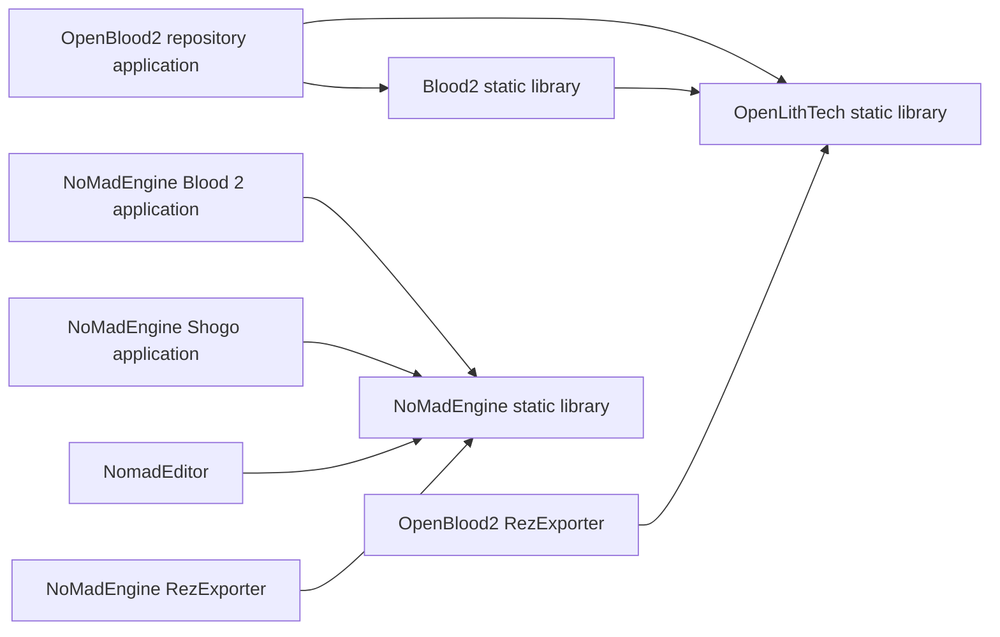

# Builds and Dependencies

This inventory records the declarations in the checked-out build files. Revisions below are requested dependency revisions, not versions resolved or installed during this work. No configure, dependency download, compilation, or test command was executed.

## Build Entry Points

| Project | Build files | Declared baseline |
| --- | --- | --- |
| OpenBlood2 | [Root CMake](../../../OpenBlood2/CMakeLists.txt), [engine](../../../OpenBlood2/OpenLithTech/CMakeLists.txt), [game code](../../../OpenBlood2/blood2/CMakeLists.txt), [application](../../../OpenBlood2/game/CMakeLists.txt) | Root/game C++17, engine C++20; CMake 3.20 at root |
| NoMadEngine | [Root CMake](../../../NoMadEngine/CMakeLists.txt), [preset](../../../NoMadEngine/CMakePresets.json), [engine](../../../NoMadEngine/nomadengine/CMakeLists.txt) | C++20; CMake 3.20 at root; `default` preset selects Ninja and Debug |
| nomad | [NoMAD.csproj](../../../nomad/NoMAD.csproj), [project.godot](../../../nomad/project.godot) | Godot.NET.Sdk 4.6.2, .NET 8, `LangVersion=latest` |
| Reference Blood 2 | Four `.dsp` files under [sources/blood2](../../../sources/blood2) | Historical Visual C++ projects; no CMake entry point in this checkout |
| Shogo Aegis | Seven `.dsp` files under [sources/Shogo_Aegis](../../../sources/Shogo_Aegis) | Historical projects, including `_60` variants |
| Larger LithTech tree | [Root CMake](../../../sources/lithtech/CMakeLists.txt), runtime/library/game CMake files and legacy project files | CMake minimum 2.8; old platform/library paths remain in declarations |

Both C++ prototypes enable `BUILD_TOOLS` by default. Their [OpenBlood2 exporter](../../../OpenBlood2/tools/RezExporter/CMakeLists.txt) and [NoMadEngine exporter](../../../NoMadEngine/tools/RezExporter/CMakeLists.txt) require CMake 3.25 and C++20. Therefore the default configurations encounter a higher CMake requirement than the root files alone advertise.

## Declared Target Relationships

The following graph shows link relationships declared for the principal C++ targets. It is not a proposed architecture.

OpenBlood2's application links the game library with `--whole-archive`, `-force_load`, or `/WHOLEARCHIVE` depending on platform. Its comments explain that static class registration needs the game object files retained. The Windows branch also declares `/FORCE:MULTIPLE`. These are existing linker choices to inspect later, not recommended defaults for new code.

NoMadEngine builds `OpenBlood2`, `OpenShogo`, `NomadEditor`, and `RezExporter` around its engine library. The two repositories both use the executable name `OpenBlood2` and the tool name `RezExporter`; paths are needed to disambiguate them.

For Godot, `NoMAD.csproj` excludes `tests/**/*.cs` from the main assembly. The separate [Nomad.Tests.csproj](../../../nomad/tests/Nomad.Tests/Nomad.Tests.csproj) compiles selected shared source directly into a .NET console executable. It does not include every Godot runtime or scene script.

## C++ Prototype Dependencies

Sources: the two root CMake files and [OpenLithTech/CMakeLists.txt](../../../OpenBlood2/OpenLithTech/CMakeLists.txt).

| Dependency | OpenBlood2 declaration | NoMadEngine declaration | Role |
| --- | --- | --- | --- |
| SDL3 | FetchContent `main` | FetchContent `main` | Windowing, platform/input services |
| SDL3_mixer | FetchContent `main` | FetchContent `main` | Audio |
| GLM | `1.0.1` | `1.0.3` | Math |
| nlohmann_json | `v3.11.3` | `v3.12.0` | JSON |
| Dear ImGui | `v1.91.5` | `v1.91.5` | Debug and editor UI |
| ImGuizmo | `master` | `master` | Editor gizmos |
| spdlog | System package if found; otherwise `v1.12.0` | `v1.17.0` | Logging |
| OpenXR SDK | `release-1.1.54`, fetched on Windows | `release-1.1.54`, fetched on Windows and Linux | Optional VR integration |
| EnTT | No declaration in the inspected build files | `v3.16.0` | ECS |
| Jolt Physics | No declaration in the inspected build files | `v5.2.0` | Physics |
| GLAD | Checked in under `thirdparty/glad/` | Checked in under `thirdparty/glad/` | OpenGL loading |
| stb headers | Font and exporter helpers in source | Font and exporter helpers in source | Font rasterization and image output |

`main` and `master` are moving branch references. The inventory records these strings without resolving them. Dependencies fetched later may therefore differ from those used when the prototypes were last built.

Both engines use OpenGL code and GLSL shaders. The workspace's preferred future `SDL_GPU` stack is documented in [AGENTS.md](../../../AGENTS.md); it is not the backend declared by these prototypes.

## Options and Platform Branches

| Project | Existing configuration |
| --- | --- |
| OpenBlood2 | `BUILD_BLOOD2`, `BUILD_GAME`, `BUILD_TOOLS` default ON; engine `BUILD_TESTS` defaults OFF; `ENABLE_VR` defaults ON but XR sources are removed when the loader is unavailable |
| NoMadEngine | `BUILD_BLOOD2`, `BUILD_SHOGO`, `BUILD_TOOLS`, `BUILD_EDITOR` default ON; optional `ENABLE_VR` follows loader discovery |
| C++ platform handling | Linux, macOS and Windows definitions/link branches; OpenXR Linux paths add X11 and GL dependencies |
| NoMadEngine physics flags | CMake forces several x86 SIMD options ON, including SSE4.1/4.2, AVX/AVX2, LZCNT, TZCNT, F16C and FMADD; suitability for other targets has not been evaluated |
| Godot | `Forward Plus` project feature, `Jolt Physics`, Windows rendering driver `d3d12`, startup scene and editor plugin enabled in `project.godot` |

Dedicated Android/iOS packaging or build manifests were not identified among the tracked files. Desktop conditionals and an optional XR module are source evidence, not a supported-platform test matrix.

## Larger LithTech Build and Libraries

[sources/lithtech/CMakeLists.txt](../../../sources/lithtech/CMakeLists.txt) enables the engine and NOLF2 by default and wires a TRON alternative. It also declares `BUILD_BLOOD2`, `BUILD_FEAR`, `BUILD_NOLF`, `BUILD_SHOGO`, and `BUILD_TOOLS`, but the inspected root file has no corresponding `add_subdirectory` branches. Some game subdirectories have their own CMake files; the presence of an option does not establish a complete build path.

The runtime declares targets including `EXE_Lithtech`, `DLL_Server`, `DLL_dx8`, `LIB_D3DRender`, `Lib_UI`, and `Lib_ILTSound`. Its [client CMake file](../../../sources/lithtech/runtime/client/CMakeLists.txt) references a fixed Microsoft DirectX SDK path, Windows source directories, and Direct3D/DirectInput/DirectPlay/DirectShow libraries. Linux-specific source files also exist under the kernel and model directories, without establishing a functioning Linux build.

The library inventory includes:

- Resource and memory services: `rezmgr`, `ltmem`, `lith`, `stdlith`, `ltamgr`, `dtxmgr`, `dibmgr`.
- Configuration and platform support: `ButeMgr`, `CryptMgr`, `RegMgr`, `RegMgr32`, `genregmgr`, `MFCStub`, `StackTracer`.
- UI and media: `LTGUIMgr`, `Lib_DShow`, bundled FreeType under `runtime/ui/`.
- Service/network and compression code: `ServerDir`, `WONAPI`, bundled zlib.

SDK libraries and historical compiled binaries are present in the repositories but were not loaded, executed, or treated as portable source dependencies. Notice/EULA paths are cataloged in [the documentation index](Inventory/documentation.md); no common license is inferred for these separate trees.
