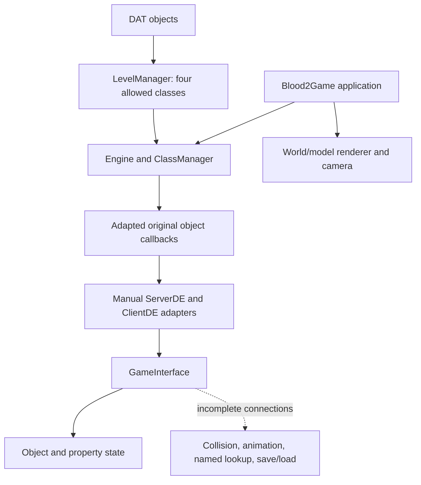

# Original Code and Engine Contracts

## What Static Integration Actually Provides

[Blood2Game.cpp](../../../../OpenBlood2/game/Blood2Game.cpp), lines 335–402, directly calls `ObjectDLLSetup`, registers the returned classes, allocates instances through placement constructors, and links parent-class relationships. [blood2/CMakeLists.txt](../../../../OpenBlood2/blood2/CMakeLists.txt) builds adapted client/server sources into one static library. These are real original-code integration mechanisms, and the resulting application was successfully linked during this audit.

However, the application still mirrors `ClassDef`, client/server shell layouts, and engine-interface tables instead of sharing a single definition across the boundary. Static linking removes a dynamic-module loading problem; it does not verify struct layout, virtual dispatch, function signatures, object lifetime, or the semantics expected by the game.

The active path has several layers:

[LevelManager::CreateLevelObjects](../../../../OpenBlood2/OpenLithTech/src/core/level_manager.cpp), lines 167–186, allows only `Light`, `DirLight`, `Door`, and `RotatingDoor`. AI models are loaded separately for display. Consequently, registration of hundreds of game classes does not demonstrate execution of those classes. Original player, weapons, triggers, and enemy behavior remain outside the demonstrated level-instantiation path.

The application updates the engine and message manager, moves its camera from SDL input, and invokes client rendering callbacks. Its server-shell setup registers message callbacks, but the inspected application path does not call the original server's world-entry and per-frame lifecycle as a complete session. The original [BloodServerShell.cpp](../../../../sources/blood2/ObjectDLL/BloodServerShell.cpp) has `OnClientEnterWorld`, `PreStartWorld`, `PostStartWorld`, and `Update` responsibilities that must be accounted for. This is a connection gap, not proof that those original implementations should be replaced.

## Object Creation: Confirmed Contract Mismatch

The original [serverobj_de.h](../../../../sources/blood2/AppHeaders/serverobj_de.h), lines 67–93, specifies creation reasons and says `MID_PRECREATE` runs before the engine consumes `ObjectCreateStruct`. Original code uses this callback to set filenames, flags, object types, and properties.

In [Engine::CreateObject](../../../../OpenBlood2/OpenLithTech/src/core/engine.cpp), lines 73–142:

- The internal position, rotation, scale, flags, and filename are copied **before** `MID_PRECREATE`.
- Changes made to the creation structure by the callback are not reapplied.
- `MID_INITIALUPDATE` receives `0.0f` even when precreate was classified as world-file creation.
- World-file classification is inferred from whether pending properties are empty, rather than supplied as an explicit creation reason.
- Current-object context is cleared instead of restoring a previous context. Pending properties are global engine state, so nested object creation requires further scrutiny.

The [synthetic production-core probe](probes/engine_contract_probe.cpp) sets position X to 42 during precreate. It observes `precreate_struct_x=42`, `stored_object_x=0`, and `initial_reason=0` despite pending world properties. [Recorded output](evidence/engine_contract_values.log).

The level loader supplies properties before creation and stores them afterward, which is useful groundwork. It does not resolve the ordering defect. The server adapter's `CreateObjectProps` also ignores the property string and delegates to ordinary creation: [blood2_compat_full.cpp](../../../../OpenBlood2/OpenLithTech/src/api/blood2_compat_full.cpp), lines 106–117. Runtime spawning that depends on string properties is therefore not equivalent to the original API.

## Scheduling: Callback Return Value Is Not an Update Interval

Original objects schedule themselves through `SetNextUpdate`. For example, [Door.cpp](../../../../sources/blood2/ObjectDLL/Door.cpp) uses short delays for movement and zero to stop recurring updates. The original [engineobjects.c](../../../../sources/blood2/AppHeaders/engineobjects.c) base engine-message function returns `1` after forwarding to aggregates.

[Engine::Update](../../../../OpenBlood2/OpenLithTech/src/core/engine.cpp), lines 36–69, interprets a positive callback return value as a delay in seconds. It overwrites the next-update field after the callback, regardless of any explicit schedule the callback set. For a return of zero it schedules the object for the current time. [GameInterface::SetNextUpdate](../../../../OpenBlood2/OpenLithTech/src/core/game_interface.cpp), lines 268–275, merely stores current time plus the supplied delay.

The probe requests 0.01 seconds during the callback and returns `1`. The engine stores **1.00 second**, and only one update occurs across two 20 ms frames. This is reproduced behavior. It can distort doors, AI, projectiles, timed triggers, and effects even when their source code compiles unchanged. Zero-delay disabling and inactive-object behavior also lack the corresponding filtering in this update loop.

## Removal: Reproduced Use-After-Free

The original [server_de.h](../../../../sources/blood2/AppHeaders/server_de.h), lines 186–188, explicitly defers deletion until the end of the frame. The replacement [Engine::RemoveObject](../../../../OpenBlood2/OpenLithTech/src/core/engine.cpp), lines 145–164, destroys the game object and erases the internal object immediately.

If an object removes itself during `MID_UPDATE`, `Engine::Update` subsequently writes to the freed object's next-update field. Erasing the current map entry also invalidates the loop iterator. The synthetic removal probe reports **AddressSanitizer: heap-use-after-free**. The failing write resolves to `engine.cpp:61`; removal resolves to `engine.cpp:163`. [ASan log](evidence/engine_contract_remove.log).

This is a concrete lifetime defect in the core, not a speculative portability concern. The reproduction uses a synthetic class; it does not claim a particular retail level was played or crashed.

## Dispatch and Interface Hazards

### Recursive aggregate forwarding

The original `bc_ObjectMessageFn` forwards to aggregates and returns. The adapted [engineobjects.cpp](../../../../OpenBlood2/blood2/AppHeaders/engineobjects.cpp), lines 130–149, adds a call to `BaseClass::_ObjectMsgFn` after aggregate forwarding. That wrapper invokes the object's virtual `ObjectMessageFn`. An override that follows the original convention and delegates back to `BaseClass::ObjectMessageFn` reaches `bc_ObjectMessageFn` again.

The [aggregate probe](probes/aggregate_dispatch_probe.cpp) links the actual adapted implementation and sends one message. The callback is entered eight times before the probe's explicit guard stops it. [Output](evidence/aggregate_dispatch.log). This is a behavioral adaptation regression relative to [the original function](../../../../sources/blood2/AppHeaders/engineobjects.c), not a necessary consequence of using a modern compiler.

### Server table without virtual-interface state

[InitializeServerDE](../../../../OpenBlood2/OpenLithTech/src/api/blood2_compat_full.cpp), lines 1562 onward, allocates and zeroes a manually mirrored table. Its first three pointers, described as vtable/common/physics state, remain zero; the function populates only nonvirtual function-pointer members. The adapted [server_de.h](../../../../OpenBlood2/blood2/AppHeaders/server_de.h) still declares virtual methods such as `StartMessageToObject`, `MoveObject`, and physics operations. The existence of a separate `ServerDE_Impl` class does not initialize a vtable on this allocated table.

The source path therefore cannot safely service those ordinary virtual calls through the returned pointer. Door code contains explicit `LT_*` bypasses acknowledging this problem. This is source-confirmed; a complete application dispatch/ABI matrix was not executed.

### Client table and competing C++ definitions

[blood2_compat_client.cpp](../../../../OpenBlood2/OpenLithTech/src/api/blood2_compat_client.cpp) builds a manual virtual table and initially fills 232 ordinary slots with one generic stub, then replaces selected entries. Function-pointer casts and manually counted slots carry calling-convention and signature risks, especially across different C++ ABIs. `IsCommandOn` always returns zero, `GetClientObject` returns null, and `StartGame` returns success without starting a session. Some menu, string, console-variable, and surface operations have real implementations; the word `Stub` is not a reliable classification by itself.

The replacement [baseclass.h](../../../../OpenBlood2/OpenLithTech/include/lithtech/baseclass.h) and adapted [cpp_engineobjects_de.h](../../../../OpenBlood2/blood2/AppHeaders/cpp_engineobjects_de.h) define different global C++ `BaseClass` classes. The engine implementation omits aggregate forwarding while the game version performs it. This violates the requirement for consistent definitions across translation units. The successful Linux executable contains weak game-side BaseClass symbols; it would be incorrect to conclude merely from reading the engine copy that every game aggregate is disabled. Link order, inlining, and platform behavior need a deliberate unified definition or a defined bridge.

## Services Required by the Original Game

The following are traced examples, not a complete API conformance matrix. `GameInterface` references point to [game_interface.cpp](../../../../OpenBlood2/OpenLithTech/src/core/game_interface.cpp); adapter references point to [blood2_compat_full.cpp](../../../../OpenBlood2/OpenLithTech/src/api/blood2_compat_full.cpp).

| Service | Observed implementation | Consequence for original code |
| --- | --- | --- |
| Strings and basic object properties | String manager, object state, property context, and several adapter forwards are implemented | Useful foundations; ownership and nested-context tests remain necessary |
| Named lookup and object lists | `FindNamedObjects`, `CreateObjectList`, and `AddObjectToList` return null; enumeration returns null | Original trigger targeting and save-list construction cannot rely on these paths |
| Collision queries | Adapter forwards to `GameInterface::IntersectSegment`, which returns false; `CastRay` also returns false | Original hitscan and visibility checks do not reach the separate collision manager |
| Movement | `GameInterface::MoveObject` assigns position directly | No equivalent sweep, contact handling, stepping, or touch notification on that path |
| Animation control | `GetAnimIndex` and `GetModelAnimation` return invalid indices; setters are empty; playback state remains zero | Displayed model animation is disconnected from original AI and weapon animation state |
| Object links | Link creation returns success; breaking is empty | No equivalent lifetime notification through `MID_LINKBROKEN` on this path |
| Attachments | Creation returns success while outputting null | Attached weapons/accessories need actual lifecycle and transform behavior |
| Persistence | `SaveObjects` and `RestoreObjects` return success without doing work | Original server code can take a success branch without a valid save or restored state |
| String-property spawning | Adapter ignores `pszProps` | Original runtime property-driven spawning loses input |
| Client commands and player handle | Constant false/null in the selected client adapter | Original client movement/control cannot be inferred from the application's movable camera |

The separate message manager has buffers and shell/object dispatch paths, but virtual server messaging and client messaging stubs prevent treating it as a complete original-game communication channel. Its object serialization stores raw pointer values in two 32-bit words. That can serve transient same-process messages, but cannot serve persistent object identity or a portable network protocol without remapping. This does not imply original network binary compatibility is required.

Original dependency examples include [Trigger.cpp](../../../../sources/blood2/ObjectDLL/Trigger.cpp) for named targets, [AI_Mgr.cpp](../../../../sources/blood2/ObjectDLL/AI_Mgr.cpp) for animation completion/model-string events and links, [Weapon.cpp](../../../../sources/blood2/ObjectDLL/Weapon.cpp) for playback state, and [BloodServerShell.cpp](../../../../sources/blood2/ObjectDLL/BloodServerShell.cpp) for persistence.

## Preservation Impact of Existing Adaptations

The inventory found 602 matching original/adapted paths, with 375 normalized text matches and 227 differences. These differences cannot all be treated as compiler fixes. Fixed-width integers and platform shims are sensible porting work, but other changes alter behavior.

For example, adapted [Door.cpp](../../../../OpenBlood2/blood2/ObjectDLL/Door.cpp) bypasses virtual methods, skips parent callback handling, disables selected calls, and substitutes a `TRIGGER` command if reading the supplied message fails. The adapted aggregate recursion is another concrete behavioral change. The static build also excludes selected original files and supplies substitute methods. A preservation-oriented reuse decision must distinguish these changes from mechanical portability work.

The [lexical API scan](evidence/original_api_candidates.json) finds 431 declared names in five original interface headers, 320 names with candidate calls, and 12,596 candidate call sites outside `AppHeaders`. Frequent examples include `GetAnimIndex` (261), `SetNextUpdate` (213), `RemoveObject` (114), `IntersectSegment` (90), and `GetModelPlaybackState` (88). This establishes where to investigate contracts; it is not an implementation percentage. The scan does not resolve types, preprocess conditional code, expand macros, or prove reachability.
