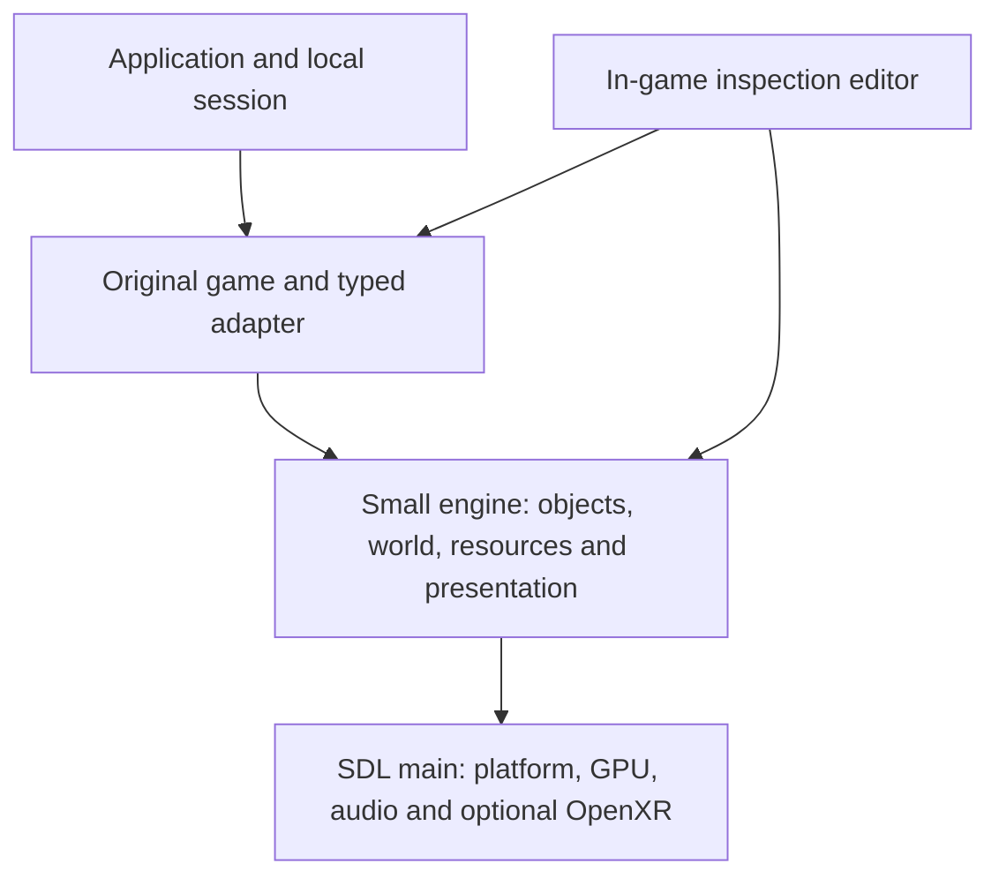

# Proposed Runtime Architecture

Create a new project in its own directory and repository. Build the services required by original Blood 2 code, using the audit to avoid known mistakes. Existing projects supply references and reviewed cherry-picks, not the application skeleton. Keep the design small: explicit functions, ordinary objects and a few build targets.

## Module Boundaries

Use the following three-target direction. M0/M1 now implement `engine`, `blood2_app` and `blood2_game`, with the original-object subset and ownership rules described in the [M1 contract](../../contracts/object_contracts.md). Organize services as source folders/functions and split another library only for a concrete need.

| Proposed target | Owns | Must not own |
| --- | --- | --- |
| `blood2_game` | Original client/server/shared gameplay, class registration, adapted headers and typed service adapter | A replacement AI/weapon system or manual vtables |
| `engine` | Objects, time, messages, resources, world/collision, animation, rendering, audio and platform code in focused folders | Duplicate gameplay rules or a general ECS framework |
| `blood2_app` | Startup, local session, configuration and in-game inspection UI | A second runtime object model |

Keep simulation and parsed data independent of presentation so headless contract tests need no graphics device. Use original game classes plus engine-owned records, vectors/maps and explicit loops. **No EnTT or ECS is required.** The editor inspects the same records; it does not introduce a parallel entity/component hierarchy. Add abstractions only where they simplify an actual boundary.

## One Typed Game Boundary

Use a single authoritative set of adapted original headers for class definitions, engine interfaces, callback signatures and shared scalar types. Compile the game and adapter against those definitions. Keep engine-internal records in their own namespace. Do not import the prototypes' competing global `BaseClass` definitions or duplicated shell/class layout declarations.

Where the original headers declare virtual methods, instantiate a real concrete C++ implementation. Where they declare callback members, populate them with functions of the exact declared type. Use explicit, typed thunks where context is needed. Do not allocate zeroed storage and treat it as a C++ interface, manually count vtable slots, or cast one generic stub to many signatures. Static linking permits source changes and normal compiler-checked calls; it does not justify undefined behavior. These changes address audit **A04, A05 and A17**.

Keep a service matrix with: declaration, original callers, owning implementation, supported semantics, tests and explicit unsupported cases. The audit's [API candidate list](../Audit/evidence/original_api_candidates.json) helps locate calls, but is not a complete or type-resolved dependency graph. Start with the session and slice paths, and add runtime diagnostics to discover further dependencies. Never return success for an unimplemented operation; return the original API's appropriate failure value and a bounded diagnostic identifying the caller/service.

## Object Lifetime and Creation

The engine owns object records and the original game instances they contain. Use internal IDs with generation checks. Keep the public legacy handle representation compatible with the adapted header contract through a controlled mapping. If a legacy caller needs a stable pointer-shaped handle, provide stable adapter storage rather than casting an integer ID into an object pointer. Audit casts and identity comparisons before selecting the exact representation.

Creation proceeds through explicit class lookup, inherited/default properties, a nested creation context, `MID_PRECREATE`, consumption of the resulting creation structure, and the correct `MID_INITIALUPDATE` reason. Distinguish world-file, runtime-string and restore creation. Nested spawning restores the outer object's property context. Report unknown classes/properties with enough information to diagnose content; do not silently drop gameplay objects.

Maintain an update worklist safe against additions and removals. `SetNextUpdate` controls scheduling; callback return values retain their original meaning. Zero-delay and inactive-state semantics come from the original contract. Mark removal pending and perform destruction at the specified end-of-frame boundary. Define link-break notifications, attachment detachment, queued-message behavior and resource release before final reclamation. Test self-removal, removal of another object, nested creation and callbacks triggered during cleanup. This addresses **A01–A03 and A07**.

Keep original objects on one simulation thread initially. Stable ownership and deterministic ordering are more useful here than introducing a job system. Later worker jobs may decode immutable resources or prepare render data, with completion committed at controlled points.

## Local Client/Server Session

Implement the original server shell's world/session entry, per-frame and teardown calls, and the original client's startup, commands and player association. Use the source implementations as the sequence reference: [BloodServerShell.cpp](../../../../sources/blood2/ObjectDLL/BloodServerShell.cpp) and [BloodClientShell.cpp](../../../../sources/blood2/ClientShellDLL/BloodClientShell.cpp). A one-process single-player transport can replace networking infrastructure while retaining message ordering and distinct client/server responsibilities.

Route SDL input through semantic game commands to the original client movement/player path. Preserve authoritative state and any original client prediction responsibilities until their behavior is understood. Support the selected level's complete required class set instead of copying the old four-class whitelist. Instantiate AI and projectiles as original game objects; displayed models and generic effect intents do not count as those objects executing.

Use bounded message buffers, typed read/write helpers, explicit ownership, and object-ID remapping. Preserve message field order and interpretation used by original callers. Do not serialize process pointers for saves or future transport. Keep raw packet compatibility with the 1998 executable outside the initial scope. This addresses **A06, A07, A15 and A17**.

## Resource and World Pipeline

Mount user-supplied archives through one resource system, with tested mount precedence, case normalization and path lookup. Use a configurable content root, initially the [local Blood II installation](readme.md#local-reference-installation). Provide bounded random reads and cache decoded resources on demand. Selectively reuse a suitable reader after checking its failure and ownership behavior.

Parse REZ/DAT/DTX/PCX/ABC into CPU-side structures independent of SDL_GPU. Check offsets, sizes, count multiplication/subtraction, recursion and section cycles before allocation or traversal. Use an error enum plus diagnostic offset/context. A viewer may offer an explicit recovery mode, but production gameplay must not accept a partially recovered world as fully valid. Preserve parsed unknown fields where useful to investigate compatibility.

Retain original units and conventions at the gameplay boundary. Document one transform policy for world geometry, collision planes, model vertices, skeletons, attachments, cameras and winding. Convert at defined presentation boundaries, including meters for later XR. Test nonuniform or unusual scale, animated sockets and moving world models before concluding that a visually plausible model is correct.

The later LithTech source can explain a structure or algorithm only after its generation/format is checked. In particular, later model-format support is not a substitute for Blood 2 ABC validation. Harden prototype readers before reuse (**A12, A13, A20**).

## Collision, Movement and Timing

Connect original `IntersectSegment`, movement, dimensions, flags and contact queries to the actual world service. Specify query masks, self-exclusion, hit ordering, world-model transforms, normals and touch callbacks. Accelerate static geometry using a verified existing BSP traversal or a compact spatial index, preserving the query result semantics. Broadphase improvements must not change which object is hit.

Implement the required sweep/slide/step/grounding behavior and moving-door interaction around original movement callers. Use [MoveMgr.cpp](../../../../sources/blood2/ClientShellDLL/MoveMgr.cpp) and [PlayerObj.cpp](../../../../sources/blood2/ObjectDLL/PlayerObj.cpp) to identify assumptions. Keep alternative physics engines behind this contract and evaluate them with comparison traces. A new controller that feels reasonable is insufficient evidence of preservation.

Use one explicit simulation-time policy for scheduled updates, motion, messages and animation events. Retain fractional time instead of truncating each frame to integer milliseconds. Determine the original timing assumptions through source and reference observations before imposing a fixed 60 Hz tick. If an accumulator/substeps are selected, specify accumulated time, maximum catch-up, overload behavior and interpolation, and prove that no subsystem silently discards elapsed time while others advance. Test 30/60/144 Hz presentation and injected stalls (**A02, A19**).

## Animation Is a Simulation Service

Provide original animation lookup, selection, looping, playback state, node transforms and model-string events. Advance gameplay-relevant model state even when culled from rendering. Dispatch keys crossed between updates exactly once, in the correct order, including loop/wrap and large-step cases. Connect them to original `MID_MODELSTRINGKEY` handling and completion checks; [AI_Mgr.cpp](../../../../sources/blood2/ObjectDLL/AI_Mgr.cpp) and [Weapon.cpp](../../../../sources/blood2/ObjectDLL/Weapon.cpp) depend on these services.

Separate the logical animation clock/events from expensive pose evaluation and skinning. Offscreen rendering work can be reduced only when required sockets, attachment transforms and gameplay queries remain correct. Start from a verified CPU pose/reference path; use GPU skinning when it matches. Allocate reusable buffers rather than per-object per-frame temporary arrays. This addresses **A14, A18 and A19**.

## Presentation, Audio and Input

Build a compact SDL_GPU forward renderer from the start: static world/lightmaps, animated models, alpha-tested and blended surfaces, sprites, sky, relevant lighting/effects and original UI surfaces. Add each feature when content requires it. Include debug overlays for the inspection editor; avoid an advanced PBR or post-processing pipeline without a demonstrated need.

Render from snapshots and a list of views so flat-screen and stereo presentation can share scene preparation. Keep camera pose, aiming policy and player collision distinct: headset tracking must not later drive physics by directly overwriting player position. Choose input actions that can accept keyboard/mouse, controller, touch or tracked devices; preserve game action meaning through each mapping.

Audio exposes real voice handles, sample/stream lifetime, position/attenuation, looping, stop, completion and priority behavior. Original callbacks and game decisions must observe actual voice state. Validate audible output, not just the creation of a node or command. Music, cinematics, menus and fonts are part of campaign delivery; retain an explicit support matrix for them (**A15**).

## In-Game Inspection Editor

The in-game editor is a required development tool for verifying that every loaded element is present and correct. Use Dear ImGui in the running application. Begin with a small object/resource list and extend inspection coverage whenever a subsystem is added.

| Inspectable elements | Required information and tools |
| --- | --- |
| World and game objects, including hidden/inactive ones | Search/list and viewport selection; source name/class, stable ID, position/rotation/scale, flags, properties and lifecycle state |
| Geometry, world models, lights, triggers and collision | Bounds, collision shapes/normals, trigger volumes, light properties and source-to-runtime placement overlays |
| Models, animation and attachments | Resource/texture references, skeleton/nodes, animation/time/events, attachment/link targets and transforms |
| Gameplay and session | Player/AI/weapon state exposed by explicit inspection functions; timers, scheduled updates and relevant message traces |
| Rendering, audio and effects | Materials/lightmaps, visibility, particles/decals, sound emitters/voices, resource load status and basic cost counters |
| Missing or rejected content | Unknown classes, unresolved resources, failed properties and source entries that did not produce runtime elements |

Provide pause, single-step and a separate inspection camera, plus focus/highlight/hide controls. Initial property views may be read-only; add small temporary runtime edits through engine APIs when useful. Queue changes at safe update boundaries, refresh selection after object destruction, and make reset/reload straightforward. Do not modify original archives.

Inspect actual engine/game state through simple explicit functions. Avoid a generic reflection, serialization or plugin framework just to drive the UI. Development builds include the editor; release builds can disable it. Verify that opening/closing it does not consume game input incorrectly or change simulation behavior. By M5, every supported element category must be inspectable, including inactive and non-rendered elements.

## Persistence

Connect original save/load callbacks in the new runtime. Save a versioned representation of engine state plus original object data, including identities, class names, schedules, animation state and necessary random state. Restore object identities first, then resolve links, attachments and references before resuming simulation. Save during quiescent points and define atomic-write/failure behavior.

Portable saves must survive a process restart and supported platform changes without pointer values or native struct dumps. Compatibility with original retail save files is a separate research item; do not make it a condition for an otherwise correct new save system. `SaveObjects`/`RestoreObjects` must report failure until real persistence exists (**A08, A17**).

## Selective Reuse and Original Code

Start gameplay integration from `sources/blood2/`, kept unchanged. Cherry-pick or copy only useful, reviewed adaptations/components from existing projects. Record the donor commit/path, purpose, changes and relevant test. A donor build or broad cleanup is not a prerequisite; imports must fit the new project's simpler interfaces and dependency set.

Use the [227 differing shared paths](../Inventory/source_copies.json) as a review aid when selecting OpenBlood2 fixes, not a checklist that must be imported or repaired in full. Preserve original parent callbacks and message behavior; exclude manual ABI tables, `LT_*` bypasses and fallback commands that hide errors. Keep a concise ledger of adaptations actually used. Reuse format knowledge and tests from all prototypes while retaining original gameplay rules (**A09**).
