# All mounted retail levels — implementation backlog

Requested on 2026-10-20. Baseline `25e6acc`, external retail 2.1 installation,
58 mounted DAT worlds. [Raw audit](evidence/all-levels-audit-01.log).

The first complete pass found **32 passing / 26 failing** worlds. Each passing
world completed transactional player entry at difficulties 1, 0 and 2, tiny
initial deltas, three seconds of simulation with movement, a runtime failure
recheck and resource cleanup. This is an opening/smoke gate, not full traversal,
combat, multiplayer or GPU certification. M2 closure remains unchanged.

Current verified opening gate after iteration 18: **52 / 58 pass, 6 / 58 fail**
([audit 16](evidence/all-levels-audit-16.log)). Remaining worlds:
Ancient City, Ancient One and the four CTF maps. Initial-entry and three-second simulation
coverage is not complete gameplay/traversal acceptance. The tables below retain
the initial baseline; iteration records explain resolved and newly exposed blockers.

## Remaining implementation queue after iteration 18

| Worlds | Required original behavior |
| --- | --- |
| `24_ancientcity` | UndeadGideon profile/model/table, boss-health lifecycle, target decisions, attack choice, head-node fire, forward jump and lateral dodge/recoil. Spear/vomit and timed player imprisonment are implemented in iteration 18; Skull, lightning and shockwave use their existing implementations. |
| `25_ancientone` | AncientOne and AncientOneTentacle profiles, health/target/attack states, original beam/tentacle weapons and effects, tentacle spawning/lifetime. |
| `multi/ctf_cabana`, `multi/ctf_deadcities`, `multi/ctf_dmx`, `multi/ctf_jam` | FlagStand and FlagObject models/owned lifetime, touch/trigger handoff, player attachment, drop/death return, timed ground return and original capture/team conditions with truthful local inspection state. Network play is not supplied by the map-inspection entry mode. |
| All 58 worlds | Repeat all-difficulty entry, simulation/runtime recheck and cleanup after each relevant correction; complete the GPU opening sweep once every map passes admission. Full campaign traversal remains a separate coverage limit. |

## Work queue

1. Port missing original classes and their actual required behavior/services.
   Do not register inert placeholders to satisfy admission.
2. Diagnose solid model geometry and NPC/player placement failures. Preserve
   atomic motion and reject unresolved overlap.
3. Diagnose CivilianAI animation selection against its actual model and original
   source; no arbitrary animation substitution.
4. Account for exact malformed/absent authored resources with explicit diagnostics
   and source-supported adaptations; do not invent replacement commercial assets.
5. Improve diagnostic coverage for the silent Midgard failure. Distinguish actual
   multiplayer entry requirements from single-player test assumptions.
6. Rebuild, run focused regressions and sanitizers, commit each validated lot,
   then rerun the complete audit. Add GPU opening checks once admission succeeds.
   Keep newly exposed later failures in this queue until resolved.

## Unregistered classes in this pass

Counts are rejected source entries, not distinct implementations.

| Class | Entries |
| --- | ---: |
| `AncientOne` | 2 |
| `AncientOneTentacle` | 16 |
| `CClientLightningSFX` | 10 |
| `CClientWarpGateSFX` | 7 |
| `CalebAI` | 4 |
| `EnhancedGideon` | 2 |
| `FlagStand` | 8 |
| `GabriellaAI` | 2 |
| `GabriellaREV` | 1 |
| `IshmaelAI` | 2 |
| `IshmaelREV` | 1 |
| `LifeLeechPU` | 3 |
| `Minefield` | 8 |
| `OpheliaAI` | 3 |
| `OpheliaREV` | 1 |
| `RevenantPU` | 3 |
| `RotatingModel` | 1 |
| `SparksObj` | 1 |
| `UndeadGideon` | 1 |

## Failing worlds and observed blockers

| World | Observed blockers |
| --- | --- |
| `09_abandoned_buildings` | 09_abandoned_buildings entry=237 class=CDestructableBrush Creation failed: helloyou3: Container face is not on its plane 09_abandoned_buildings entry=1120 class=CClientWarpGateSFX Class not ported: Required original class is not registered 09_abandoned_buildings: World initialization rejected: 1 unsupported classes, 1 failed entries, 0 unavailable services |
| `11_slaughter_house` | 11_slaughter_house: Original NPC failure: CivilianAI0: AI_Update: AI animation model/clip unavailable |
| `12_train_station` | 12_train_station entry=672 class=Sprite Creation failed: Sprite0: Missing, oversized or non-SPR sprite resource: spritetextures\redlight1.spr 12_train_station entry=727 class=SoulDrudge Creation failed: NPC world ground placement failed: result 61 body 20.674137,35.827911,20.674137 12_train_station entry=737 class=BoneLeech Creation failed: NPC world ground placement failed: result 1 body 6.891021,1.251030,6.891021 12_train_station entry=738 class=BoneLeech Creation failed: NPC world ground placement failed: result 1 body 6.891021,1.251030,6.891021 12_train_station: World initialization rejected: 0 unsupported classes, 4 failed entries, 0 unavailable services |
| `18_temple` | 18_temple entry=141 class=DetailSprite Creation failed: sprites\redlight1.spr: Missing, oversized or non-SPR sprite resource:  18_temple entry=465 class=LifeLeechPU Class not ported: Required original class is not registered 18_temple: World initialization rejected: 1 unsupported classes, 1 failed entries, 0 unavailable services |
| `20_powerstation` | 20_powerstation entry=497 class=SparksObj Class not ported: Required original class is not registered 20_powerstation entry=803 class=CClientLightningSFX Class not ported: Required original class is not registered 20_powerstation: World initialization rejected: 2 unsupported classes, 0 failed entries, 0 unavailable services |
| `21_laboratory` | 21_laboratory entry=583 class=CClientLightningSFX Class not ported: Required original class is not registered 21_laboratory entry=684 class=RotatingModel Class not ported: Required original class is not registered 21_laboratory: World initialization rejected: 2 unsupported classes, 0 failed entries, 0 unavailable services |
| `22_office` | 22_office entry=177 class=CDestructableModel Creation failed: Model clip-zero dimensions unavailable: Model resource not mounted: modelsworldobjects\urinal2.abc 22_office entry=775 class=CDestructableBrush Creation failed: Rejected precreate: CDestructableBrush: SpawnObject not accepted: TheAngerPU 22_office: World initialization rejected: 0 unsupported classes, 2 failed entries, 0 unavailable services |
| `23_rooftop` | 23_rooftop entry=244 class=EnhancedGideon Class not ported: Required original class is not registered 23_rooftop entry=252 class=OpheliaAI Class not ported: Required original class is not registered 23_rooftop entry=253 class=CalebAI Class not ported: Required original class is not registered 23_rooftop entry=259 class=LifeLeechPU Class not ported: Required original class is not registered 23_rooftop: World initialization rejected: 4 unsupported classes, 0 failed entries, 0 unavailable services |
| `24_ancientcity` | 24_ancientcity entry=312 class=UndeadGideon Class not ported: Required original class is not registered 24_ancientcity entry=390 class=EnhancedGideon Class not ported: Required original class is not registered 24_ancientcity: World initialization rejected: 2 unsupported classes, 0 failed entries, 0 unavailable services |
| `24b_arena` | 24b_arena entry=106 class=GabriellaREV Class not ported: Required original class is not registered 24b_arena entry=110 class=IshmaelREV Class not ported: Required original class is not registered 24b_arena entry=135 class=CClientLightningSFX Class not ported: Required original class is not registered 24b_arena entry=136 class=CClientLightningSFX Class not ported: Required original class is not registered 24b_arena entry=137 class=CClientLightningSFX Class not ported: Required original class is not registered 24b_arena entry=138 class=OpheliaREV Class not ported: Required original class is not registered 24b_arena entry=158 class=CClientWarpGateSFX Class not ported: Required original class is not registered 24b_arena entry=159 class=CClientWarpGateSFX Class not ported: Required original class is not registered 24b_arena entry=160 class=CClientWarpGateSFX Class not ported: Required original class is not registered 24b_arena entry=227 class=CClientWarpGateSFX Class not ported: Required original class is not registered 24b_arena entry=228 class=CClientWarpGateSFX Class not ported: Required original class is not registered 24b_arena entry=229 class=CClientWarpGateSFX Class not ported: Required original class is not registered 24b_arena: World initialization rejected: 12 unsupported classes, 0 failed entries, 0 unavailable services |
| `25_ancientone` | 25_ancientone entry=15 class=AncientOne Class not ported: Required original class is not registered 25_ancientone entry=16 class=LifeLeechPU Class not ported: Required original class is not registered 25_ancientone entry=22 class=AncientOneTentacle Class not ported: Required original class is not registered 25_ancientone entry=23 class=AncientOneTentacle Class not ported: Required original class is not registered 25_ancientone entry=24 class=AncientOneTentacle Class not ported: Required original class is not registered 25_ancientone entry=25 class=AncientOneTentacle Class not ported: Required original class is not registered 25_ancientone entry=26 class=AncientOneTentacle Class not ported: Required original class is not registered 25_ancientone entry=27 class=AncientOneTentacle Class not ported: Required original class is not registered 25_ancientone entry=28 class=AncientOneTentacle Class not ported: Required original class is not registered 25_ancientone entry=29 class=AncientOneTentacle Class not ported: Required original class is not registered 25_ancientone entry=117 class=AncientOneTentacle Class not ported: Required original class is not registered 25_ancientone entry=118 class=AncientOneTentacle Class not ported: Required original class is not registered 25_ancientone entry=119 class=AncientOneTentacle Class not ported: Required original class is not registered 25_ancientone entry=120 class=AncientOneTentacle Class not ported: Required original class is not registered 25_ancientone entry=121 class=AncientOneTentacle Class not ported: Required original class is not registered 25_ancientone entry=122 class=AncientOneTentacle Class not ported: Required original class is not registered 25_ancientone entry=123 class=AncientOneTentacle Class not ported: Required original class is not registered 25_ancientone entry=124 class=AncientOneTentacle Class not ported: Required original class is not registered 25_ancientone entry=125 class=AncientOne Class not ported: Required original class is not registered 25_ancientone entry=157 class=CalebAI Class not ported: Required original class is not registered 25_ancientone entry=177 class=CClientLightningSFX Class not ported: Required original class is not registered 25_ancientone entry=178 class=CClientLightningSFX Class not ported: Required original class is not registered 25_ancientone entry=179 class=CClientLightningSFX Class not ported: Required original class is not registered 25_ancientone entry=180 class=CClientLightningSFX Class not ported: Required original class is not registered 25_ancientone entry=181 class=CClientLightningSFX Class not ported: Required original class is not registered 25_ancientone entry=202 class=IshmaelAI Class not ported: Required original class is not registered 25_ancientone entry=203 class=OpheliaAI Class not ported: Required original class is not registered 25_ancientone entry=204 class=GabriellaAI Class not ported: Required original class is not registered 25_ancientone: World initialization rejected: 28 unsupported classes, 0 failed entries, 0 unavailable services |
| `credits` | credits entry=9 class=CalebAI Class not ported: Required original class is not registered credits: World initialization rejected: 1 unsupported classes, 0 failed entries, 0 unavailable services |
| `end` | end entry=13 class=CalebAI Class not ported: Required original class is not registered end entry=14 class=IshmaelAI Class not ported: Required original class is not registered end entry=15 class=GabriellaAI Class not ported: Required original class is not registered end entry=16 class=OpheliaAI Class not ported: Required original class is not registered end: World initialization rejected: 4 unsupported classes, 0 failed entries, 0 unavailable services |
| `multi/bb_area15` | multi/bb_area15: Player entry: Original player creation/start-point entry failed |
| `multi/bb_bloodkeep` | multi/bb_bloodkeep entry=21 class=Sound Creation failed: Missing or oversized sound resource multi/bb_bloodkeep: World initialization rejected: 0 unsupported classes, 1 failed entries, 0 unavailable services |
| `multi/bb_brownstar` | multi/bb_brownstar: Player entry: Original player creation/start-point entry failed |
| `multi/bb_cabana` | multi/bb_cabana entry=56 class=RevenantPU Class not ported: Required original class is not registered multi/bb_cabana: World initialization rejected: 1 unsupported classes, 0 failed entries, 0 unavailable services |
| `multi/bb_condemned` | multi/bb_condemned entry=150 class=Sound Creation failed: Missing or oversized sound resource multi/bb_condemned entry=151 class=Sound Creation failed: Missing or oversized sound resource multi/bb_condemned entry=239 class=Door Creation failed: Buildings: Open or non-manifold container shell: 4 edges / balance 0 in component 3 at -7488 -1986 -1568 -> -7488 -2048 -1568 multi/bb_condemned: World initialization rejected: 0 unsupported classes, 3 failed entries, 0 unavailable services |
| `multi/bb_crypt` | multi/bb_crypt: Player entry: Original player creation/start-point entry failed |
| `multi/bb_fields` | multi/bb_fields entry=59 class=Minefield Class not ported: Required original class is not registered multi/bb_fields entry=60 class=Minefield Class not ported: Required original class is not registered multi/bb_fields entry=61 class=Minefield Class not ported: Required original class is not registered multi/bb_fields entry=62 class=Minefield Class not ported: Required original class is not registered multi/bb_fields entry=63 class=Minefield Class not ported: Required original class is not registered multi/bb_fields entry=64 class=Minefield Class not ported: Required original class is not registered multi/bb_fields entry=65 class=Minefield Class not ported: Required original class is not registered multi/bb_fields entry=66 class=Minefield Class not ported: Required original class is not registered multi/bb_fields: World initialization rejected: 8 unsupported classes, 0 failed entries, 0 unavailable services |
| `multi/bb_midgard` | Failure without diagnostic; improve the audit before classifying. |
| `multi/bb_rooftop` | multi/bb_rooftop: Player entry: Original player creation/start-point entry failed |
| `multi/ctf_cabana` | multi/ctf_cabana entry=56 class=RevenantPU Class not ported: Required original class is not registered multi/ctf_cabana entry=118 class=RevenantPU Class not ported: Required original class is not registered multi/ctf_cabana entry=136 class=FlagStand Class not ported: Required original class is not registered multi/ctf_cabana entry=137 class=FlagStand Class not ported: Required original class is not registered multi/ctf_cabana: World initialization rejected: 4 unsupported classes, 0 failed entries, 0 unavailable services |
| `multi/ctf_deadcities` | multi/ctf_deadcities entry=588 class=FlagStand Class not ported: Required original class is not registered multi/ctf_deadcities entry=589 class=FlagStand Class not ported: Required original class is not registered multi/ctf_deadcities: World initialization rejected: 2 unsupported classes, 0 failed entries, 0 unavailable services |
| `multi/ctf_dmx` | multi/ctf_dmx entry=485 class=FlagStand Class not ported: Required original class is not registered multi/ctf_dmx entry=486 class=FlagStand Class not ported: Required original class is not registered multi/ctf_dmx: World initialization rejected: 2 unsupported classes, 0 failed entries, 0 unavailable services |
| `multi/ctf_jam` | multi/ctf_jam entry=516 class=FlagStand Class not ported: Required original class is not registered multi/ctf_jam entry=517 class=FlagStand Class not ported: Required original class is not registered multi/ctf_jam: World initialization rejected: 2 unsupported classes, 0 failed entries, 0 unavailable services |

## Iteration 2: original RotatingModel and RevenantPU

Both classes now register their original behavior. RotatingModel shares the
original aggregate and exposes its state in Objects; RevenantPU uses the original
model/skin and offer, with no fabricated player acceptance for unhandled type 8.
`multi/bb_cabana` now passes all three difficulties. `21_laboratory` remains blocked
by CClientLightningSFX. Midgard fails during the initial 0.0001 s step: NecroWardPU0 starts
10.6571 units inside world polygon 449, normal (0,1,0), at (-96,256,-224).
It is not an unreadable DAT. Slaughter House requests ordinal 17 on labtech.abc,
which has only 17 clips (0–16); the requested state is 19, Metacmd 1. The backlog above records the baseline pass.

Dev focused regressions: all 24 brush, destructible-model and Airship/power tests
pass. New tests exercise visual rotation with stable body extents, stopping,
cleanup, real Revenant assets and original non-acknowledgement.

The same 24 tests pass under Clang ASan/UBSan with leak detection enabled:
[Dev](evidence/all-levels-lot2-dev.log),
[sanitizers](evidence/all-levels-lot2-sanitizers.log).
[Cabana admission](evidence/all-levels-cabana.log) passes all three difficulties;
[GPU opening](evidence/all-levels-cabana-gpu.log) renders three frames on the
NVIDIA RTX 3060 and exits 0 (SDL dummy audio). Dev inspector application builds.

## Iteration 3: Slaughter House and Midgard

Slaughter House now follows the original ignored invalid-ordinal request with
verified current animation playback, source dimension/clock behavior and visible
retained-request counters. Midgard's initially embedded nonsolid gravity pickup
uses the same bounded primary-world placement as solid bodies. Neither fix
relaxes later collision or supplies missing animations. Both worlds pass all
three difficulties and the final runtime check. The focused 56 service and
AI state/locomotion/fire regressions pass in Dev.

The [second exhaustive audit](evidence/all-levels-audit-02.log) passes **35 / 58**
worlds and fails **23 / 58**. This includes the three newly passing worlds
Cabana, Slaughter House and Midgard; the original baseline table remains above.

- [Dev regressions](evidence/all-levels-lot3-dev.log): 56/56.
- [Initial sanitizer run](evidence/all-levels-lot3-sanitizers-initial.log):
  the 56 service/AI cases and Midgard pass; Slaughter House times out at 180 s.
  This timeout is retained as a failed run, not a sanitizer success.
- [Sanitizer map rerun](evidence/all-levels-lot3-sanitizer-worlds.log): both
  maps pass with ASan/UBSan and leak detection. Instrumented Debug map tests
  now have a 600 s timeout; all three difficulties and simulation steps are
  unchanged. The rerun takes 268 s total. Progress flushes after each difficulty.
- [Release map tests](evidence/all-levels-lot3-release.log): all three pass.
  Inspector Dev and inspector-free Release applications build.
- Release GPU opening renders three frames and exits 0 for
  [Slaughter House](evidence/all-levels-slaughter-gpu.log) and
  [Midgard](evidence/all-levels-midgard-gpu.log), NVIDIA RTX 3060, dummy audio.

Further diagnosis: Area15 contains only Multiplayer=true start markers; its
single-player startup rejection is distinct from collision failure. Train Station
has two BoneLeech centers exactly on shelf2's top (Y=64), and SoulDrudge0 starts
in a primary-world wedge. These remain the next placement work.

## Iteration 4: Train Station and box-model topology

Train Station now passes admission, simulation and runtime recheck at all three
difficulties. Initial placement handles the SoulDrudge's floor-edge intersection
and the two BoneLeech shelf-face starts with bounded, checked corrections.

BoxPhysics world models use validated authored triangles for retained geometry
and their existing AABB for collision; requiring a closed polygon volume for
that representation was unnecessary. Abandoned Buildings' helloyou3 and
Condemned's Buildings now create. Containers remain closed/planar and malformed
coordinates/indices still fail. The private brush catalog gains exactly one
created CDestructableBrush (2490 created / 38 rejected), with its malformed stored
plane still counted. Tests verify both box collision and strict volume rejection.

The exact missing-resource ledger also records: Sprite0's
spritetextures\redlight1.spr, Temple's empty DetailSprite Filename with authored
name sprites\redlight1.spr, Office's modelsworldobjects\urinal2.abc, and sounds
ambient/chantloop2.wav, ambient/neonlight1.wavt and ambient/neonlight2.wavt. Each
requires the specific class/property/path, observed failure category and actual
resource absence. No file is substituted. These omissions remain inspector rows.
Bloodkeep and Condemned now reach player entry but have no solo start marker;
they still fail the current solo entry test.

Validation: the 61 focused services, compound-shell, brush, container, object and
Train Station tests pass in [Dev](evidence/all-levels-lot4-dev.log) and
[ASan/UBSan with leak detection](evidence/all-levels-lot4-sanitizers.log).
The [Release map test](evidence/all-levels-lot4-release.log) passes.
[Release GPU opening](evidence/all-levels-train-gpu.log) renders three frames
on the NVIDIA RTX 3060 and exits 0 with dummy audio.

The [third exhaustive audit](evidence/all-levels-audit-03.log), before adding
multiplayer-marker inspection, passes **36 / 58** and fails **22 / 58**.
Train Station is the newly passing map. The baseline table above remains historical.

## Iteration 5: inspection of multiplayer-only start markers

The inspector level chooser and explicit `--view-world` entry may use the first
live authored multiplayer marker when no solo marker exists. This is a local
inspection policy: it keeps the solo profile and simulation, requires normal
checked ground placement, and records the actual marker and multiplayer fallback
in the Session inspector. Solo markers retain priority. Normal New Game,
restored entry and campaign transitions retain their original solo selection.
The opt-in resets on world unload/replacement; transactional inspection requests
set it on the candidate only. Missing all markers still fails.

The audit now explicitly exercises inspection entry and prints the marker mode.
This can establish local opening of multiplayer geometry, not network play,
team selection, CTF rules or multiplayer respawn parity.

Validation: all seven player entry regression cases and Area15, Bloodkeep,
Condemned and Rooftop pass in [Dev](evidence/all-levels-lot5-dev.log) and
[ASan/UBSan/leak checks](evidence/all-levels-lot5-sanitizers.log).
The [Release six-map run](evidence/all-levels-lot5-release.log) has the same four
passes and two retained failures. Brownstar now reaches `floorplate.spr` with
raw FPS 65537; Crypt now reaches its Sprite moon sky target, which the current
world-model-only sky service rejects. The overall runs are **11/13** and **4/6**,
not passing suites. These two newly exposed failures are the next lot.
[Area15 Release GPU opening](evidence/all-levels-area15-gpu.log) renders three
frames on NVIDIA RTX 3060 and exits 0 (dummy audio).

## Iteration 6: Brownstar animated material and Crypt moon

Brownstar's SPR stores FPS 65537, which makes the original integer frame period
zero. Inspection of the installed Client.exe confirms both the zero-length tracker
and the world-surface guard that retains its initial texture when no current frame
exists. The bounded reader now accepts this original representation; no path,
frame, texture or playback speed is substituted. Tests cover zero-duration clocks,
current-frame absence and retained world material selection.

Crypt's `moon` is a bound Sprite, at sky slot 2 between authored BSP layers.
The sky registry and presenter now accept that type and interleave its textured
billboard at the original slot, using the existing depth-disabled sky pipelines.
The sprite does not also draw in the ordinary scene. Hidden/stale slots, alpha,
resource validation, compressed camera and unload ownership remain checked.

Validation: [15 Dev sprite/sky/map cases](evidence/all-levels-lot6-dev.log) and
[7 Dev texture/sprite-view cases](evidence/all-levels-lot6-dev-textures.log) pass.
The corresponding [18 sanitizer cases](evidence/all-levels-lot6-sanitizers.log) and
[4 texture cases](evidence/all-levels-lot6-sanitizer-textures.log) pass with leak
detection. Dev inspector and Release applications build; pre-existing aggregate
initializer warnings at texture_tests.cpp:185 remain visible.

The [initial Release run](evidence/all-levels-lot6-release-initial.log) passes both
maps and the existing sky/world-sprite pixel tests, but fails the new sky-sprite
integration. The dedicated sky snapshot now consumes FLAG_SKYOBJECT at its boundary
and uses explicit SkyAlpha batches in the opaque sky renderer. The corrected
[Crypt GPU test](evidence/all-levels-lot6-sky-sprite.log) passes: slots 1 star,
2 moon, 3/4 clouds, 5 Sky; 17,196 moon pixels differ when hidden. The test isolates
sky geometry from the player room for that pixel assertion and checks unload.
The [Brownstar](evidence/all-levels-brownstar-gpu.log) and
[Crypt](evidence/all-levels-crypt-gpu.log) normal Release direct-entry runs each
render three complete frames and exit 0 on NVIDIA RTX 3060, dummy audio.

## Iteration 7: Fields mines and complete GPU opening audit

The [original Minefield](../../contracts/minefield_contracts.md) now creates all
eight Fields volumes with actual death damage, grenade components and decoded
sound. The source player/standing-character/Hidden exceptions and self-attributed
damage remain intact. No broad damage radius or replacement game rule was added.

The [first GPU audit](evidence/all-levels-gpu-audit-01.log) attempted **all 58**
worlds with Release direct inspection and three frames on NVIDIA RTX 3060, dummy
audio. Its **42 passes / 16 failures** exactly match audit 4;
[per-world output](evidence/all-levels-gpu-audit-01-details.log) retains every
failed entry. This run preceded Minefield integration.

Validation: [36 Dev cases](evidence/all-levels-lot7-dev.log) and
[36 ASan/UBSan/leak cases](evidence/all-levels-lot7-sanitizers.log) pass, including
object callbacks, containers, mines and Fields at all three difficulties.
[Three Release cases](evidence/all-levels-lot7-release.log) pass, and
[Fields GPU opening](evidence/all-levels-fields-gpu.log) renders three frames and
exits 0. Both applications build.

The initial [focused test failure](evidence/all-levels-lot7-tests-initial.log)
used the AI-only retaliation accessor to assert player damage attribution; the
correct assertion checks the actual typed damage payload. The initial
[regression failure](evidence/all-levels-lot7-regressions-initial.log) asserted
Minefield was unregistered; that obsolete expectation is now reversed. These
failed runs remain retained, separate from the passing reruns.

[Exhaustive audit 5](evidence/all-levels-audit-05.log) passes **43 / 58** and fails
**15 / 58**. The remaining implementation queue is unchanged except Fields is
resolved. This validates local level entry and short simulation, not complete
traversal, CTF/network play or global M3 acceptance.

## Iteration 8: Caleb and authored spark emitters

[CalebAI and SparksObj](../../contracts/world_actor_contracts.md) now execute
original setup/rules through the existing AI and particle/audio services. Credits
passes all three difficulties and short simulation. Sparks preserve strict clocks,
case-sensitive prefixes, byte-count truncation, Type lookup and zero-origin quirks.
Their components remain real detached particle systems and decoded sound requests.

[Audit 6](evidence/all-levels-audit-06.log) passes **44 / 58**, fails **14 / 58**.
Power Station now reaches CVBC's failed sound request in addition to missing
lightning support: its exact authored `Sounds\lightpop2.wav` is absent.
[Authored properties](evidence/all-levels-power-sparks-properties.log) were dumped
with the earlier diagnostic binary, so its class-registration labels are historical.
No sound replacement is made.

Validation: [43 Dev regressions](evidence/all-levels-lot8-dev.log) and
[43 ASan/UBSan/leak regressions](evidence/all-levels-lot8-sanitizers.log) pass.
[Release tests](evidence/all-levels-lot8-release.log) pass both new behavior cases,
Credits and the existing actual-particle GPU readback test.
[Credits direct GPU opening](evidence/all-levels-credits-gpu.log) renders three
frames and exits 0 on NVIDIA RTX 3060 with dummy audio. Both applications build;
pre-existing PlayerVoice.cpp float/enum comparison warnings remain.

The [initial run](evidence/all-levels-lot8-initial.log) passes 27/29 cases.
[Diagnosis](evidence/all-levels-lot8-actor-diagnosis.log) identifies the absent
default spark sound and a missing collision world in the isolated Caleb fixture.
The sound test now authors an explicitly present sound; the Caleb fixture installs
a floor. Production defaults and strict animation/resize checks were preserved.
These initial failures remain distinct from the passing reruns.

## Iteration 9: original lightning and explicit partial sound omissions

[Lightning contracts](../../contracts/lightning_contracts.md) describe the original
ray, trigger-attributed radius damage, segment shapes, particle fade and detached
lifetime. Actual DTX billboards render through the existing particle path. Three
point-light states are evaluated; their world illumination remains unavailable.
Power Station and Laboratory now pass all three difficulties and short simulation.

Exact authored missing emitter sounds remain visible partial omissions on their
Created entries. This applies to Power Station CVBC/KABOOM and Ancient One
Lightning1–5. The sound is never substituted or reported as played. The exception
requires the actual DAT-created object, authored path and missing resource; a
runtime lookalike with the same name still fails. Visual/damage failures remain
fatal. [Catalog activation](evidence/all-levels-lightning-catalog.log) exercises
all ten surviving emitters: four real voices and six missing Thunder requests.

[Initial tests](evidence/all-levels-lot9-dev-initial.log) fail on CVBC's absent
sound and the old damage-attribution guard. Lightning now grants attribution
only during its synchronous source radius delivery; outside-event forgery stays
rejected. The failed run remains separate from passing reruns.

Validation: [33 Dev regressions](evidence/all-levels-lot9-dev.log),
[34 ASan/UBSan/leak regressions](evidence/all-levels-lot9-sanitizers.log),
[6 Release tests including GPU readback](evidence/all-levels-lot9-release.log) pass.
The final source-identity guard passes [5 Dev cases](evidence/all-levels-lot9-dev-final.log),
the added [runtime-lookalike case](evidence/all-levels-lot9-catalog-identity.log),
[3 sanitizer cases](evidence/all-levels-lot9-san-identity.log) and
[5 Release cases](evidence/all-levels-lot9-release-identity.log). Both applications
build. GPU readback checks visible bolt pixels, fading, particle expiry and
remaining light lifetime.

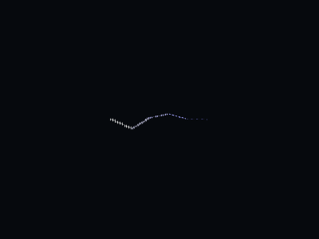

[Power Station](evidence/all-levels-powerstation-gpu.log) and
[Laboratory](evidence/all-levels-laboratory-gpu.log) each render three Release
frames on NVIDIA RTX 3060, dummy audio, and exit 0.
[Exhaustive audit 7](evidence/all-levels-audit-07.log) passes **46 / 58** and fails
**12 / 58**. Remaining work: LifeLeech, WarpGate, Chosen/REV and boss behavior,
FlagStand/FlagObject, and Office's unknown authored TheAngerPU destruction spawn.
No alias is supplied. Opening and short simulation do not certify full traversal,
network play or global M3 acceptance.

## Iteration 10: Life Leech and Temple

The [Life Leech contracts](../../contracts/life_leech_contracts.md) cover the
original pickup/weapon, curved primary, one-pass alternate push, post-armor
healing, real comet particles and both impact composites. Client animation keys
now exercise both modes with the real view model and exact Focus consumption.
Source undefined rotation/zero-distance behavior is replaced with documented
finite operations; point-light illumination remains unavailable.

[Audit 8](evidence/all-levels-audit-08.log) passes **47 / 58**, fails **11 / 58**.
Temple passes all three difficulties, simulation and cleanup. Remaining work:
WarpGate, Chosen/REV and boss classes, FlagStand/FlagObject, and Office's unknown
TheAngerPU spawn. LifeLeech entries in Rooftop and Ancient One are no longer
rejected, but those worlds still fail on other missing classes.

[50 Dev regressions](evidence/all-levels-lot10-dev.log) pass; the final
player-death flag and saved-damage checks pass in
[10 focused Dev tests](evidence/all-levels-lot10-final-dev.log), followed by
[4 weapon/client cases](evidence/all-levels-lot10-client.log). The initial
[8-case run](evidence/all-levels-lot10-initial.log) exposed an incomplete attached
loop request. The [next run](evidence/all-levels-lot10-leech-second.log) exposed
a fixture assertion that ignored original player aim correction. Both failures
are retained; the corrected test measures curvature from the actual firing direction.

The [56-case sanitizer run](evidence/all-levels-lot10-sanitizers.log) passes 54
and times out in objects.message_churn (10 seconds) and weapons.private
(240 seconds) while compilation was also running. The suite remains a failed
run. The same two tests, with unchanged deadlines,
[pass in isolation](evidence/all-levels-lot10-san-retry.log) in 6.15 and 106.24
seconds. The [final four Life Leech cases](evidence/all-levels-lot10-san-leech-final.log)
pass under ASan/UBSan with leak detection, including actual client FIRE_KEY use.

[Release](evidence/all-levels-lot10-release.log) passes Temple and all three
initial weapon tests, but fails the new GPU pixel threshold.
[Diagnosis](evidence/all-levels-lot10-gpu-diagnosis.log) passes all four weapon
cases and finds only 12 visible pixels at the distant test camera. The closer
fixture [passes](evidence/all-levels-lot10-gpu-final.log) without changing
production dimensions or rendering: [397 pixels](evidence/all-levels-lot10-gpu-readback.log),
actual impact sprites, expiry and empty-scene readback. Both applications build.

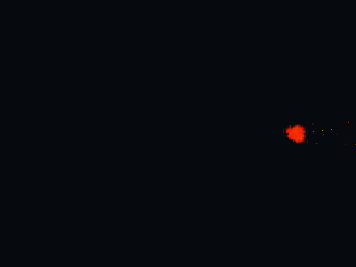
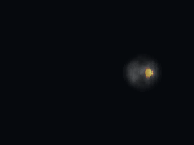

[Temple GPU opening](evidence/all-levels-temple-gpu.log) renders three inspector-free
Release frames on NVIDIA RTX 3060, dummy audio, and exits 0. This is an opening
and short-simulation gate; complete traversal, networking and M3 are unaccepted.

## Iteration 11: WarpGate and Abandoned Buildings

The [WarpGate contracts](../../contracts/warp_gate_contracts.md) cover the
original controller, sprite and two independent particle systems. All seven
catalog gates now create and emit; three use actual SPR particle textures,
confirmed against the installed retail executable. Abandoned Buildings' zero-count
PS2 retains its unused directory-only texture field. No asset is substituted.
Original deferred visibility, asymmetric ramps, emission clock, cached axes,
color helper and per-update rotation remain intact. Sounds are properties only,
as in the original controller.

[Audit 9](evidence/all-levels-audit-09.log) passes **48 / 58**, fails **10 / 58**.
Abandoned Buildings passes all three difficulties, initial tiny deltas, movement,
three-second simulation, runtime recheck and cleanup. Arena's six WarpGate entries
are implemented; its three REV actors still block admission.

[41 Dev regressions](evidence/all-levels-lot11-dev.log) pass (objects, sprites,
object particles, streams, lightning and warp gates).
The [first run](evidence/all-levels-lot11-initial.log) failed on missing editor
property-group markers; these are now declared with the original integer type.
The [second run](evidence/all-levels-lot11-second.log) passed Abandoned but exposed
an incorrect test-clock reset on switching worlds. The
[unchanged failing repetition](evidence/all-levels-lot11-clock-failure.log) is
retained; the [corrected fixture](evidence/all-levels-lot11-clock-fixed.log) uses
the actual monotonic object clock and passes all three WarpGate cases.

[Four ASan/UBSan tests](evidence/all-levels-lot11-sanitizers.log) pass with leak
detection enabled, including Abandoned in all three difficulties (204.45 seconds)
and all seven actual gates.

[Five Release tests](evidence/all-levels-lot11-release.log) pass, including
Abandoned and GPU readback. [Detailed results](evidence/all-levels-lot11-release-detail.log)
record 3,404 visible combined pixels and 1,271 pixels from SPR-textured particles
alone, followed by complete removal and empty-scene readback. Captures were
visually inspected. [Abandoned GPU opening](evidence/all-levels-abandoned-gpu.log)
renders three Release frames on NVIDIA RTX 3060 with dummy audio and exits 0.
Both Release and inspector applications build; renderer/shader/dependency state
is unchanged. This opening and smoke evidence is not full traversal or M3 acceptance.

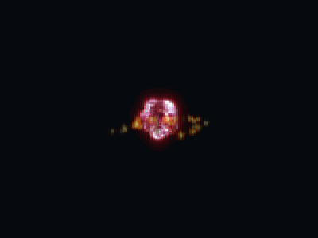
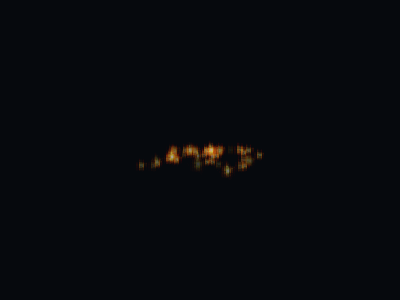

## Iteration 12: Office and audited destruction spawns

Office's `tv01` now retains original destruction behavior even though its authored
`TheAngerPU` spawn names no original class. The original helper returns null at
GetClass: the television dies and records no child. The name stays unregistered,
ValidateSpawnObject still rejects it, and it is never aliased to AngerPU. The
[read-only retail-module check](evidence/all-levels-lot12-retail-class-check.log)
corroborates the source absence. Contracts retain the module hash and source ledger.

The audit also caught a missing allowlist entry for the already implemented
LifeLeechPU. Its original typed spawn now creates the real pickup and applies
the requested velocity after initialization; the focused projectile test checks
its actual model and all three velocity components.

[Audit 10](evidence/all-levels-audit-10.log) passes **49 / 58**, fails **9 / 58**.
Remaining: Rooftop, Ancient City, Arena, Ancient One, End, and four CTF worlds.
Work remains on Chosen/REV, Enhanced/Undead Gideon, AncientOne/tentacles and
FlagStand/FlagObject. Office passes all three difficulties and the simulation gate;
a separate test damages the actual authored tv01 and checks removal, no child,
explicit report and cleanup.

[14 Dev tests](evidence/all-levels-lot12-dev.log) and
[14 Release tests](evidence/all-levels-lot12-release.log) pass. The
[initial run](evidence/all-levels-lot12-initial.log) and
[first count correction](evidence/all-levels-lot12-counts-incomplete.log) retained
stale full-catalog expectations: admitting tv01 changes destructible counts from
2490/38 created/rejected to 2491/37, explosions/detonations 50 to 51 and dynamic
brushes 138 to 139; the previous spawn rejection is gone. Counts now match the
new behavior and the separate destruction test guards the no-child outcome.

[All 14 ASan/UBSan tests](evidence/all-levels-lot12-sanitizers.log) also pass
with leak detection enabled (159.66 seconds total), including the catalog,
actual tv01 destruction and Life Leech spawn.

[Office GPU opening](evidence/all-levels-office-gpu.log) renders three Release
frames on NVIDIA RTX 3060, dummy audio, and exits 0. Dev inspector and Release
applications build. These checks do not certify full traversal or network play;
M2 closure and M3 scope are unchanged.

## Iteration 13: original Gabriella and Ophelia variants

GabriellaAI/REV and OpheliaAI/REV now instantiate their actual models, skins,
inventories and independent animation tables. Original decisions, two-weapon
switching, standing/crouched/running attacks, escape and timed sidesteps are
connected to the existing checked AI lifecycle. [Contracts](../../contracts/chosen_ai_contracts.md)
record sniper, no-weapon, target-loss, missing-break and velocity quirks.

[Audit 11](evidence/all-levels-audit-11.log) remains **49 / 58 passing**, with
seven fewer unported source entries and no new creation failures. Remaining
implementations: IshmaelAI/REV and Orb, EnhancedGideon, UndeadGideon,
AncientOne/tentacles and FlagStand/FlagObject. The four affected worlds still
require these other original classes; no admission check is bypassed.

[50 Dev tests](evidence/all-levels-lot13-dev.log) pass: Chosen profiles/actions/
authored worlds plus AI runtime/fire and Fanatic/Prophet regressions. Tests verify
all difficulties, table separation, real alternate/primary shots, sniper crouch,
virtual two-animation weapon switching, one-second sidestep velocity and escape
fallbacks. All seven authored instances initialize.

The [initial run](evidence/all-levels-lot13-initial.log) exposed a fixture reusing
collision after world unload. The [second run](evidence/all-levels-lot13-second.log)
tried to initialize the same session twice and aimed a sniper through an intervening
actor; both fixture errors are corrected, without weakening collision or lifecycle.

[All 50 ASan/UBSan tests](evidence/all-levels-lot13-sanitizers.log) pass with
leak detection enabled (153.44 seconds).

[Four Release tests](evidence/all-levels-lot13-release.log) pass, including GPU
readback of all four actual model/skin pairs at three clip times.
[Detailed results](evidence/all-levels-lot13-release-detail.log): 23,600 filled
pixels, zero CPU/GPU differences. Captures were visually inspected. Dev inspector
and Release applications build; no shader, renderer or dependency changes.
These focused checks are not full encounter/traversal acceptance.

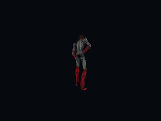
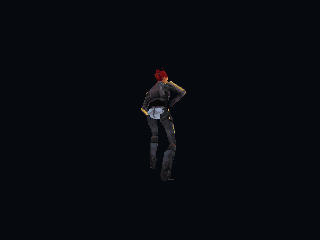
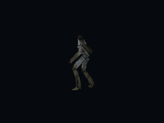
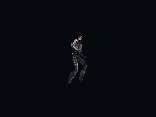

## Iteration 14: original Orb weapon, projectiles and camera

The original Orb dependency is implemented before registering IshmaelAI/REV.
Both actual projectile modes, guidance, head attachment, periodic damage, audio,
client FIRE_KEY delivery, pickup, NPC use and alternate camera are connected.
[Contracts](../../contracts/orb_contracts.md) preserve signed-component targeting,
strict clocks, final explosion damage and checked camera/link ownership.
Actual blue/white trails and ten metal fragments use the original assets and
recipes; inspector state includes component errors.

[Audit 12](evidence/all-levels-audit-12.log) remains **49 / 58 passing**, **9 failing**.
Remaining classes: IshmaelAI/REV, EnhancedGideon, UndeadGideon, AncientOne,
Tentacle, FlagStand and FlagObject. No world admission rule was relaxed.

[66 Dev regressions](evidence/all-levels-lot14-dev.log) and the separate
[14 object-contract tests](evidence/all-levels-lot14-objects.log) pass. Five focused
Orb cases cover signed guidance/no base timeout, head damage and deferred removal,
actual alternate camera/aim/input gates, player/NPC fire, pickup, original particle
settings, fragment lifetime and explicit trail-capacity failure. Existing Leech,
AI, inventory-use, player-state and camera tests pass as well.

The retained [initial fixture run](evidence/all-levels-lot14-initial.log) used
an exact .001-second step smaller than the float scheduling deadline, and later
[attachment diagnosis](evidence/all-levels-lot14-attachment-debug.log) showed the
original localized damage modifier: delivered 12 damage is not always 12 health
lost. The fixture now tests delivery and actual health loss separately.

[Six Release tests](evidence/all-levels-lot14-release.log) pass, including GPU
readback: 279 Orb/trail pixels, 334 impact pixels with all ten actual fragment
models, and exact empty background after expiry. Captures were visually checked.
The [initial GPU failure](evidence/all-levels-lot14-release-initial.log) exposed
poor fixture framing; the [second](evidence/all-levels-lot14-gpu-second.log)
exposed its missing explosion-model scene submission. Both fixture errors were
fixed without reducing pixel thresholds or changing production rendering.
Dev inspector and Release applications build. No shaders/dependencies changed.

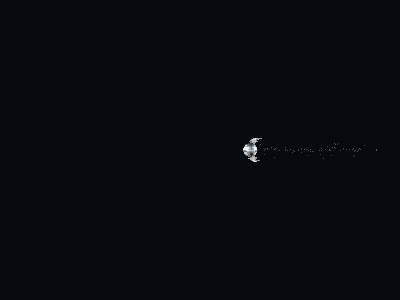
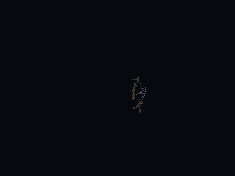

[79 ASan/UBSan checks](evidence/all-levels-lot14-sanitizers.log) pass (158.82 seconds),
plus the separately run [clearance encounter](evidence/all-levels-lot14-sanitizers-clearance.log)
(86.54 seconds), with leak detection enabled. The first combined command was
externally terminated with status 143 during that encounter; its
[incomplete output](evidence/all-levels-lot14-sanitizers-interrupted.log) is retained
and is not counted as a successful run. All 80 selected checks subsequently pass.
These focused checks and opening audit do not certify complete campaign traversal.

## Iteration 15: original Ishmael and revenant

IshmaelAI and IshmaelREV now have original profiles, independent model tables,
actual weapon/animation-key attacks, heal, teleport/recoil and death behavior.
[Contracts](../../contracts/ishmael_contracts.md) preserve their target-loss/gravity
differences, health multiplier and per-target death damage. The new checked sphere
query includes inactive objects and body extents rather than substituting a
center-only/destructible-only query. Heal18 and Divine shockball22 have real
commercial particles, models and audio; point-light illumination remains outside
this continuation.

[Audit 13](evidence/all-levels-audit-13.log) passes **50 / 58**, fails **8 / 58**.
Arena now passes all three difficulties and the simulation gate. End has no missing
class but reaches a newly exposed original Caleb script-animation rejection.
Remaining work: that script path, EnhancedGideon, UndeadGideon, AncientOne,
Tentacle and the four CTF worlds' FlagStand/FlagObject behavior. No incomplete
class placeholders or admission exceptions are introduced.

[56 Dev checks](evidence/all-levels-lot15-dev.log) pass, including eight Ishmael
cases, original Chosen/Orb, object contracts, particle/model/ring/light services
and Cathedral/Sewage/Slaughter regressions. Tests cover all difficulty profiles,
actual Orb FIRE_KEY delivery, both attack weapons, heal timing, source fade and
revenant gravity, real death effects and per-target damage without falloff,
inactive/body-extent sphere selection, cleanup and all three authored instances.

The [first test run](evidence/all-levels-lot15-initial.log) exposed the original
missing laugh resource. [Diagnosis](evidence/all-levels-lot15-teleport-debug.log)
and [all-three index checks](evidence/all-levels-lot15-second.log) confirm that
laugh1/2/3 are all absent. Tests preserve these exact sound failures and verify
continued source teleport behavior; they do not require invented audio.
The [initial key fixture](evidence/all-levels-lot15-dev-initial.log) did not advance
model clocks; its [second revision](evidence/all-levels-lot15-key-second.log)
allowed the original automatic deactivation without player wake-up. The
[final fixture](evidence/all-levels-lot15-key-final.log) runs real session/model
updates with explicit diagnostic activation and observes an actual Orb shot.

[Ten Release checks](evidence/all-levels-lot15-release.log) pass, including both
actual model/skin pairs at three animation times: 16,269 filled pixels, zero
CPU/GPU differences. The [final effects readback](evidence/all-levels-lot15-gpu-effects.log)
uses the same alpha style as production and a camera outside the shockball:
216 blue heal pixels, 2,923 red shockball pixels and exact empty background after
expiry. Captures were visually inspected. [Arena application opening](evidence/all-levels-arena-gpu.log)
renders three Release frames and exits successfully on NVIDIA RTX 3060.
Dev inspector and Release applications build; shaders and dependencies are unchanged.

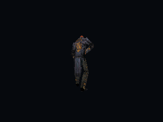
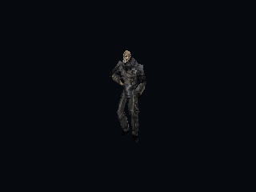
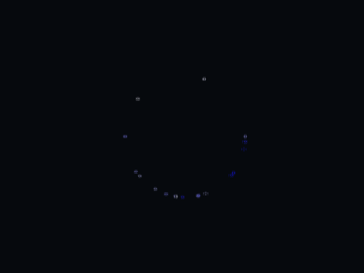
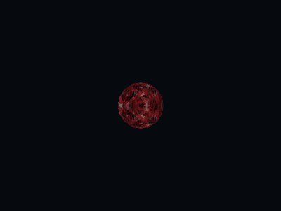

All 56 selected behaviors also complete under Clang Debug ASan/UBSan with leak
detection. The [combined run](evidence/all-levels-lot15-sanitizers-initial.log)
passes 54 tests, retains the old key fixture failure and times out Slaughter House
at 120 seconds. The [recheck](evidence/all-levels-lot15-sanitizers-recheck.log)
passes the corrected key fixture and reproduces that timeout without compilation.
The [same Slaughter House binary](evidence/all-levels-lot15-sanitizers-slaughter-timed.log)
then completes every assertion, all three difficulties and cleanup in **238.19
seconds**, exit 0, under an external 240-second bound. The two CTest timeouts remain
recorded failures, not silently reclassified passes. Only that sanitizer test's
future timeout is raised to 300 seconds on this measured evidence; its workload,
assertions, compiler optimization and production code are unchanged. CTest metadata
was checked after the budget adjustment; the identical long workload was not run
a fourth time. These are focused behavior/opening checks, not campaign acceptance.

## Iteration 16: End's triggered animation

End's Trigger invokes Caleb's original walk script synchronously inside a movement
contact. The [captured stack](evidence/all-levels-lot16-resize-stack.log) identifies
the `moving_` guard in ResizeObject: even an exactly unchanged body was rejected.
The existing clip is ordinal 2; the initial missing-animation hypothesis was
incorrect, and its speculative script change was discarded. The retained
[initial failure](evidence/all-levels-lot16-initial.log) records that diagnosis.

[The engine correction](../../contracts/ai_animation_clearance_contracts.md#unchanged-dimensions-from-a-contact-callback)
accepts a validated exact no-op without collision work or mutation. Actual size
changes during movement remain refused. Scripts/assets are unchanged.
[Audit 14](evidence/all-levels-audit-14.log) passes **51 / 58**, fails **7 / 58**:
End now passes all difficulties, simulation and runtime/cleanup rechecks.

All 22 selected AI state/script checks pass in
[Dev](evidence/all-levels-lot16-dev.log),
[Release](evidence/all-levels-lot16-release.log) and
[Clang Debug ASan/UBSan with leak detection](evidence/all-levels-lot16-sanitizers.log).
The added touch test verifies unchanged success, changed-size refusal, stable
position/extents and preserved invalid/unavailable-service errors. The real End
case observes Caleb's authored nonlooping walk animation, advances three seconds
and verifies runtime readiness and cleanup at all three difficulties.
The [Release application](evidence/all-levels-end-gpu.log) opens End and renders
three frames on NVIDIA RTX 3060. Both applications build; graphics pipelines and
dependencies are unchanged. This is entry/simulation coverage, not full traversal.

## Iteration 17: original EnhancedGideon

[EnhancedGideon](../../contracts/enhanced_gideon_contracts.md) now has its original
profile, independent animation/sound table, actual skin, health publication,
combat/teleport and scripted locomotion. Equivalent Gideon methods are shared;
Enhanced-specific no-fire, gravity, health capture and facing branches remain
explicit. [Audit 15](evidence/all-levels-audit-15.log) passes **52 / 58**, fails
**6 / 58**. Rooftop passes all three difficulties and simulation. Ancient City
now has only UndeadGideon unsupported; AncientOne/Tentacle and four CTF maps remain.

[59 selected Dev checks](evidence/all-levels-lot17-dev.log) and the same
[59 Clang Debug ASan/UBSan checks](evidence/all-levels-lot17-sanitizers.log) pass.
They exercise six new Enhanced cases plus ordinary Gideon combat, attack,
teleport, lifecycle, and shared script/path behavior. The End regression was
then rebuilt against the new library and [passes again](evidence/all-levels-lot17-end-dev.log).
[17 object-contract checks](evidence/all-levels-lot17-objects-dev.log) also pass.
The freshly rebuilt End case and all 17 object checks also
[pass under sanitizers](evidence/all-levels-lot17-objects-sanitizers.log).

The [first fixture run](evidence/all-levels-lot17-initial.log) assumed a second
health update before its scheduler deadline and invoked close facing without a
sampled target. [Diagnosis](evidence/all-levels-lot17-second.log) separated these
fixture prerequisites; explicit callbacks and RefreshTargetPosition fix them.
The [wider initial run](evidence/all-levels-lot17-old-fixtures.log) also found four
old missing-ordinal assertions, superseded by iteration 3's original retained-clip
behavior. Those tests now verify retained real playback, physical velocity and
shield state, and separately reject a truly missing model. No production failure
is suppressed to satisfy these fixtures.

[Seven Release tests](evidence/all-levels-lot17-release.log) pass, including
[GPU readback](evidence/all-levels-lot17-release-details.log) of the real Enhanced
model/skin at three animation times: 7,710 filled pixels, zero CPU/GPU differences.
The saved capture was visually inspected. [Rooftop application opening](evidence/all-levels-rooftop-gpu.log)
renders three Release frames on NVIDIA RTX 3060 and exits successfully. Dev
inspector and inspector-free Release applications build. Graphics pipelines and
dependencies are unchanged. Entry/simulation coverage is not full boss/campaign
traversal, network play or a new milestone acceptance.

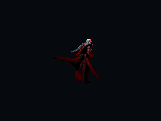

## Iteration 18: Undead Gideon weapon prerequisites

[Original spear/vomit and player imprisonment](../../contracts/gideon_weapons_contracts.md)
now execute through owned typed messages and the existing physics/particle paths.
The spear applies four seconds without refreshing an active effect; wall occlusion
blocks both its preliminary imprisonment ray and ordinary damage. Vomit has real
source trail particles, Normal direct damage, ten-second expiry and no invented
impact explosion. Relative imprisonment clocks survive typed player restoration.
The original localized notices are inspected; their console overlay is not supplied.

The [first focused run](evidence/all-levels-lot18-initial.log) passed six tests but
omitted the first-update client message pump before resuming movement. The
[corrected fixture](evidence/all-levels-lot18-second.log) passes all seven cases.
The [broader run](evidence/all-levels-lot18-dev.log) then found a real restore
regression: iteration 16's unconditional equal-size success skipped collision for
a newly staged saved position. [Diagnosis](evidence/all-levels-lot18-restore-diagnosis.log)
identifies the floor-overlap assertion. The no-op exception is now restricted to
an active movement transaction. Ordinary equal-size calls retain the placement
check; End's synchronous contact script still passes. The restore suite also
rejects malformed imprisonment clocks before mutation.

[49 Dev checks](evidence/all-levels-lot18-dev-final.log) and
[49 Clang Debug ASan/UBSan checks with leak detection](evidence/all-levels-lot18-sanitizers.log)
pass: objects, movement, player state/restoration, Orb, End/contact resize and eight
new weapon/imprisonment cases. The subsequently added wall-occluded spear
assertions also [pass in Dev](evidence/all-levels-lot18-spear-dev.log) and are included
in both sanitizer and Release runs. Both applications build. Commands used:
`cmake --build build/{dev,release,sanitize} --target ...` for the corresponding
applications and test targets, then CTest restricted to these named suites;
GPU tests are excluded from sanitizers.

The [Release run](evidence/all-levels-lot18-release.log) passes all 49 headless tests;
its first GPU fixture fails a pixel-count assertion because the small trail was
mostly outside the camera view (18 lit pixels). With the camera centered near the
actual emitter, the [GPU readback](evidence/all-levels-lot18-gpu-final.log) passes:
479 visible pixels, no impact explosion, exact empty background after removal.
The production recipe and threshold are unchanged. The capture was visually
inspected. Initial failures remain retained in their raw logs.

[Audit 16](evidence/all-levels-audit-16.log) again passes **52 / 58**, fails **6 / 58**,
including all three difficulties and runtime/unload checks for passing maps.
UndeadGideon itself is the next implementation; AncientOne/Tentacle and the CTF
flag/player behavior remain in the explicit queue above. This lot changes no
commercial/reference data, shaders or dependencies and does not certify full
campaign traversal or reopen M2.

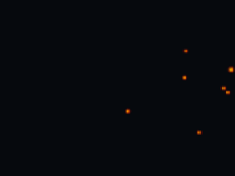
