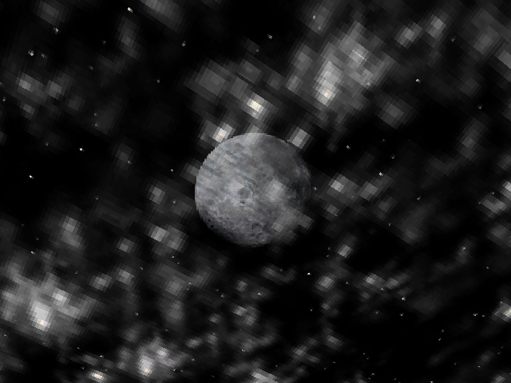

# All mounted retail levels — implementation backlog

Requested on 2026-10-20. Baseline `25e6acc`, external retail 2.1 installation,
58 mounted DAT worlds. [Raw audit](evidence/all-levels-audit-01.log).

The first complete pass found **32 passing / 26 failing** worlds. Each passing
world completed transactional player entry at difficulties 1, 0 and 2, tiny
initial deltas, three seconds of simulation with movement, a runtime failure
recheck and resource cleanup. This is an opening/smoke gate, not full traversal,
combat, multiplayer or GPU certification. M2 closure remains unchanged.

Current verified opening gate after iteration 8: **44 / 58 pass, 14 / 58 fail**
([audit 6](evidence/all-levels-audit-06.log)). Remaining worlds: Abandoned Buildings,
Temple, Power Station, Laboratory, Office, Rooftop, Ancient City, Arena, Ancient One,
End and the four CTF maps. Initial-entry and three-second simulation
coverage is not complete gameplay/traversal acceptance. The tables below retain
the initial baseline; iteration records explain resolved and newly exposed blockers.

## Work queue

1. Port missing original classes and their actual required behavior/services.
   Do not register inert placeholders to satisfy admission.
2. Diagnose solid model geometry and NPC/player placement failures. Preserve
   atomic motion and reject unresolved overlap.
3. Diagnose CivilianAI animation selection against its actual model and original
   source; no arbitrary animation substitution.
4. Account for exact malformed/absent authored resources with explicit diagnostics
   and source-supported adaptations; do not invent replacement commercial assets.
5. Improve diagnostic coverage for the silent Midgard failure. Distinguish actual
   multiplayer entry requirements from single-player test assumptions.
6. Rebuild, run focused regressions and sanitizers, commit each validated lot,
   then rerun the complete audit. Add GPU opening checks once admission succeeds.
   Keep newly exposed later failures in this queue until resolved.

## Unregistered classes in this pass

Counts are rejected source entries, not distinct implementations.

| Class | Entries |
| --- | ---: |
| `AncientOne` | 2 |
| `AncientOneTentacle` | 16 |
| `CClientLightningSFX` | 10 |
| `CClientWarpGateSFX` | 7 |
| `CalebAI` | 4 |
| `EnhancedGideon` | 2 |
| `FlagStand` | 8 |
| `GabriellaAI` | 2 |
| `GabriellaREV` | 1 |
| `IshmaelAI` | 2 |
| `IshmaelREV` | 1 |
| `LifeLeechPU` | 3 |
| `Minefield` | 8 |
| `OpheliaAI` | 3 |
| `OpheliaREV` | 1 |
| `RevenantPU` | 3 |
| `RotatingModel` | 1 |
| `SparksObj` | 1 |
| `UndeadGideon` | 1 |

## Failing worlds and observed blockers

| World | Observed blockers |
| --- | --- |
| `09_abandoned_buildings` | 09_abandoned_buildings entry=237 class=CDestructableBrush Creation failed: helloyou3: Container face is not on its plane 09_abandoned_buildings entry=1120 class=CClientWarpGateSFX Class not ported: Required original class is not registered 09_abandoned_buildings: World initialization rejected: 1 unsupported classes, 1 failed entries, 0 unavailable services |
| `11_slaughter_house` | 11_slaughter_house: Original NPC failure: CivilianAI0: AI_Update: AI animation model/clip unavailable |
| `12_train_station` | 12_train_station entry=672 class=Sprite Creation failed: Sprite0: Missing, oversized or non-SPR sprite resource: spritetextures\redlight1.spr 12_train_station entry=727 class=SoulDrudge Creation failed: NPC world ground placement failed: result 61 body 20.674137,35.827911,20.674137 12_train_station entry=737 class=BoneLeech Creation failed: NPC world ground placement failed: result 1 body 6.891021,1.251030,6.891021 12_train_station entry=738 class=BoneLeech Creation failed: NPC world ground placement failed: result 1 body 6.891021,1.251030,6.891021 12_train_station: World initialization rejected: 0 unsupported classes, 4 failed entries, 0 unavailable services |
| `18_temple` | 18_temple entry=141 class=DetailSprite Creation failed: sprites\redlight1.spr: Missing, oversized or non-SPR sprite resource:  18_temple entry=465 class=LifeLeechPU Class not ported: Required original class is not registered 18_temple: World initialization rejected: 1 unsupported classes, 1 failed entries, 0 unavailable services |
| `20_powerstation` | 20_powerstation entry=497 class=SparksObj Class not ported: Required original class is not registered 20_powerstation entry=803 class=CClientLightningSFX Class not ported: Required original class is not registered 20_powerstation: World initialization rejected: 2 unsupported classes, 0 failed entries, 0 unavailable services |
| `21_laboratory` | 21_laboratory entry=583 class=CClientLightningSFX Class not ported: Required original class is not registered 21_laboratory entry=684 class=RotatingModel Class not ported: Required original class is not registered 21_laboratory: World initialization rejected: 2 unsupported classes, 0 failed entries, 0 unavailable services |
| `22_office` | 22_office entry=177 class=CDestructableModel Creation failed: Model clip-zero dimensions unavailable: Model resource not mounted: modelsworldobjects\urinal2.abc 22_office entry=775 class=CDestructableBrush Creation failed: Rejected precreate: CDestructableBrush: SpawnObject not accepted: TheAngerPU 22_office: World initialization rejected: 0 unsupported classes, 2 failed entries, 0 unavailable services |
| `23_rooftop` | 23_rooftop entry=244 class=EnhancedGideon Class not ported: Required original class is not registered 23_rooftop entry=252 class=OpheliaAI Class not ported: Required original class is not registered 23_rooftop entry=253 class=CalebAI Class not ported: Required original class is not registered 23_rooftop entry=259 class=LifeLeechPU Class not ported: Required original class is not registered 23_rooftop: World initialization rejected: 4 unsupported classes, 0 failed entries, 0 unavailable services |
| `24_ancientcity` | 24_ancientcity entry=312 class=UndeadGideon Class not ported: Required original class is not registered 24_ancientcity entry=390 class=EnhancedGideon Class not ported: Required original class is not registered 24_ancientcity: World initialization rejected: 2 unsupported classes, 0 failed entries, 0 unavailable services |
| `24b_arena` | 24b_arena entry=106 class=GabriellaREV Class not ported: Required original class is not registered 24b_arena entry=110 class=IshmaelREV Class not ported: Required original class is not registered 24b_arena entry=135 class=CClientLightningSFX Class not ported: Required original class is not registered 24b_arena entry=136 class=CClientLightningSFX Class not ported: Required original class is not registered 24b_arena entry=137 class=CClientLightningSFX Class not ported: Required original class is not registered 24b_arena entry=138 class=OpheliaREV Class not ported: Required original class is not registered 24b_arena entry=158 class=CClientWarpGateSFX Class not ported: Required original class is not registered 24b_arena entry=159 class=CClientWarpGateSFX Class not ported: Required original class is not registered 24b_arena entry=160 class=CClientWarpGateSFX Class not ported: Required original class is not registered 24b_arena entry=227 class=CClientWarpGateSFX Class not ported: Required original class is not registered 24b_arena entry=228 class=CClientWarpGateSFX Class not ported: Required original class is not registered 24b_arena entry=229 class=CClientWarpGateSFX Class not ported: Required original class is not registered 24b_arena: World initialization rejected: 12 unsupported classes, 0 failed entries, 0 unavailable services |
| `25_ancientone` | 25_ancientone entry=15 class=AncientOne Class not ported: Required original class is not registered 25_ancientone entry=16 class=LifeLeechPU Class not ported: Required original class is not registered 25_ancientone entry=22 class=AncientOneTentacle Class not ported: Required original class is not registered 25_ancientone entry=23 class=AncientOneTentacle Class not ported: Required original class is not registered 25_ancientone entry=24 class=AncientOneTentacle Class not ported: Required original class is not registered 25_ancientone entry=25 class=AncientOneTentacle Class not ported: Required original class is not registered 25_ancientone entry=26 class=AncientOneTentacle Class not ported: Required original class is not registered 25_ancientone entry=27 class=AncientOneTentacle Class not ported: Required original class is not registered 25_ancientone entry=28 class=AncientOneTentacle Class not ported: Required original class is not registered 25_ancientone entry=29 class=AncientOneTentacle Class not ported: Required original class is not registered 25_ancientone entry=117 class=AncientOneTentacle Class not ported: Required original class is not registered 25_ancientone entry=118 class=AncientOneTentacle Class not ported: Required original class is not registered 25_ancientone entry=119 class=AncientOneTentacle Class not ported: Required original class is not registered 25_ancientone entry=120 class=AncientOneTentacle Class not ported: Required original class is not registered 25_ancientone entry=121 class=AncientOneTentacle Class not ported: Required original class is not registered 25_ancientone entry=122 class=AncientOneTentacle Class not ported: Required original class is not registered 25_ancientone entry=123 class=AncientOneTentacle Class not ported: Required original class is not registered 25_ancientone entry=124 class=AncientOneTentacle Class not ported: Required original class is not registered 25_ancientone entry=125 class=AncientOne Class not ported: Required original class is not registered 25_ancientone entry=157 class=CalebAI Class not ported: Required original class is not registered 25_ancientone entry=177 class=CClientLightningSFX Class not ported: Required original class is not registered 25_ancientone entry=178 class=CClientLightningSFX Class not ported: Required original class is not registered 25_ancientone entry=179 class=CClientLightningSFX Class not ported: Required original class is not registered 25_ancientone entry=180 class=CClientLightningSFX Class not ported: Required original class is not registered 25_ancientone entry=181 class=CClientLightningSFX Class not ported: Required original class is not registered 25_ancientone entry=202 class=IshmaelAI Class not ported: Required original class is not registered 25_ancientone entry=203 class=OpheliaAI Class not ported: Required original class is not registered 25_ancientone entry=204 class=GabriellaAI Class not ported: Required original class is not registered 25_ancientone: World initialization rejected: 28 unsupported classes, 0 failed entries, 0 unavailable services |
| `credits` | credits entry=9 class=CalebAI Class not ported: Required original class is not registered credits: World initialization rejected: 1 unsupported classes, 0 failed entries, 0 unavailable services |
| `end` | end entry=13 class=CalebAI Class not ported: Required original class is not registered end entry=14 class=IshmaelAI Class not ported: Required original class is not registered end entry=15 class=GabriellaAI Class not ported: Required original class is not registered end entry=16 class=OpheliaAI Class not ported: Required original class is not registered end: World initialization rejected: 4 unsupported classes, 0 failed entries, 0 unavailable services |
| `multi/bb_area15` | multi/bb_area15: Player entry: Original player creation/start-point entry failed |
| `multi/bb_bloodkeep` | multi/bb_bloodkeep entry=21 class=Sound Creation failed: Missing or oversized sound resource multi/bb_bloodkeep: World initialization rejected: 0 unsupported classes, 1 failed entries, 0 unavailable services |
| `multi/bb_brownstar` | multi/bb_brownstar: Player entry: Original player creation/start-point entry failed |
| `multi/bb_cabana` | multi/bb_cabana entry=56 class=RevenantPU Class not ported: Required original class is not registered multi/bb_cabana: World initialization rejected: 1 unsupported classes, 0 failed entries, 0 unavailable services |
| `multi/bb_condemned` | multi/bb_condemned entry=150 class=Sound Creation failed: Missing or oversized sound resource multi/bb_condemned entry=151 class=Sound Creation failed: Missing or oversized sound resource multi/bb_condemned entry=239 class=Door Creation failed: Buildings: Open or non-manifold container shell: 4 edges / balance 0 in component 3 at -7488 -1986 -1568 -> -7488 -2048 -1568 multi/bb_condemned: World initialization rejected: 0 unsupported classes, 3 failed entries, 0 unavailable services |
| `multi/bb_crypt` | multi/bb_crypt: Player entry: Original player creation/start-point entry failed |
| `multi/bb_fields` | multi/bb_fields entry=59 class=Minefield Class not ported: Required original class is not registered multi/bb_fields entry=60 class=Minefield Class not ported: Required original class is not registered multi/bb_fields entry=61 class=Minefield Class not ported: Required original class is not registered multi/bb_fields entry=62 class=Minefield Class not ported: Required original class is not registered multi/bb_fields entry=63 class=Minefield Class not ported: Required original class is not registered multi/bb_fields entry=64 class=Minefield Class not ported: Required original class is not registered multi/bb_fields entry=65 class=Minefield Class not ported: Required original class is not registered multi/bb_fields entry=66 class=Minefield Class not ported: Required original class is not registered multi/bb_fields: World initialization rejected: 8 unsupported classes, 0 failed entries, 0 unavailable services |
| `multi/bb_midgard` | Failure without diagnostic; improve the audit before classifying. |
| `multi/bb_rooftop` | multi/bb_rooftop: Player entry: Original player creation/start-point entry failed |
| `multi/ctf_cabana` | multi/ctf_cabana entry=56 class=RevenantPU Class not ported: Required original class is not registered multi/ctf_cabana entry=118 class=RevenantPU Class not ported: Required original class is not registered multi/ctf_cabana entry=136 class=FlagStand Class not ported: Required original class is not registered multi/ctf_cabana entry=137 class=FlagStand Class not ported: Required original class is not registered multi/ctf_cabana: World initialization rejected: 4 unsupported classes, 0 failed entries, 0 unavailable services |
| `multi/ctf_deadcities` | multi/ctf_deadcities entry=588 class=FlagStand Class not ported: Required original class is not registered multi/ctf_deadcities entry=589 class=FlagStand Class not ported: Required original class is not registered multi/ctf_deadcities: World initialization rejected: 2 unsupported classes, 0 failed entries, 0 unavailable services |
| `multi/ctf_dmx` | multi/ctf_dmx entry=485 class=FlagStand Class not ported: Required original class is not registered multi/ctf_dmx entry=486 class=FlagStand Class not ported: Required original class is not registered multi/ctf_dmx: World initialization rejected: 2 unsupported classes, 0 failed entries, 0 unavailable services |
| `multi/ctf_jam` | multi/ctf_jam entry=516 class=FlagStand Class not ported: Required original class is not registered multi/ctf_jam entry=517 class=FlagStand Class not ported: Required original class is not registered multi/ctf_jam: World initialization rejected: 2 unsupported classes, 0 failed entries, 0 unavailable services |

## Iteration 2: original RotatingModel and RevenantPU

Both classes now register their original behavior. RotatingModel shares the
original aggregate and exposes its state in Objects; RevenantPU uses the original
model/skin and offer, with no fabricated player acceptance for unhandled type 8.
`multi/bb_cabana` now passes all three difficulties. `21_laboratory` remains blocked
by CClientLightningSFX. Midgard fails during the initial 0.0001 s step: NecroWardPU0 starts
10.6571 units inside world polygon 449, normal (0,1,0), at (-96,256,-224).
It is not an unreadable DAT. Slaughter House requests ordinal 17 on labtech.abc,
which has only 17 clips (0–16); the requested state is 19, Metacmd 1. The backlog above records the baseline pass.

Dev focused regressions: all 24 brush, destructible-model and Airship/power tests
pass. New tests exercise visual rotation with stable body extents, stopping,
cleanup, real Revenant assets and original non-acknowledgement.

The same 24 tests pass under Clang ASan/UBSan with leak detection enabled:
[Dev](evidence/all-levels-lot2-dev.log),
[sanitizers](evidence/all-levels-lot2-sanitizers.log).
[Cabana admission](evidence/all-levels-cabana.log) passes all three difficulties;
[GPU opening](evidence/all-levels-cabana-gpu.log) renders three frames on the
NVIDIA RTX 3060 and exits 0 (SDL dummy audio). Dev inspector application builds.

## Iteration 3: Slaughter House and Midgard

Slaughter House now follows the original ignored invalid-ordinal request with
verified current animation playback, source dimension/clock behavior and visible
retained-request counters. Midgard's initially embedded nonsolid gravity pickup
uses the same bounded primary-world placement as solid bodies. Neither fix
relaxes later collision or supplies missing animations. Both worlds pass all
three difficulties and the final runtime check. The focused 56 service and
AI state/locomotion/fire regressions pass in Dev.

The [second exhaustive audit](evidence/all-levels-audit-02.log) passes **35 / 58**
worlds and fails **23 / 58**. This includes the three newly passing worlds
Cabana, Slaughter House and Midgard; the original baseline table remains above.

- [Dev regressions](evidence/all-levels-lot3-dev.log): 56/56.
- [Initial sanitizer run](evidence/all-levels-lot3-sanitizers-initial.log):
  the 56 service/AI cases and Midgard pass; Slaughter House times out at 180 s.
  This timeout is retained as a failed run, not a sanitizer success.
- [Sanitizer map rerun](evidence/all-levels-lot3-sanitizer-worlds.log): both
  maps pass with ASan/UBSan and leak detection. Instrumented Debug map tests
  now have a 600 s timeout; all three difficulties and simulation steps are
  unchanged. The rerun takes 268 s total. Progress flushes after each difficulty.
- [Release map tests](evidence/all-levels-lot3-release.log): all three pass.
  Inspector Dev and inspector-free Release applications build.
- Release GPU opening renders three frames and exits 0 for
  [Slaughter House](evidence/all-levels-slaughter-gpu.log) and
  [Midgard](evidence/all-levels-midgard-gpu.log), NVIDIA RTX 3060, dummy audio.

Further diagnosis: Area15 contains only Multiplayer=true start markers; its
single-player startup rejection is distinct from collision failure. Train Station
has two BoneLeech centers exactly on shelf2's top (Y=64), and SoulDrudge0 starts
in a primary-world wedge. These remain the next placement work.

## Iteration 4: Train Station and box-model topology

Train Station now passes admission, simulation and runtime recheck at all three
difficulties. Initial placement handles the SoulDrudge's floor-edge intersection
and the two BoneLeech shelf-face starts with bounded, checked corrections.

BoxPhysics world models use validated authored triangles for retained geometry
and their existing AABB for collision; requiring a closed polygon volume for
that representation was unnecessary. Abandoned Buildings' helloyou3 and
Condemned's Buildings now create. Containers remain closed/planar and malformed
coordinates/indices still fail. The private brush catalog gains exactly one
created CDestructableBrush (2490 created / 38 rejected), with its malformed stored
plane still counted. Tests verify both box collision and strict volume rejection.

The exact missing-resource ledger also records: Sprite0's
spritetextures\redlight1.spr, Temple's empty DetailSprite Filename with authored
name sprites\redlight1.spr, Office's modelsworldobjects\urinal2.abc, and sounds
ambient/chantloop2.wav, ambient/neonlight1.wavt and ambient/neonlight2.wavt. Each
requires the specific class/property/path, observed failure category and actual
resource absence. No file is substituted. These omissions remain inspector rows.
Bloodkeep and Condemned now reach player entry but have no solo start marker;
they still fail the current solo entry test.

Validation: the 61 focused services, compound-shell, brush, container, object and
Train Station tests pass in [Dev](evidence/all-levels-lot4-dev.log) and
[ASan/UBSan with leak detection](evidence/all-levels-lot4-sanitizers.log).
The [Release map test](evidence/all-levels-lot4-release.log) passes.
[Release GPU opening](evidence/all-levels-train-gpu.log) renders three frames
on the NVIDIA RTX 3060 and exits 0 with dummy audio.

The [third exhaustive audit](evidence/all-levels-audit-03.log), before adding
multiplayer-marker inspection, passes **36 / 58** and fails **22 / 58**.
Train Station is the newly passing map. The baseline table above remains historical.

## Iteration 5: inspection of multiplayer-only start markers

The inspector level chooser and explicit `--view-world` entry may use the first
live authored multiplayer marker when no solo marker exists. This is a local
inspection policy: it keeps the solo profile and simulation, requires normal
checked ground placement, and records the actual marker and multiplayer fallback
in the Session inspector. Solo markers retain priority. Normal New Game,
restored entry and campaign transitions retain their original solo selection.
The opt-in resets on world unload/replacement; transactional inspection requests
set it on the candidate only. Missing all markers still fails.

The audit now explicitly exercises inspection entry and prints the marker mode.
This can establish local opening of multiplayer geometry, not network play,
team selection, CTF rules or multiplayer respawn parity.

Validation: all seven player entry regression cases and Area15, Bloodkeep,
Condemned and Rooftop pass in [Dev](evidence/all-levels-lot5-dev.log) and
[ASan/UBSan/leak checks](evidence/all-levels-lot5-sanitizers.log).
The [Release six-map run](evidence/all-levels-lot5-release.log) has the same four
passes and two retained failures. Brownstar now reaches `floorplate.spr` with
raw FPS 65537; Crypt now reaches its Sprite moon sky target, which the current
world-model-only sky service rejects. The overall runs are **11/13** and **4/6**,
not passing suites. These two newly exposed failures are the next lot.
[Area15 Release GPU opening](evidence/all-levels-area15-gpu.log) renders three
frames on NVIDIA RTX 3060 and exits 0 (dummy audio).

## Iteration 6: Brownstar animated material and Crypt moon

Brownstar's SPR stores FPS 65537, which makes the original integer frame period
zero. Inspection of the installed Client.exe confirms both the zero-length tracker
and the world-surface guard that retains its initial texture when no current frame
exists. The bounded reader now accepts this original representation; no path,
frame, texture or playback speed is substituted. Tests cover zero-duration clocks,
current-frame absence and retained world material selection.

Crypt's `moon` is a bound Sprite, at sky slot 2 between authored BSP layers.
The sky registry and presenter now accept that type and interleave its textured
billboard at the original slot, using the existing depth-disabled sky pipelines.
The sprite does not also draw in the ordinary scene. Hidden/stale slots, alpha,
resource validation, compressed camera and unload ownership remain checked.

Validation: [15 Dev sprite/sky/map cases](evidence/all-levels-lot6-dev.log) and
[7 Dev texture/sprite-view cases](evidence/all-levels-lot6-dev-textures.log) pass.
The corresponding [18 sanitizer cases](evidence/all-levels-lot6-sanitizers.log) and
[4 texture cases](evidence/all-levels-lot6-sanitizer-textures.log) pass with leak
detection. Dev inspector and Release applications build; pre-existing aggregate
initializer warnings at texture_tests.cpp:185 remain visible.

The [initial Release run](evidence/all-levels-lot6-release-initial.log) passes both
maps and the existing sky/world-sprite pixel tests, but fails the new sky-sprite
integration. The dedicated sky snapshot now consumes FLAG_SKYOBJECT at its boundary
and uses explicit SkyAlpha batches in the opaque sky renderer. The corrected
[Crypt GPU test](evidence/all-levels-lot6-sky-sprite.log) passes: slots 1 star,
2 moon, 3/4 clouds, 5 Sky; 17,196 moon pixels differ when hidden. The test isolates
sky geometry from the player room for that pixel assertion and checks unload.
The [Brownstar](evidence/all-levels-brownstar-gpu.log) and
[Crypt](evidence/all-levels-crypt-gpu.log) normal Release direct-entry runs each
render three complete frames and exit 0 on NVIDIA RTX 3060, dummy audio.

## Iteration 7: Fields mines and complete GPU opening audit

The [original Minefield](../../contracts/minefield_contracts.md) now creates all
eight Fields volumes with actual death damage, grenade components and decoded
sound. The source player/standing-character/Hidden exceptions and self-attributed
damage remain intact. No broad damage radius or replacement game rule was added.

The [first GPU audit](evidence/all-levels-gpu-audit-01.log) attempted **all 58**
worlds with Release direct inspection and three frames on NVIDIA RTX 3060, dummy
audio. Its **42 passes / 16 failures** exactly match audit 4;
[per-world output](evidence/all-levels-gpu-audit-01-details.log) retains every
failed entry. This run preceded Minefield integration.

Validation: [36 Dev cases](evidence/all-levels-lot7-dev.log) and
[36 ASan/UBSan/leak cases](evidence/all-levels-lot7-sanitizers.log) pass, including
object callbacks, containers, mines and Fields at all three difficulties.
[Three Release cases](evidence/all-levels-lot7-release.log) pass, and
[Fields GPU opening](evidence/all-levels-fields-gpu.log) renders three frames and
exits 0. Both applications build.

The initial [focused test failure](evidence/all-levels-lot7-tests-initial.log)
used the AI-only retaliation accessor to assert player damage attribution; the
correct assertion checks the actual typed damage payload. The initial
[regression failure](evidence/all-levels-lot7-regressions-initial.log) asserted
Minefield was unregistered; that obsolete expectation is now reversed. These
failed runs remain retained, separate from the passing reruns.

[Exhaustive audit 5](evidence/all-levels-audit-05.log) passes **43 / 58** and fails
**15 / 58**. The remaining implementation queue is unchanged except Fields is
resolved. This validates local level entry and short simulation, not complete
traversal, CTF/network play or global M3 acceptance.

## Iteration 8: Caleb and authored spark emitters

[CalebAI and SparksObj](../../contracts/world_actor_contracts.md) now execute
original setup/rules through the existing AI and particle/audio services. Credits
passes all three difficulties and short simulation. Sparks preserve strict clocks,
case-sensitive prefixes, byte-count truncation, Type lookup and zero-origin quirks.
Their components remain real detached particle systems and decoded sound requests.

[Audit 6](evidence/all-levels-audit-06.log) passes **44 / 58**, fails **14 / 58**.
Power Station now reaches CVBC's failed sound request in addition to missing
lightning support: its exact authored `Sounds\lightpop2.wav` is absent.
[Authored properties](evidence/all-levels-power-sparks-properties.log) were dumped
with the earlier diagnostic binary, so its class-registration labels are historical.
No sound replacement is made.

Validation: [43 Dev regressions](evidence/all-levels-lot8-dev.log) and
[43 ASan/UBSan/leak regressions](evidence/all-levels-lot8-sanitizers.log) pass.
[Release tests](evidence/all-levels-lot8-release.log) pass both new behavior cases,
Credits and the existing actual-particle GPU readback test.
[Credits direct GPU opening](evidence/all-levels-credits-gpu.log) renders three
frames and exits 0 on NVIDIA RTX 3060 with dummy audio. Both applications build;
pre-existing PlayerVoice.cpp float/enum comparison warnings remain.

The [initial run](evidence/all-levels-lot8-initial.log) passes 27/29 cases.
[Diagnosis](evidence/all-levels-lot8-actor-diagnosis.log) identifies the absent
default spark sound and a missing collision world in the isolated Caleb fixture.
The sound test now authors an explicitly present sound; the Caleb fixture installs
a floor. Production defaults and strict animation/resize checks were preserved.
These initial failures remain distinct from the passing reruns.
