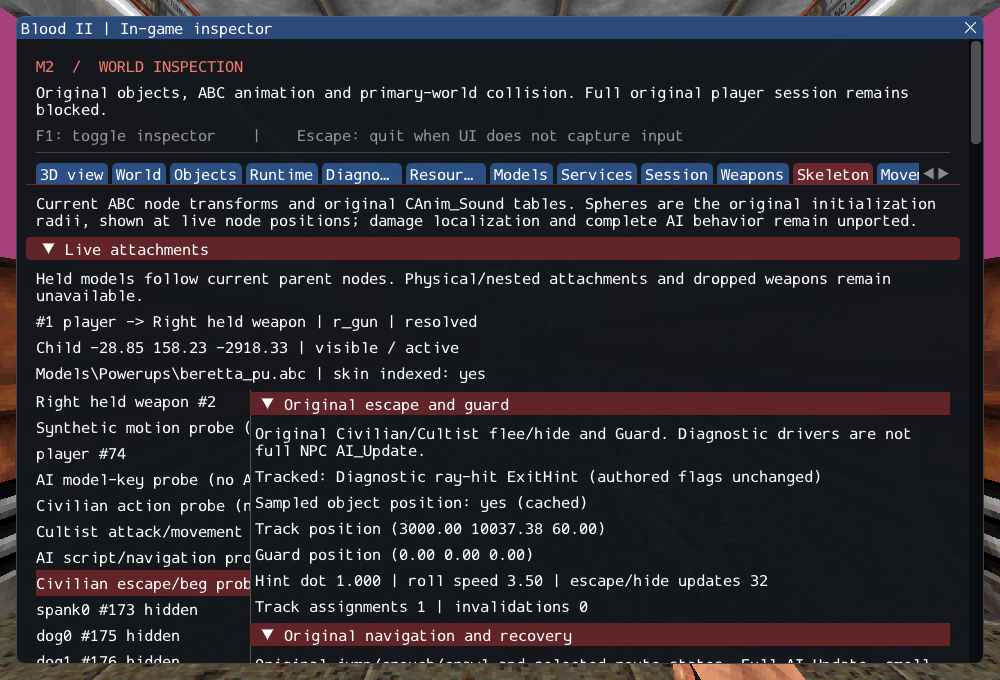

# M2 — Original AI escape, hiding and guard

2026-10-16. M2 remains **incomplete**. Original Cultist/Civilian Escape_RunAway and
Escape_Hide, AI_Mgr GuardLocation and MC_Taunt_Beg now execute through typed services.
No production NPC is registered. SubwayA remains 187 created / 4 transferred sounds /
372 editor-only / 17 unsupported / 0 failed source entries, plus seven SelfTriggers.

[Implementation](../../../src/game/original/AIEscape.cpp) retains class-specific
hint filters, current civilian versus cached Cultist dimensions, cached facing order,
source fallback states, guard perception/ledge sequencing and beg's lateral velocity.
Checked tracked-object identity preserves the original lack of an escape-owned link.
Missing clips/queries, stale objects, failed plans and nested/removing decisions
remain explicit failures. See [contracts](../../contracts/ai_escape_contracts.md)
and [source ledger](../sources/m2_ai_escape_sources.json).

The Skeleton inspector exposes track identity/sample availability, guard position,
hint dot, roll speed, phase/route and errors without driving simulation. The GPU
character scenario adds a real female-civilian ABC escaping toward an explicitly
ray-hit diagnostic ExitHint, then beginning the original beg animation. Hidden UI
and world reload assertions exercise normal clocks/motion and old-identity invalidation.
Its target, position, speed and schedule are diagnostic; authored marker flags and
world AI registration remain unchanged.

Ten synthetic cases cover both original classes, no fabricated marker visibility,
actual perception/path queries, current dimensions, cached facing, all escape/guard
phases, residual velocity, failed plans/animations, tracked versus target links,
impact-coordinate sampling and deferred/reentrant removal. A private six-model
catalog resolves TAUNT[6] for male/female Cultists (index 47), male/female civilians
and labtech (index 5). Gideon has no matching clip and must fail without a fallback.

GCC Debug: **458/458**, 172.53s. Inspector-free GCC Release:
**458/458**, 72.54s. Each contains 368 synthetic headless,
63 private headless and 27 serial GPU checks. Targeted Clang ASan/UBSan with leak
checks: **145/145**, 78.17s, including 18 private cases.
No final compiler, sanitizer or Vulkan finding was observed.

Commands from Blood2 (commercial paths stay in ignored local configuration):

```sh
cmake --build --preset debug -j4
ctest --test-dir build/debug --output-on-failure -j4
cmake --preset local-release
cmake --build --preset release -j2
ctest --test-dir build/release --output-on-failure -j4
cmake -S . -B build/sanitize
cmake --build build/sanitize -j2 --target ai_escape_tests ai_recovery_tests ai_locomotion_tests ai_fire_tests ai_script_tests ai_follow_tests ai_navigation_tests ai_trigger_tests ai_state_tests ai_target_tests path_manager_tests character_motion_tests object_contract_tests services_tests player_tests
ASAN_OPTIONS=detect_leaks=1:halt_on_error=1 UBSAN_OPTIONS=halt_on_error=1 \
  ctest --test-dir build/sanitize -R '^(objects|services|player|character_motion|paths|ai_target|ai_state|ai_fire|ai_trigger|ai_navigation|ai_follow|ai_script|ai_locomotion|ai_recovery|ai_escape)\.' --output-on-failure -j1
./build/debug/blood2 --inspect-player
./build/debug/blood2 --start-game
```

Player inspection exits 0; complete startup still exits 6 with required unsupported
services. All 10,923 inventoried reference files and six reference repositories
remain unchanged. Thirteen changed/new C++ files pass clang-format 23.1.3; local
Markdown links resolve. Linux Wayland/Vulkan on NVIDIA GeForce RTX 3060 Laptop
was exercised; other platforms, XR and retail gameplay/physics parity remain unverified.

The [execution ledger](evidence/m2-ai-escape.json) retains logs, hashes and the exact
project patch. [Reference preservation](evidence/m2-ai-escape-source-integrity.json)
and diagnostic inspection are retained:



Full NPC initialization, AI_Update/activation/retention, shade/smell/assist/pickup/
recoil/death states, required FX and ExitTrigger/session transitions remain open.
M3 remains the first original combat/scenario slice; M4 expands rendering fidelity.
