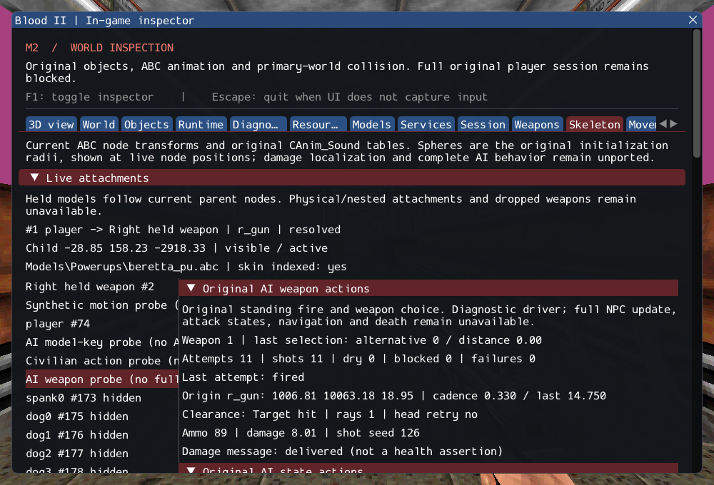

# M2 continuation: original AI weapon choice and standing fire

**Status: implemented bounded methods; M2 remains incomplete.** NPC weapon choice,
Beretta/knife aiming, clear-shot checks, standing-fire timing and model-key fire
now execute original rules through typed services. The NPC shot path also corrects
an existing error: player eye alignment was being applied to non-player owners.

The source's strict range/cadence boundaries, raw-AMMO_NONE selection quirk,
body-forward fallback, initial-miss/head-retry distinction, cached-head update,
dry acceptance and double Metacmd increment are preserved. Undefined switch-table
indexing and unavailable services fail explicitly. The inspector distinguishes
attempts, actual shots, ammo, damage delivery, blocked clearance and failures.
[Contracts](../../contracts/ai_fire_contracts.md) document adaptations and limits;
[source hashes/ranges](../sources/m2_ai_fire_sources.json) record provenance.

## Verification

Twelve new scenarios cover selection, clearance, liquid/glass filters, head retry,
gun/body aim and actual damage, model keys, strict cadence, blocked-size recovery,
inactive playback, malformed/missing services and callback removal. Four lifetime
cycles remove shooter and target during the first damage callback; later markers
do not fire and destruction occurs once. The existing Cabal state test now checks
both missing-inventory failure and successful initialized selection.

Six real NPC models are queried without editing assets: male/female Cultist pistol
clips are 500 ms and have no fire_key; civilian/labtech pistol clips are missing;
Gideon's mapped pistol clip is 2333 ms with one fire_key. This does not integrate
Gideon's weapon-specific aiming. Two five-second SubwayA runs drive a labelled
Cultist-model diagnostic against an original damage aggregate and verify shots,
health changes, completion and clean unload. The authored server camera blocks
all ten sound keys in each run, as in the source; this gate is asserted explicitly.
The runs deliver 18 and 19 shots, nine completed clips each, and reduce target
health from 1000 to 855.716 and 847.709 respectively. Production class accounting
is not changed by these test registrations.

The extended GPU character scenario runs the same original standing-fire command
while ImGui is hidden and after reload, using fresh actor/target identities and
real damage/ammo checks and actual sound starts without key failures. Existing
state/audio/target/sight/attachment checks remain.
The scheduler is explicitly diagnostic, not a substitute for original AI_Update.

GCC Debug: **384/384**, 169.0s. Inspector-free GCC Release:
**384/384**, 101.52s. Each contains 302 synthetic headless,
55 private headless and 27 serial GPU checks. Targeted Clang ASan/UBSan with leak
checks: **136/136**, sequential, 226.06s. No final compiler,
sanitizer or Vulkan validation finding was observed. A final focused GPU character
run also verifies final inspection wrapping and diagnostic audio assertions after
the full Debug run. The private SubwayA recheck asserts authored camera sound
suppression; the GPU probe checks actual sound starts.

Commands from Blood2 (private data path stays in ignored local configuration):

```sh
cmake --build --preset debug -j4
ctest --test-dir build/debug --output-on-failure -j4
cmake --preset local-release
cmake --build --preset release -j4
ctest --test-dir build/release --output-on-failure -j4
cmake -S . -B build/sanitize
cmake --build build/sanitize -j4
ASAN_OPTIONS=detect_leaks=1:halt_on_error=1 UBSAN_OPTIONS=halt_on_error=1 \
  ctest --test-dir build/sanitize -R '^(objects|services|weapons|player|locomotion|character|character_audio|character_motion|ai_keys|ai_sight|attachments|ai_target|ai_perception|ai_state|ai_fire)\.' --output-on-failure -j1
ctest --test-dir build/debug -R '^(gpu.character|ai_fire.subway)$' --output-on-failure
./build/debug/blood2 --inspect-player
./build/debug/blood2 --start-game
```

Player inspection exits 0; complete session startup still exits 6. Linux
Wayland/Vulkan on NVIDIA GeForce RTX 3060 Laptop was exercised; other platforms,
XR and retail behavior remain unverified. Thirteen changed/new C++ files pass
clang-format 23.1.3; documentation link targets were checked. All 10,923 inventoried
reference files and six reference repositories are unchanged.

The [execution ledger](evidence/m2-ai-fire.json) records logs, content hashes and
the exact project patch. The [source-integrity check](evidence/m2-ai-fire-source-integrity.json)
records preservation. The image shows a diagnostic actor only:



## Remaining gate

SubwayA retains **187 created, 4 transferred sounds, 372 editor-only,
17 unsupported, 0 failed** source entries, plus seven owned SelfTriggers.
Five CivilianAI, ten CultistAI, Gideon and ExitTrigger are still unsupported.

Next: original NPC initialization and complete AI_Update, required attack and
movement/navigation/death paths, then remaining client FX and exit/session
services. A working weapon command does not constitute a production NPC or the
M3 playable sequence. The [M2 acceptance criteria](../../history/Roadmap/03_milestones.md)
are unchanged. No dependency, reference repository or commercial asset changed.
