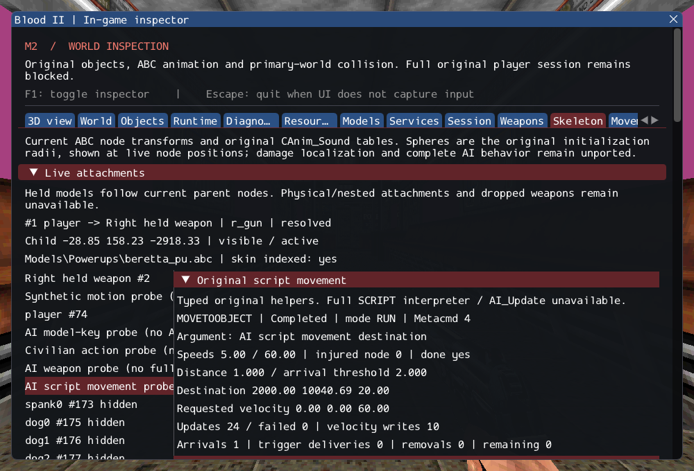

# M2 — Original scripted locomotion and route following

2026-10-16. M2 remains **incomplete**. This increment connects selected original
AI_Mgr velocity, Script_Walk/Run, SETMOVEMENT, FOLLOWPATH and MOVETOOBJECT helpers.
It does not register partial CivilianAI/CultistAI/Gideon classes or accept the full
SCRIPT trigger. SubwayA remains 187 created / 4 transferred sounds / 372 editor-only /
17 unsupported / 0 failed source entries, plus seven owned SelfTriggers.

## Implementation and preserved behavior

[AIScriptMovement.cpp](../../../src/game/original/AIScriptMovement.cpp) uses
[CMovement](../../contracts/ai_navigation_contracts.md) for cached transforms and
route calculation, [PathMgr](../../contracts/path_manager_contracts.md) for owned
authored points, existing target links and ordinary single-step collision physics.
The original logic is recorded in the [source ledger](../sources/m2_ai_follow_sources.json).
[Contracts](../../contracts/ai_follow_contracts.md) distinguish preserved rules
from safety adaptations.

Tests preserve cached-basis facing delay, exact velocity sentinel, unnormalized
signed scaling, trapped zero, weapon/injury clip selection and the first-call-only
injury slowdown. Path arrival ignores authored height, consumes at most one point
per update, triggers named/self actions, and completes on the next empty update.
MOVETOOBJECT retains its four-phase sequence and fresh final-target snap without
replanning an already calculated route. Arrival/completion does not implicitly stop
velocity. Full AI collision/navigation fidelity is not inferred from these rules.

Named actions snapshot identities across callbacks; removing a later recipient,
removing the owner and recursive updates are exercised. Message/string ownership
survives those cases and repeated unload. Failed path calculation never follows a
partial route. Missing animation/resize/opportunity-fire services are explicit
failures. The complete interpreter/update loop remains unavailable.

## Observable inspection and verification

The Skeleton panel shows command, mode, outcome, Metacmd, injury/speeds, destination,
arrival threshold, requested velocity, update/failure counts, consumed points,
trigger deliveries/removals and remaining owned action data. Historical source IDs
are checked and never used to execute routes. The GPU diagnostic has an independent
real Cultist model with original run animation and MOVETOOBJECT helper callbacks;
its isolated placement and missing interpreter are labelled. Hidden inspection and
reload use executable assertions, independent of UI rendering.

The focused headless suite covers velocity, locomotion, authored following, cached
orientation, named following, actions, callback lifetime, unavailable paths and
single physical integration with wall collision. Private tests resolve normal and
injured clips for six retail character models and use actual SubwayA spawn geometry
through two load/unload cycles. The private spawn test first leaves the player so
its solid volume does not overlap the diagnostic actor; it is a short local arrival
check, not proof of a full NPC route through the level.

The private animation matrix uses **pistol fire-type selection**; success is not
assumed for every model. Nine of 24 requests succeed. Cultist male/female select
walk/run 4/5, male civilian and labtech 2/4, female civilian walk 3 with no matching
run, and Gideon has neither matching pistol locomotion clip. All twelve selected
left/right injured pistol clips are absent. Tests require explicit failure for those
15 unavailable requests; they do not supply invented aliases or crawl fallback.
Other weapon columns and full class initialization are outside this matrix.

GCC Debug: **413/413**, 169.17s. Inspector-free GCC Release:
**413/413**, 99.49s. Each contains 327 synthetic headless,
59 private headless and 27 serial GPU checks. Targeted Clang ASan/UBSan with leak
checks: **88/88**, 61.32s, including 12 private cases.
A final Debug `gpu.character` run also passes after a display-only line-layout change.
No final compiler, sanitizer or Vulkan finding was observed.

Commands from Blood2 (private paths stay in ignored local configuration):

```sh
cmake --build --preset debug -j4
ctest --test-dir build/debug --output-on-failure -j4
cmake --preset local-release
cmake --build --preset release -j2
ctest --test-dir build/release --output-on-failure -j4
cmake -S . -B build/sanitize
cmake --build build/sanitize -j2 --target ai_follow_tests ai_navigation_tests ai_trigger_tests ai_state_tests ai_target_tests path_manager_tests character_motion_tests object_contract_tests services_tests player_tests
ASAN_OPTIONS=detect_leaks=1:halt_on_error=1 UBSAN_OPTIONS=halt_on_error=1 \
  ctest --test-dir build/sanitize -R '^(objects|services|player|character_motion|paths|ai_target|ai_state|ai_trigger|ai_navigation|ai_follow)\.' --output-on-failure -j1
./build/debug/blood2 --inspect-player
./build/debug/blood2 --start-game
```

Inspection exits 0; complete startup still exits 6 with explicit unsupported
requirements. All 10,923 inventoried reference files and six reference repositories
remain unchanged. Eight changed/new C++ files pass clang-format 23.1.3; local
Markdown links resolve. Linux Wayland/Vulkan on NVIDIA GeForce RTX 3060 Laptop
was exercised; other platforms, XR and retail gameplay/physics parity are unverified.

The new GPU movement probe runs alongside the existing fire probe after reload.
An initial sequential version extended scene time enough to expire the original
cintrig1 cinematic. Keeping both probes in the existing time window preserves the
original strict object/string count assertion; no tolerance was added. A diagnostic
count delta now identifies lifecycle mismatches. Touch-callback recursion is checked
after movement so a failed nested command cannot be overwritten as completion.

The [execution ledger](evidence/m2-ai-follow.json) records logs, hashes and the exact
project patch. [Reference preservation](evidence/m2-ai-follow-source-integrity.json)
and diagnostic inspection are retained:



## Remaining M2 work

Original MC_Walk/Run obstacle recovery and shade queries, full SCRIPT parsing and
dispatch, complete production NPC initialization/AI_Update/deactivation/death,
required client FX and ExitTrigger/session transitions remain unavailable. Required
unsupported calls still block normal complete startup. No acceptance criterion was
weakened and no dependency pin changed. Later M3 requires a real combat/scenario
slice; richer lighting/material fidelity remains M4 work.

Project implementation commit: `875b47087dedfaca6bf97e80104079d4af6968da`.
