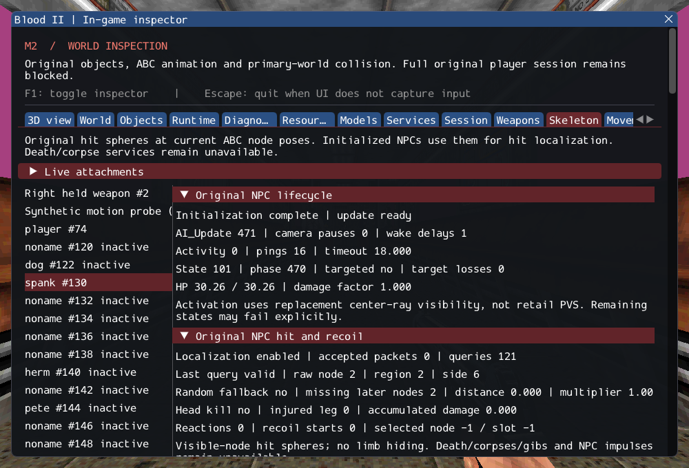

# M2 — Original NPC hit localization and recoil

Production CultistAI/CivilianAI now receive original CDestructable hit-region damage
and nonlethal AI_Mgr reactions. Current animated node poses and original hit spheres
select the region; damage updates armor/HP and original injured-leg state. Cultists
can enter the original recoil command and complete it through AI_Update. Civilians
retain the original subsequent EscapeRun override. The in-game Skeletons inspector
shows localization, damage/recoil history and failures for visible, hidden and
inactive actors.

[Contracts](../../contracts/ai_hit_contracts.md) and
[source ledger](../sources/m2_ai_hit_sources.json) separate preserved rules,
checked adaptations and unavailable services. No additional class/dependency is
introduced. The existing SDL/SDL_GPU/ImGui pins remain unchanged.

## Preservation details

- `DAMAGE_TYPE_NORMAL=0` makes the original random fallback apply to normal misses
  too. Inclusive raw draw 18 maps to -1, keeps half damage and skips the reaction.
- The original finite projected segment, closest strict tie, unscaled dimensions/
  fixed spheres and unwrapped yaw difference are retained. Missing later node names
  reuse the previous pose; missing head, duplicate names and invalid poses fail.
- Cabal neck hits set HP to zero before armor, even for zero incoming damage.
  Nonlethal limb damage is halved. Limp uses strict < half maximum health and
  latches only the first leg. Recoil compares the per-update damage accumulator
  against one quarter of remaining HP; noninterruptible scripts retain priority.
- Fire recoil draws raw node IDs without mapping. Unmatched nodes retain the
  current animation and still start a nonlooping recoil command. This does not
  implement fire weapons or burning effects.
- Refused/nested damage does not replay stale metadata. Damage-trigger removal
  cancels the reaction and destruction stays deferred. NPC update, animation and
  visibility activation remain independent of the inspector.

Current nodes are all visible; per-node hiding/dismemberment is unavailable. The
source corpse/drop/gib/death-effects branch is still missing: lethal damage leaves
zero HP and a suspended, inspectable failure. There is no successful fake death.
NPC impulses and later source classes/services remain pending.

## Verification

GCC Debug: **481/481**, 172.64s. Inspector-free GCC Release:
**481/481**, 38.12s. Each includes **386 synthetic headless,
68 private headless and 27 GPU** checks. Targeted Clang ASan/UBSan/leak checks:
**188/188**, 308.21s, including 26 private cases.
The nine added hit/recoil cases pass in all three configurations. A final inspector
wording correction was rebuilt and its GPU character check rerun in both
configurations; both pass. A Clang fixture
aggregate-initializer warning was corrected with explicit nested initialization;
the final rebuild is clean. No final sanitizer finding was reported.

Commands from Blood2 (commercial paths remain in ignored local configuration):

```sh
cmake --build build/debug -j4
cmake --preset local-release
cmake --build build/release -j2
ctest --test-dir build/debug --output-on-failure -j4
ctest --test-dir build/release --output-on-failure -j4
cmake -S . -B build/sanitize
cmake --build build/sanitize -j2 --target ai_hit_tests ai_runtime_tests ai_escape_tests ai_recovery_tests ai_locomotion_tests ai_fire_tests ai_script_tests ai_follow_tests ai_navigation_tests ai_trigger_tests ai_state_tests ai_target_tests ai_perception_tests path_manager_tests character_motion_tests object_contract_tests services_tests player_tests weapon_tests
ASAN_OPTIONS=detect_leaks=1:halt_on_error=1 UBSAN_OPTIONS=halt_on_error=1 \
  ctest --test-dir build/sanitize -R '^(objects|services|player|weapons|character_motion|paths|ai_target|ai_state|ai_fire|ai_trigger|ai_navigation|ai_follow|ai_script|ai_locomotion|ai_recovery|ai_escape|ai_perception|ai_runtime|ai_hit)\.' --output-on-failure -j1
./build/debug/blood2 --inspect-player
./build/debug/blood2 --start-game
```

Inspection exits 0; full startup still exits 6. All 10,923 inventoried reference
files and six reference repositories remain unchanged. Changed/new C++ files pass
clang-format 23.1.3; local Markdown links resolve. GPU runs are sequential across
configurations; only Linux/Wayland/Vulkan was exercised.

The [execution ledger](evidence/m2-ai-hit.json) retains test/build logs, reference
integrity and the exact committed project patch.



The focused synthetic tests cover every raw-to-region mapping, finite segment
endpoints, closest ties, tied/zero directions, normal random fallback/raw 18,
missing/duplicate/pending node outcomes, armor order/head kill, Fire packets,
strict limp and accumulator thresholds, SCRIPT interruption, Teleport/Dodge,
all twelve recoil slots/completion, unmatched fire draws, phase overflow,
refused packets and synchronous nested/removing damage-trigger callbacks.

Private tests instantiate male/female Cultists and Civilians with external assets,
apply actual typed nonlethal torso damage, and drive production Cultist AI_Update
until the real recoil animation completes. A real visibility ping wakes each
actor after its source first-update automatic deactivation; tests do not bypass
that state. Civilian post-base EscapeRun is checked. All four models lack the two
ankle names; these are explicit prior-transform fallbacks, not pose successes.
Removal releases inventory/attachments/messages and class memberships.

The existing GPU character smoke now also localizes a diagnostic torso query on
an authored production NPC while inspection is hidden and after reload. It does
not inflict damage or alter authored flags; successful queries are separately
labelled from accepted damage. The full GPU suite retains all existing scene,
texture, animation, lifetime and reload assertions.

## M2 remains incomplete

SubwayA accounting stays **202 created + 4 transferred world sounds + 372 editor-only
+ 2 unsupported (Gideon/ExitTrigger) = 580**, with no creation failures. Required
death/corpse/drop/gib behavior, client FX and remaining session/state services
still block the actual M2 exit gate. The earlier no-player self-target boundary
is unchanged. User-reported pink train glass and manual-spawn input trouble remain
recorded for later work; neither is claimed fixed here. Other platforms and retail
randomness/physics parity remain unverified.
