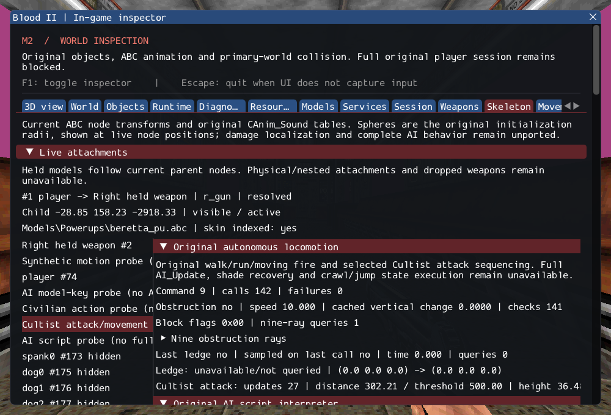

# M2 — Original autonomous locomotion and Cultist attack states

2026-10-16. M2 remains **incomplete**. This increment adds the original obstacle
and ledge queries, four movement commands and Cultist close/far attack sequencing.
It does not register production NPCs or replace the full original AI_Update.
SubwayA stays 187 created / 4 transferred sounds / 372 editor-only / 17 unsupported /
0 failed source entries, plus seven owned SelfTriggers.

## Implementation

[AILocomotion.cpp](../../../src/game/original/AILocomotion.cpp) preserves source
velocity/vertical obstruction thresholds, nine-ray row/column flags, recovery branch
priority, false-on-throttle ledge results, cached facing, injury/support speed rules
and moving-fire cadence. [CultistAttack.cpp](../../../src/game/original/CultistAttack.cpp)
connects close/far phases to existing facing, weapon choice, standing/moving fire
and state decisions. [Contracts](../../contracts/ai_locomotion_contracts.md) and
[source selections](../sources/m2_ai_locomotion_sources.json) record the exact
boundary and safety adaptations.

Queries and commands use existing typed collision/support, animation and inventory
services. They do not add a second motion integrator. A blocked resize can select
CrawlUnder, but its unported state execution still fails. The source's shade-based
FindPosAroundObj branch likewise remains an explicit failure. No successful stub,
arbitrary avoidance point or production registration closes these gaps.

## Observable evidence

The Skeleton inspector shows the last command, obstruction velocity/vertical change,
all nine ray endpoints/results and checked hit identities, ledge timing and Cultist
attack distances/thresholds. It reads state without advancing it. The existing GPU
probe now drives an original close-attack cycle followed by moving fire against a
real damage receiver. It uses a real Cultist ABC, normal model clocks and physics,
with assertions while the inspector is hidden and after unload/reentry. Its isolated
placement and scheduler remain explicitly diagnostic.

Ten synthetic tests exercise threshold equality, cached vertical motion, self-first
hits, world/body rays, recovery precedence, ledge throttle, grounded/gravity and injury
rules, one motion integration, real resize blocking versus missing clips, strict
shot cadence, independent fire_key/timed shots, double completion increments,
callback removal/reentrancy and close/far attack range boundaries. A same-tick
retry after failed ledge collision remains a failure; only a completed query
consumes its throttle interval. The private
catalog attempts four movement clips on each of six original NPC models; missing
fire clips fail without substitution. All twelve walk/run selections and the four
Cultist moving-fire selections succeed. The eight civilian/labtech/Gideon pistol
moving-fire selections report missing clips, as their original tables require.

GCC Debug: **433/433**, 172.16s. Inspector-free GCC Release:
**433/433**, 101.34s. Each contains 345 synthetic headless,
61 private headless and 27 serial GPU checks. Targeted Clang ASan/UBSan with leak
checks: **120/120**, 75.61s, including 16 private cases.
No final compiler, sanitizer or Vulkan finding was observed.

Commands from Blood2 (commercial paths stay in ignored local configuration):

```sh
cmake --build --preset debug -j4
ctest --test-dir build/debug --output-on-failure -j4
cmake --preset local-release
cmake --build --preset release -j2
ctest --test-dir build/release --output-on-failure -j4
cmake -S . -B build/sanitize
cmake --build build/sanitize -j2 --target ai_locomotion_tests ai_fire_tests ai_script_tests ai_follow_tests ai_navigation_tests ai_trigger_tests ai_state_tests ai_target_tests path_manager_tests character_motion_tests object_contract_tests services_tests player_tests
ASAN_OPTIONS=detect_leaks=1:halt_on_error=1 UBSAN_OPTIONS=halt_on_error=1 \
  ctest --test-dir build/sanitize -R '^(objects|services|player|character_motion|paths|ai_target|ai_state|ai_fire|ai_trigger|ai_navigation|ai_follow|ai_script|ai_locomotion)\.' --output-on-failure -j1
./build/debug/blood2 --inspect-player
./build/debug/blood2 --start-game
```

Player inspection exits 0; complete startup still exits 6 with required unsupported
services. All 10,923 inventoried reference files and six reference repositories
remain unchanged. Nine changed/new C++ files pass clang-format 23.1.3; local Markdown
links resolve. Linux Wayland/Vulkan on NVIDIA GeForce RTX 3060 Laptop was exercised;
other platforms, XR and retail gameplay/physics parity remain unverified.

The [execution ledger](evidence/m2-ai-locomotion.json) retains logs, hashes and the exact
project patch. [Reference preservation](evidence/m2-ai-locomotion-source-integrity.json)
and diagnostic inspection are retained:



## Remaining M2 gate

NPC production initialization, the complete AI_Update including activation/visibility
pings and target retention, remaining navigation/recoil/death actions, shade recovery,
required client FX and ExitTrigger/session transitions are still absent. The next
increment must integrate those real prerequisites. No test-only driver changes the
observable acceptance criteria. M3 remains the original combat/scenario slice and
M4 the broader rendering fidelity work.
