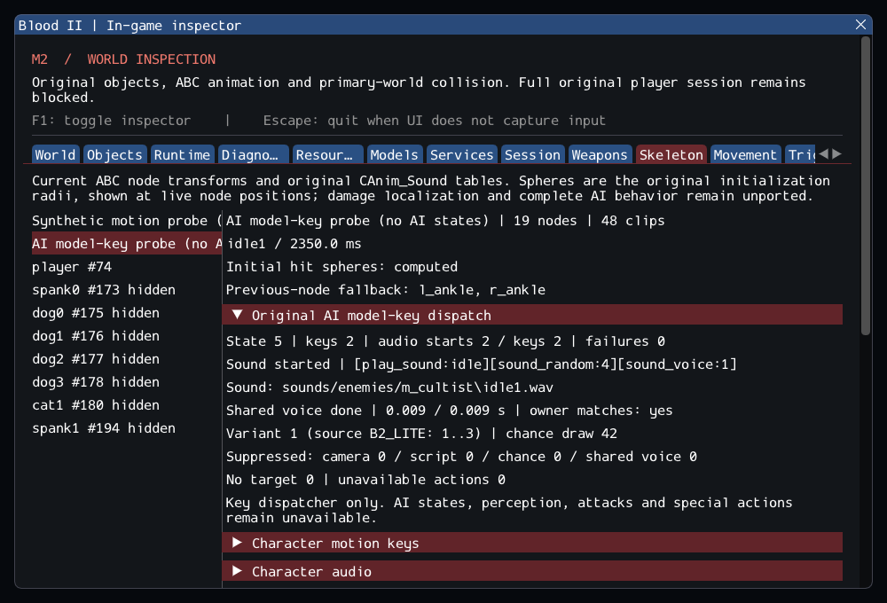

# M2 continuation — original AI animation-key audio

M2 remains incomplete. Selected original AI_Mgr::InitStatics and OnStringKey now
execute animation sound markers through the existing decoded WAV/SDL audio path.
The integration preserves source branch priority, camera/script suppression,
B2_LITE's three variants, chance-draw ordering and shared class/gender voice
ownership. See [contracts](../../contracts/ai_model_key_contracts.md) and
[source selections](../sources/m2_ai_model_key_sources.json).

The six required NPC models contain **147 actual keys**. This traversal starts
**140 decoded sounds**, finds six fire markers without targets and reports Gideon's
one extra action as unavailable. No sound lookup/decoder failure occurred in this
seeded traversal. Clips are exercised independently with audio advanced between
them; this is neither complete variant coverage nor AI gameplay simulation.
No production NPC class is registered to claim completion prematurely.

The original show_weapon branch reads an uninitialized buffer; it remains an
explicit unavailable operation. Bounded parsing, checked identities and shared
ownership replace unsafe buffers and borrowed lifetimes. Existing motion, player
sound and model callback ordering remain intact. The GPU inspector labels its
extra character **AI model-key probe (no AI states)**, plays an unchanged male
cultist clip, requires another actual key while hidden, and verifies fresh
playback/identity after reload. Existing synthetic motion, player footsteps,
locomotion and node assertions remain in the same scenario.

## Validation

Commands from Blood2:

```sh
cmake --preset local-debug
cmake --build --preset debug -j4
ctest --preset debug --output-on-failure -j4
cmake --preset local-release
cmake --build --preset release -j3
ctest --preset release --output-on-failure -j4
cmake -S . -B build/sanitize -G Ninja -DCMAKE_BUILD_TYPE=Debug \
  -DCMAKE_C_COMPILER=clang -DCMAKE_CXX_COMPILER=clang++ \
  -DBLOOD2_INSPECTOR=OFF -DBLOOD2_SANITIZERS=ON -DBLOOD2_GPU_TESTS=OFF \
  -DBLOOD2_TEST_DATA_DIR="/home/yann/.steam/steam/steamapps/common/Blood II/"
cmake --build build/sanitize -j2
ASAN_OPTIONS=detect_leaks=1:halt_on_error=1 UBSAN_OPTIONS=halt_on_error=1 \
  ctest --test-dir build/sanitize -L headless --output-on-failure -j1
```

GCC Debug passed **300/300** in **139.29s**. GCC Release without ImGui
passed **300/300** in **85.21s**. Clang ASan/UBSan/leak checks passed
**277/277 headless sequentially** in **593.42s**, without findings.
The suite contains 238 synthetic headless, 39 private headless and 23 serial GPU
cases. Final builds are warning-free; eight changed/new C++ files pass clang-format
23.1.3. The 10,923 reference files and six reference repositories are unchanged.
--inspect-player succeeds; --start-game still exits 6. The GPU capture was reviewed.

The inspector shows two real idle keys, two actual sound starts, no dispatch
failures, the source variant/chance values and a completed shared voice cursor.
The clip's decoded sound is very short (about 9 ms in this captured case); no
claim of audible device playback is made. Hidden dispatch, fresh reload and old
identity invalidation pass along with the existing player and motion assertions.

Logs, source comparisons, integrity, patch and hashes are retained in the
[evidence ledger](evidence/m2-ai-model-keys.json).
Blood2 commit: `951708a90568cad0bfcc6795168a9b77cb211b3d`.



The unchanged SubwayA gate is **187 created source entries, 4 transferred world
sounds, 372 editor-only, 17 unsupported and zero failed**, plus 7 SelfTriggers.
Runtime counts remain 194/197 before/after player, then 185/188 after nine Keys.
Five CivilianAI, ten CultistAI, Gideon and ExitTrigger instances are still missing.
AI states, hearing, aiming/fire/extra, attachments and required client FX keep
M2 incomplete; --start-game still exits 6. M3–M8 remain planned. No retail binary,
other-platform, headset or audible-device equivalence is claimed.
