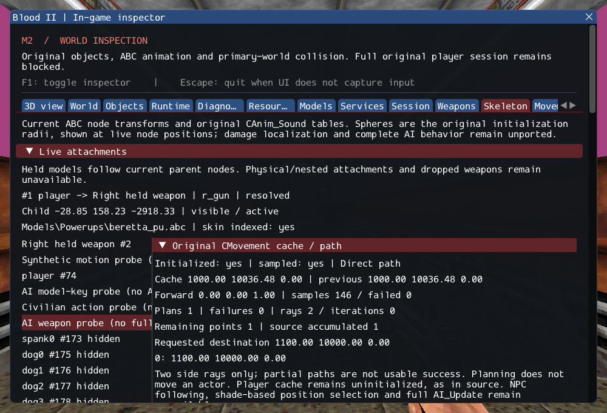

# M2 continuation: original navigation cache and obstacle paths

**CMovement is integrated; M2 remains incomplete.** Characters now own the original
movement aggregate. Explicitly initialized diagnostic actors sample transforms
through original callback forwarding and calculate source-style obstacle detours
using typed collision services. Paths, partial failures and work limits are visible
in the in-game inspector. This supplies a dependency for future NPC actions; it
does not make characters follow paths or register the missing production NPCs.

Read the [contracts](../../contracts/ai_navigation_contracts.md) and
[source hashes/ranges](../sources/m2_ai_navigation_sources.json). The original
two-side-ray algorithm, right-side preference, extra turn offsets, zero range after
a missed lateral ray and retained partial failures are preserved. The adapter adds
checked lifetime, defined initial samples, bounded work and value-owned points.
It does not claim swept-body route clearance or retail physics parity.

Project commit: `270fb8868f8d80e4376fb6cf974a60e37dcdb7f4` (baseline `f71a2d390234e383d4bc38c52eaefd7df7128d5a`).

## Verification

Nine scenarios cover aggregate sample ordering/inactivity, direct paths and output
ownership, exact synthetic detour coordinates, right-before-left clearance, central
obstacles intentionally missed by the source algorithm, character/glass/container
filter separation, full versus primary-only infinite rays, invalid/missing services,
retained partial paths, optional consolidation, bounded long searches, four repeated
creation/removal cycles with 1,000 consumed paths each, and two private SubwayA cycles.
A real cultist ABC is loaded for the private diagnostic at the player spawn, and a
one-unit destination is checked against actual level geometry. This is local
clearance evidence, not a production NPC navigation test.

The existing GPU character case also verifies the new cache and direct planning
outside UI, with hidden inspection and reload, alongside prior original hearing,
standing fire, animation, audio and damage checks. Existing assertions remain.

GCC Debug: **402/402**, 172.26s. Inspector-free GCC Release:
**402/402**, 35.19s. Each contains 318 synthetic headless,
57 private headless and 27 serial GPU checks. Targeted Clang ASan/UBSan with leak
checks: **162/162**, 271.77s, including 27 private cases.
No final compiler, sanitizer or Vulkan finding was observed.

Commands from Blood2 (private paths remain in ignored local configuration):

```sh
cmake --build --preset debug -j4
ctest --test-dir build/debug --output-on-failure -j4
cmake --preset local-release
cmake --build --preset release -j2
ctest --test-dir build/release --output-on-failure -j4
cmake -S . -B build/sanitize
cmake --build build/sanitize -j2 --target ai_navigation_tests ai_trigger_tests ai_fire_tests ai_model_key_tests ai_perception_tests ai_sight_tests ai_state_tests ai_target_tests attachment_tests character_animation_tests character_audio_tests character_motion_tests locomotion_tests object_contract_tests player_tests services_tests weapon_tests sprite_tests
ASAN_OPTIONS=detect_leaks=1:halt_on_error=1 UBSAN_OPTIONS=halt_on_error=1 \
  ctest --test-dir build/sanitize -R '^(objects|services|weapons|player|locomotion|character|character_audio|character_motion|ai_keys|ai_sight|attachments|ai_target|ai_perception|ai_state|ai_fire|ai_trigger|ai_navigation|sprites)\.' --output-on-failure -j1
./build/debug/blood2 --inspect-player
./build/debug/blood2 --start-game
```

Inspection exits 0; complete startup remains blocked with exit 6. All 10,923
inventoried reference files and six reference repositories are unchanged. Twelve
changed/new C++ files pass clang-format 23.1.3; local Markdown link targets were
checked. Linux Wayland/Vulkan on NVIDIA GeForce RTX 3060 Laptop was exercised.
Other platforms, XR and retail physics/gameplay parity remain unverified.

The [execution ledger](evidence/m2-ai-navigation.json) records logs, hashes and the exact
project patch. [Reference preservation](evidence/m2-ai-navigation-source-integrity.json)
and diagnostic inspection are retained:



## Remaining gate

SubwayA still has **187 created, 4 transferred sounds, 372 editor-only, 17 unsupported,
0 failed**, plus seven SelfTriggers. The unsupported entries are five CivilianAI,
ten CultistAI, Gideon and ExitTrigger. Full NPC initialization/AI_Update, activity
and visibility services, moving/attack/death states, path following, shade-based
position selection and required FX remain incomplete. Existing AI helpers continue
using their documented current-transform adaptations. Save/restore is unavailable.
No source repository, commercial asset or dependency pin is changed.
