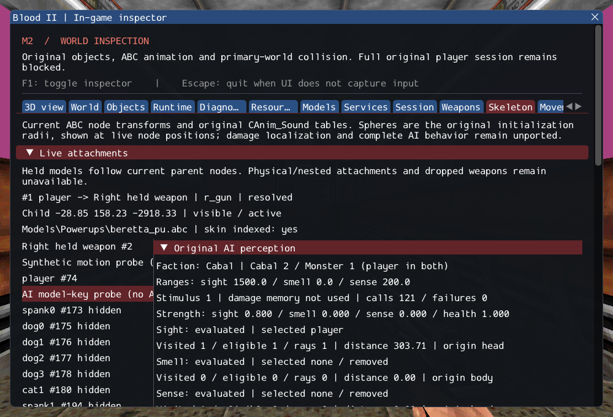

# M2 — Original AI perception and target acquisition

M2 remains **incomplete**. The original faction candidate lists, radius search,
stimulus computation and opportunity selection now execute, with checked object
lifetime and in-game inspection. The real player enters both original faction
lists. The small original ExitHint class is registered; it is distinct from the
still-missing ExitTrigger. No incomplete NPC is counted as a created world object.
See [contracts](../../contracts/ai_perception_contracts.md),
[source selections](../sources/m2_ai_perception_sources.json) and
[the unchanged M2 gate](../../history/Roadmap/03_milestones.md#m2--connect-world-session-and-gameplay-services).

## Implemented behavior

FindObjectInRadius retains original list order, nearest/tie behavior, head-origin
range checks, forward-hemisphere tests, player invisibility filtering and CanSee
body/head rays. Sense ignores obstruction and invisibility. Smell, ammo and ExitHint
queries use their original lists. Current checked poses replace MoveObj snapshots.
The typed selector avoids registering an incomplete AI base as a world class.

ComputeStimuli preserves query order, sight-over-sense-over-smell priority, body
rather than head distances for strengths, the zero-strength override, health ratio,
and the absence of a second-nearest retry for dead targets. Smell does not become
a combat target. Accepted ordinary damage records an AI attacker identity for the
source's retaliation priority. ChooseOpportunityTarget preserves its weapon guard
and sight-only rule; neither command executes an attack or a state machine.

All lists unlink on destruction and immediately skip pending handles. Last-attacker
memory uses a checked non-owning identity, avoiding the original shared directed-link
conflict. Undefined original specific+avoid calculations, coincident normalization
and non-character attacker casts produce explicit errors. Required query failures
are distinguishable from an empty result. No unavailable service returns fabricated
success. Timed-power activation storage/query is imported for invisibility checks;
collection, timers, fading, resets and saving remain pending.

The Skeleton panel reports ranges/factions, stimuli, query counts/selected identities,
animated-head origins and failures even when a model is missing. It does not query
or advance gameplay while drawing. The existing GPU character probe now acquires
the actual player before facing it, including while hidden and after reload.
The probe is explicitly diagnostic, not a replacement for an authored NPC.

## Verification

GCC Debug: **361/361**, 166.48s. Inspector-free GCC Release:
**361/361**, 99.34s. Each full suite contains 283 synthetic headless,
51 private headless and 27 serial GPU cases. Full Clang ASan/UBSan with leak
checks: **334/334 headless**, sequential, 628.41s. No final compiler,
sanitizer or Vulkan validation findings were observed. The final inspector wording
correction was rebuilt and its GPU scenario rerun successfully after the full
Debug suite; all gameplay changes were present in that full run.

Commands run from Blood2 (private root in ignored local configuration):

```sh
cmake --build --preset debug -j4
ctest --test-dir build/debug --output-on-failure -j4
cmake --preset local-release
cmake --build --preset release -j4
ctest --test-dir build/release --output-on-failure -j4
cmake -S . -B build/sanitize
cmake --build build/sanitize -j4
ASAN_OPTIONS=detect_leaks=1:halt_on_error=1 UBSAN_OPTIONS=halt_on_error=1 \
  ctest --test-dir build/sanitize -L headless --output-on-failure -j1
ctest --test-dir build/debug -R '^gpu.character$' --output-on-failure
./build/debug/blood2 --inspect-player
./build/debug/blood2 --start-game
```

Player inspection exits 0; full startup still exits 6. Tests ran on Linux,
Wayland/Vulkan with the NVIDIA GeForce RTX 3060 Laptop GPU. Other platforms and XR
were not tested. The 10,923 inventoried reference files and six reference repositories
are unchanged; external commercial resources were not copied. Twelve changed/new
C++ files pass clang-format 23.1.3, and local Markdown targets were checked.
[Execution ledger](evidence/m2-ai-perception.json) retains logs, hashes, source comparison
and the project patch. Blood2 commit: `2b2096495668d166a27981d5cccf9e5fdf506dee`. Dependencies and shaders remain pinned and unchanged.



Eleven new cases cover faction/player membership and teardown, nearest/tie and
reversed specific-class matching, exact-side FOV, obstruction/invisibility, original
hint/ammo list order and scent expiration, strength/priority boundaries, dead targets,
retaliation, opportunity weapon guards, failed services/invalid inputs and repeated
unload. Private cases sample 240 animation midpoints across six NPC models without
advancing clocks, and run two SubwayA player leave/re-entry cycles. Existing suites
exercise the same player/damage aggregates and deferred lifecycle.

## Remaining gate

SubwayA stays at 187 created, four transferred sounds, 372 editor-only,
17 unsupported and zero failed, plus seven owned SelfTriggers. Those 17 source
entries remain five CivilianAI, ten CultistAI, Gideon and ExitTrigger. AI_Update,
state/action transitions, navigation, auditory alerts and Fire still need original
integration, alongside required client FX and exit/session services. M2 is open;
M3's playable combat slice and M4–M8 remain subsequent milestones.
