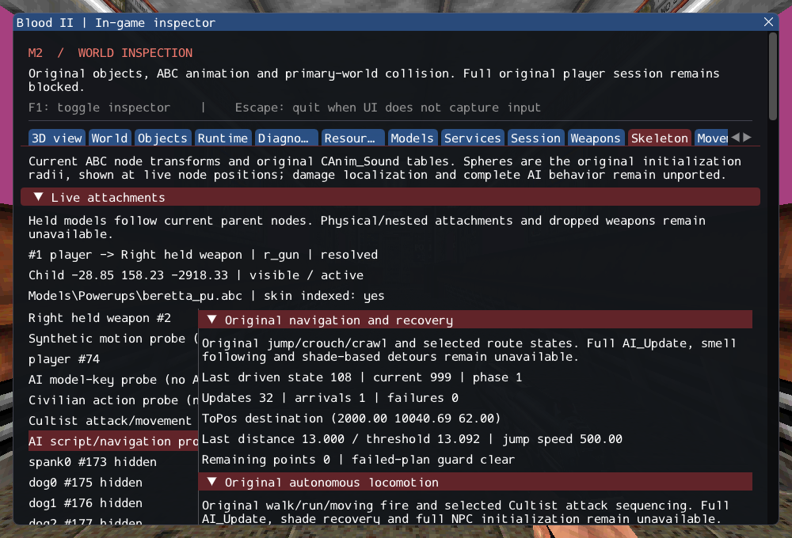

# M2 — Original AI recovery and navigation states

2026-10-16. M2 remains **incomplete**. Original jump/crouch/crawl, firing crawl,
JumpOver/CrawlUnder, Walk/RunToPos, Walk/RunAroundObj and SearchVisualTarget now
execute through existing typed services. No production NPC is registered; SubwayA
remains 187 created / 4 transferred sounds / 372 editor-only / 17 unsupported /
0 failed source entries, plus seven owned SelfTriggers.

[Commands](../../../src/game/original/AILocomotion.cpp) retain cached velocity,
landing completion, source clip selection and firing cadence.
[Navigation states](../../../src/game/original/AINavigationStates.cpp) retain
actual perception, side-ray clearance, path phases, one-point arrival and ledge
short circuits. Failed planning is latched so old/partial points cannot be followed
on a subsequent call. The original shade-dependent detour service remains an
explicit failure. [Contracts](../../contracts/ai_recovery_contracts.md) and
[source selections](../sources/m2_ai_recovery_sources.json) distinguish
source rules from checked failure and replacement-physics adaptations.

The Skeleton inspector exposes current/driven state, destination, phase, point,
arrival threshold, jump speed and errors without driving simulation. The existing
real-ABC script GPU probe now continues through RunToPos and returns to Inactive;
hidden and world reload assertions retain script completion and add navigation
completion. Its explicit placement/driver is diagnostic, not production AI_Update.
An initial graphics run exposed a verification-harness timing error: after reload,
the independent route had no failures but was still running when the shot-only
probe completed. Starting it alongside the earlier key/state checks fixes that
scheduling mismatch without changing route length, speed, completion assertions or
the authored scene's elapsed test clock.

Thirteen synthetic tests cover jump support versus playback completion, a real
gravity arc, crouch side effects, blocked resize, crawl recovery overwrite, firing
cadence/markers, callback removal/reentrancy, cached arrival, final-point ledge
short circuit, failed-plan retry, real perception/clearance and search's repeated
ledge query. A private catalog attempts the four clips on six original NPC models;
missing clips must fail, with no invented fallback. All eight selections on male
and female Cultists succeed (clips 6/7/8/15). The sixteen pistol-type selections on
male/female civilians, Labtech and Gideon report absent original clips. This does
not claim that those classes should attempt these commands in production.

GCC Debug: **447/447**, 172.45s. Inspector-free GCC Release:
**447/447**, 99.55s. Each contains 358 synthetic headless,
62 private headless and 27 serial GPU checks. Targeted Clang ASan/UBSan with leak
checks: **134/134**, 78.88s, including 17 private cases.
No final compiler, sanitizer or Vulkan finding was observed.

Commands from Blood2 (commercial paths stay in ignored local configuration):

```sh
cmake --build --preset debug -j4
ctest --test-dir build/debug --output-on-failure -j4
cmake --preset local-release
cmake --build --preset release -j2
ctest --test-dir build/release --output-on-failure -j4
cmake -S . -B build/sanitize
cmake --build build/sanitize -j2 --target ai_recovery_tests ai_locomotion_tests ai_fire_tests ai_script_tests ai_follow_tests ai_navigation_tests ai_trigger_tests ai_state_tests ai_target_tests path_manager_tests character_motion_tests object_contract_tests services_tests player_tests
ASAN_OPTIONS=detect_leaks=1:halt_on_error=1 UBSAN_OPTIONS=halt_on_error=1 \
  ctest --test-dir build/sanitize -R '^(objects|services|player|character_motion|paths|ai_target|ai_state|ai_fire|ai_trigger|ai_navigation|ai_follow|ai_script|ai_locomotion|ai_recovery)\.' --output-on-failure -j1
./build/debug/blood2 --inspect-player
./build/debug/blood2 --start-game
```

Player inspection exits 0; complete startup still exits 6 with required unsupported
services. All 10,923 inventoried reference files and six reference repositories
remain unchanged. Nine changed/new C++ files pass clang-format 23.1.3; local Markdown
links resolve. Linux Wayland/Vulkan on NVIDIA GeForce RTX 3060 Laptop was exercised;
other platforms, XR and retail gameplay/physics parity remain unverified.

The [execution ledger](evidence/m2-ai-recovery.json) retains logs, hashes and the exact
project patch. [Reference preservation](evidence/m2-ai-recovery-source-integrity.json)
and diagnostic inspection are retained:



NPC initialization, full AI_Update/activation/target retention, smell/escape/recoil/
death, shade recovery, required FX and ExitTrigger/session transitions remain open.
M3 is still the first original combat/scenario slice; M4 expands rendering fidelity.
