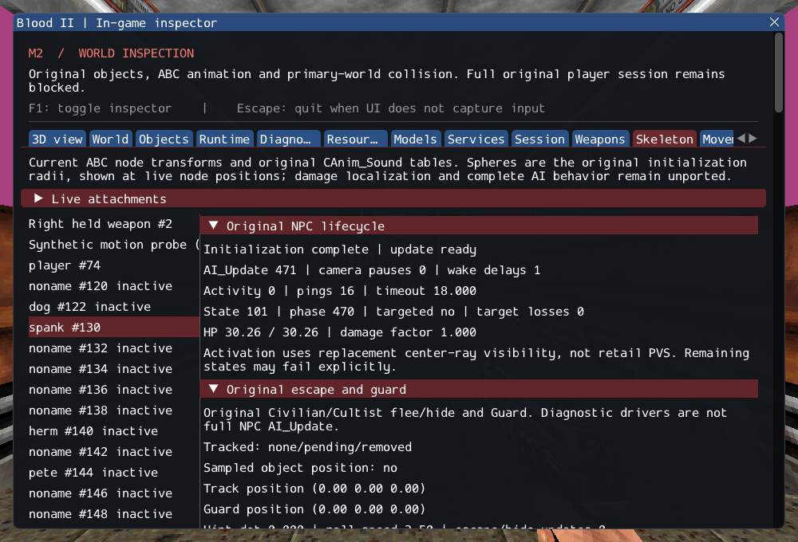

# M2 — Original Cultist/Civilian lifecycle and AI_Update

The production class registry now creates CultistAI and CivilianAI from original
world properties. Initialization selects original models/skins, shared animation
and sound tables, inventory/stats, scaling, placement and scheduling. AI_Update
connects automatic activation, camera restrictions, target retention, current
track sampling and the previously integrated state/action bodies. Source SCRIPT
messages and civilian trigger/damage branches are connected. The inventory aggregate
updates held weapons; lifecycle state and failures are inspectable in game.

[Contracts](../../contracts/ai_runtime_contracts.md) distinguish source rules from
replacement engine services and deliberate failure handling. [Source ledger](../sources/m2_ai_runtime_sources.json)
records donor ranges and hashes. No dependency update, reference edit or commercial
asset import is involved.

SubwayA now creates all ten authored CultistAI and five CivilianAI: **202 live-created
source entries, 4 transferred sounds, 372 editor-only, 2 unsupported and 0 failed**,
plus seven owned SelfTriggers. Gideon and ExitTrigger remain unsupported. Counts
of generated inventory/weapon children are distinct from source entries.

## Observable behavior

Two fresh SubwayA sessions enter the original player before stepping and exercise
all fifteen authored NPCs for 600 ticks at 1/60 s. Each records 207 AI_Update calls
and seven visibility pings with every NPC still ready. Runtime counts are 224
before player entry, 227 after entry and 229 after the first tick (nine consumed
Keys, ten NPC held models and the player's held model); eleven attachments remain.

A separate synthetic-floor arena uses a production CultistAI, real external models,
original player and normal scheduling. Across 600 ticks it records 522 AI_Update
calls, 25 Beretta shots and player health reduced to zero. This verifies acquisition,
state dispatch, animation fire keys and damage together; it is not retail-level
combat or death-sequence acceptance. Ten synthetic lifecycle/service cases plus
four private cases cover activation/occlusion/wake timing, camera restrictions,
checked targets, callback removal/reentry, support/friction, property/model
initialization, difficulty, rollback, reload and shared-table isolation.

There is a reproduced no-player boundary: stepping SubwayA before player entry
suspends three NPCs. The original empty-enemy-list fallback searches their own
faction, sensing selects self, and the checked target/link service refuses a
self-link. The nested reason is shown in the inspector and asserted by the world
regression. Delayed player entry does not revive these failed actors; resolving
this boundary remains future work. Missing state bodies also suspend explicitly.

The populated GPU view now includes fifteen NPC models and ten held weapons. The
long smoke checks keep their 240-frame/event/hidden/reload assertions and allow
45 seconds internally (60 seconds CTest) instead of 15/30; Debug previously expired
while deforming this larger scene. This is a wall-time allowance, not a performance
claim. The character smoke checks real authored NPC updates while the inspector is
hidden, then reloads and verifies the old identity is invalidated.

The three-cycle private weapon regression also includes the full intro and NPC
population. Its isolated Clang ASan/UBSan/leak run passes in 139.85 seconds, exceeding
the former 90-second test timeout. Only sanitizer configurations receive a 240-second
wall budget for that test; all simulation frames, fire assertions and teardown
checks remain unchanged. Ordinary Debug/Release retain 90 seconds.

## Verification

GCC Debug: **472/472**, 203.42s. Inspector-free GCC Release:
**472/472**, 103.83s. Each contains 378 synthetic headless,
67 private headless and 27 serial GPU checks. Targeted Clang ASan/UBSan with leak
checks: **179/179**, 289.43s, including 25 private cases.
No final compiler, sanitizer or Vulkan validation finding was observed.

Commands from Blood2 (commercial paths stay in ignored local configuration):

```sh
cmake --build --preset debug -j4
ctest --test-dir build/debug --output-on-failure -j4
cmake --preset local-release
cmake --build --preset release -j2
ctest --test-dir build/release --output-on-failure -j4
cmake -S . -B build/sanitize
cmake --build build/sanitize -j2 --target ai_runtime_tests ai_escape_tests ai_recovery_tests ai_locomotion_tests ai_fire_tests ai_script_tests ai_follow_tests ai_navigation_tests ai_trigger_tests ai_state_tests ai_target_tests ai_perception_tests path_manager_tests character_motion_tests object_contract_tests services_tests player_tests weapon_tests
ASAN_OPTIONS=detect_leaks=1:halt_on_error=1 UBSAN_OPTIONS=halt_on_error=1 \
  ctest --test-dir build/sanitize -R '^(objects|services|player|weapons|character_motion|paths|ai_target|ai_state|ai_fire|ai_trigger|ai_navigation|ai_follow|ai_script|ai_locomotion|ai_recovery|ai_escape|ai_perception|ai_runtime)\.' --output-on-failure -j1
./build/debug/blood2 --inspect-player
./build/debug/blood2 --start-game
```

Player inspection exits 0; complete startup still exits 6 with two uninstantiated
source entries and remaining required services. All 10,923 inventoried reference
files and six reference repositories remain unchanged. 46 changed/new C++ files
pass clang-format 23.1.3; local Markdown links resolve. Linux Wayland/Vulkan on
NVIDIA GeForce RTX 3060 Laptop was exercised; other platforms, XR and retail
randomness/activation/physics parity remain unverified.

The [execution ledger](evidence/m2-ai-runtime.json) retains logs, hashes and the exact
project patch. [Reference preservation](evidence/m2-ai-runtime-source-integrity.json)
and diagnostic inspection are retained:



M2 remains incomplete. Registration and a working update loop do not implement
remaining recoil/death and other missing state bodies, required model keys/client
FX, Gideon or exit/session services. Failed actions suspend visibly; they do not
pretend to succeed. Automatic activation uses actual center-ray visibility rather
than the still-unread retail PVS; the documented collision/friction/resize solver
remains a replacement requiring gameplay comparison.

## User observations retained for later work

Reported on 2026-10-16, without changing this increment's priority:

- First-level train window material appears pink. Missing/unsupported material is
  a hypothesis, not a verified cause; reproduce and inspect the exact resource later.
- Player spawning shows the intro and then the player, but direct movement does
  not work in the user's session. Movement through full-screen inspector buttons
  works. Reproduce launch mode, input capture and camera/player gates before
  diagnosing; no input/UI/material fix is claimed here.

The [interactive entry correction](m2_npc_entry.md) now holds application simulation until player entry, preventing the reproduced pre-player NPC suspension. Raw diagnostic stepping retains that boundary; broader combat and M2 remain incomplete.
