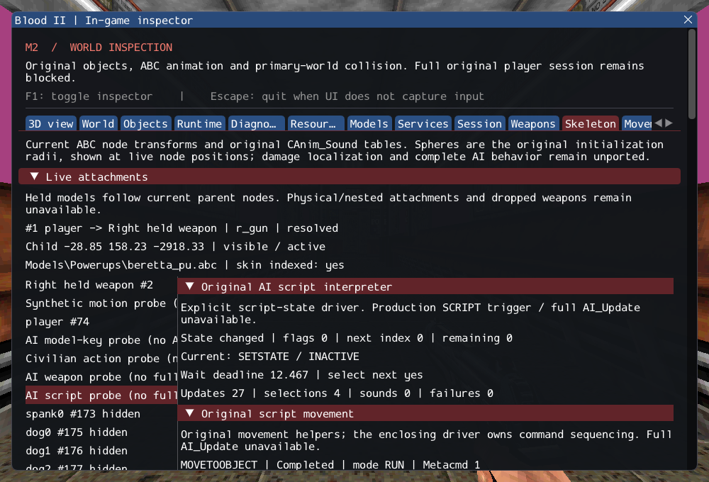

# M2 — Original AI script preparation and state interpreter

2026-10-16. M2 remains **incomplete**. This increment implements the original
script instruction list and AI_STATE_Script on the existing typed movement,
animation, target/state and audio services. No production NPC class is registered.
SubwayA remains 187 created / 4 transferred sounds / 372 editor-only / 17 unsupported /
0 failed source entries, plus seven owned SelfTriggers.

## Implementation

[AIScript.cpp](../../../src/game/original/AIScript.cpp) preserves original
command selection, loop index wrapping/nonloop consumption, next-update cadence,
integer waits, real one-shot sounds, animation completion, state/target selection
and FOLLOWPATH/MOVETOOBJECT dispatch. [Contracts](../../contracts/ai_script_contracts.md)
and the [source ledger](../sources/m2_ai_script_sources.json) distinguish
original rules from checked storage/lifetime adaptations.

WAIT retains atoi-prefix semantics (`1.9` means one second). PLAYANIMATIONLOOPING
starts the clip then falls through to ComputeState because the original state
switch has no matching case. An explicit/unknown DONE invokes the decision twice;
list exhaustion invokes it once. Tests preserve these quirks. Missing decision
logic, clips, path queries or sounds remain failures; failed side effects are not
replayed. Malformed replacement text leaves stored commands/state intact and latches
an inspectable failure until explicit valid preparation.

The original SCRIPT trigger also forces AI_Update, which includes missing common
activation/retention/services. It therefore remains rejected. PrepareScript and
AI_STATE_Script are explicit prerequisites and diagnostic entry points, not a
shortcut that accepts a partial production update. Existing complete startup
refusal and class accounting remain unchanged.

## Observable evidence

The Skeleton inspector now shows current/remaining instructions, flags/cursor,
deadline, update/selection/audio counts and failures before movement details.
The existing real Cultist-model probe executes SETMOVEMENT, MOVETOOBJECT, WAIT and
SETSTATE with normal animation/collision clocks; assertions cover hidden inspection
and a second load. Its fixed isolated placement is labelled diagnostic. No extra
scene time or relaxed object-count assertion is introduced.

Eight synthetic tests cover parsing, sequencing, loops/waits, animation clocks and
fallthrough, targets/state changes, collision movement, callback removal/reentrancy
and PCM audio. Private validation parses all six authored SubwayA script properties:
12 instructions and zero rejections. Six real character models each finish their
first `idle1` clip before the scripted state change. This does not prove authored
scripts execute in the still-unported NPCs or establish retail physics parity.

GCC Debug: **422/422**, 171.24s. Inspector-free GCC Release:
**422/422**, 100.15s. Each contains 335 synthetic headless,
60 private headless and 27 serial GPU checks. Targeted Clang ASan/UBSan with leak
checks: **97/97**, 61.43s, including 13 private cases.
No final compiler, sanitizer or Vulkan finding was observed.

Commands from Blood2 (private paths stay in ignored local configuration):

```sh
cmake --build --preset debug -j4
ctest --test-dir build/debug --output-on-failure -j4
cmake --preset local-release
cmake --build --preset release -j2
ctest --test-dir build/release --output-on-failure -j4
cmake -S . -B build/sanitize
cmake --build build/sanitize -j2 --target ai_script_tests ai_follow_tests ai_navigation_tests ai_trigger_tests ai_state_tests ai_target_tests path_manager_tests character_motion_tests object_contract_tests services_tests player_tests
ASAN_OPTIONS=detect_leaks=1:halt_on_error=1 UBSAN_OPTIONS=halt_on_error=1 \
  ctest --test-dir build/sanitize -R '^(objects|services|player|character_motion|paths|ai_target|ai_state|ai_trigger|ai_navigation|ai_follow|ai_script)\.' --output-on-failure -j1
./build/debug/blood2 --inspect-player
./build/debug/blood2 --start-game
```

Inspection exits 0; complete startup still exits 6 with explicit unsupported
requirements. All 10,923 inventoried reference files and six reference repositories
remain unchanged. Seven changed/new C++ files pass clang-format 23.1.3; local
Markdown links resolve. Linux Wayland/Vulkan on NVIDIA GeForce RTX 3060 Laptop
was exercised; other platforms, XR and retail gameplay/physics parity are unverified.

Lifetime cases cover path callbacks and virtual exit decisions that attempt to
replace an executing script. Nested failure remains latched through the enclosing
callback. Test-owned PathPoint strings are checked after world unload, while
message counts are checked immediately after callback teardown. Real-model tests
rebuild their synthetic collision fixture after unload before requesting resize;
this does not bypass the required collision service.

The [execution ledger](evidence/m2-ai-script.json) records logs, hashes and the exact
project patch. [Reference preservation](evidence/m2-ai-script-source-integrity.json)
and diagnostic inspection are retained:



## Remaining M2 gate

Production initialization, complete AI_Update/deactivation/target retention,
autonomous attack/death actions, shade/opportunity-fire movement services, required
client FX and ExitTrigger/session transitions remain missing. Script parsing and
diagnostic execution do not close the gate. M3 still requires the original-code
combat/scenario slice; richer lighting/material fidelity remains M4 work.
