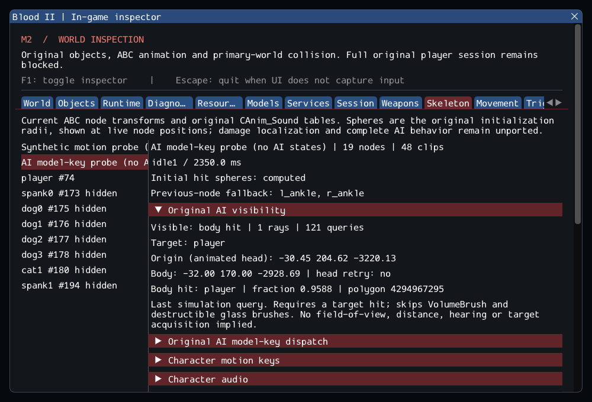

# M2 continuation — original AI visibility

M2 remains incomplete. Selected AI_Mgr::CanSee now queries current animated head
poses and the existing collision engine. The source's body-first/head-retry order
and GlobalFilterFn volume/destructible-glass rules are preserved. See the
[contracts](../../contracts/ai_sight_contracts.md) and
[source ledger](../sources/m2_ai_sight_sources.json).

Solid objects and FLAG_RAYHIT objects are eligible. Blood II's flag declaration
and the later engine's intersection callback establish that exception to ignoring
nonsolid objects; other ray callers keep their existing selection modes.

A ray must hit the target. A miss does not trigger the head retry; an obstruction
does, provided the target has a readable head node. The filter skips all
VolumeBrush descendants, including non-liquids, and destructible glass brushes.
It does not skip doors, indestructible glass, wooden FireThrough brushes or glass
polygons in the primary world. Missing collision and invalid identities are
separate failures, never successful visibility.

This adds a real original query, not NPC target acquisition or a state machine.
The observer-position fallback uses current engine state in place of the unported
MoveObj aggregate snapshot. Ray geometry remains the documented replacement
solver, with object AABBs rather than skeletal hit spheres. No retail timing,
ray-edge, other-platform or XR equivalence is claimed.

## Verification

Commands from Blood2:

```sh
cmake --preset local-debug
cmake --build --preset debug -j4
ctest --preset debug --output-on-failure -j4
cmake --preset local-release
cmake --build --preset release -j3
ctest --preset release --output-on-failure -j4
cmake -S . -B build/sanitize -G Ninja -DCMAKE_BUILD_TYPE=Debug \
  -DCMAKE_C_COMPILER=clang -DCMAKE_CXX_COMPILER=clang++ \
  -DBLOOD2_INSPECTOR=OFF -DBLOOD2_SANITIZERS=ON -DBLOOD2_GPU_TESTS=OFF \
  -DBLOOD2_TEST_DATA_DIR="/home/yann/.steam/steam/steamapps/common/Blood II/"
cmake --build build/sanitize -j2
ASAN_OPTIONS=detect_leaks=1:halt_on_error=1 UBSAN_OPTIONS=halt_on_error=1 \
  ctest --test-dir build/sanitize -L headless --output-on-failure -j1
```

GCC Debug passed **315/315** in **153.88s**; inspector-free GCC
Release passed **315/315** in **82.98s**. Clang ASan/UBSan/leak
checks passed **292/292 headless sequentially** in **602.86s**,
without findings. The suites contain 250 synthetic headless, 42 private headless
and 23 serial GPU cases. Final builds are warning-free and 11 changed/new C++
files pass clang-format 23.1.3. The 10,923 reference files and six reference
repositories remain unchanged. --inspect-player succeeds; --start-game retains exit 6.

The private catalog covers **240 animation midpoints** across six real NPC models.
The GPU capture was reviewed: the last query starts at the animated cultist head
and hits the actual player after movement. Hidden queries and fresh identities
after reload pass alongside the pre-existing audio/motion assertions.

Logs, source comparisons, patch and hashes are retained in the
[evidence ledger](evidence/m2-ai-sight.json).
Blood2 commit: `b79cb21ff5eac8e74a635664220c3728dd170a40`.



Synthetic tests cover direct and head-only visibility, missing heads, inactive and
nonsolid targets, original material/class filtering, primary-world obstruction,
invalid/removed handles, unavailable collision and three unload cycles. The new
fixtures initially lacked the model object type and supplied a brush-only property
to a ladder; those fixtures were corrected before final validation. Production
fallback rules and collision expectations were not relaxed.

The private catalog samples the midpoint of every animation in six real NPC
models against a controlled solid target, without advancing tracks or dispatching
keys. Two SubwayA cycles use a cultist-model diagnostic probe at the entered
player's position. These tests prove current-pose/query integration, not the
positions or perception behavior of unported authored NPCs.

The existing GPU skeleton scenario reads the last visibility record for its
explicitly labelled AI model-key probe. Queries run while ImGui is hidden and
against fresh identities after reload. The capture exposes the observer head,
target body, actual hit and source filters. Earlier audio, character motion and
player assertions remain in place. No extra runtime probe was added.

SubwayA accounting stays **187 live-created source entries, four transferred world
sounds, 372 editor-only, 17 unsupported and zero failed**, plus seven SelfTriggers.
Required CivilianAI, CultistAI, Gideon and ExitTrigger instances remain missing.
Range/FOV, target acquisition, navigation/actions, attacks, attachments and required
FX/services keep --start-game blocked with exit 6. M3–M8 remain planned.
