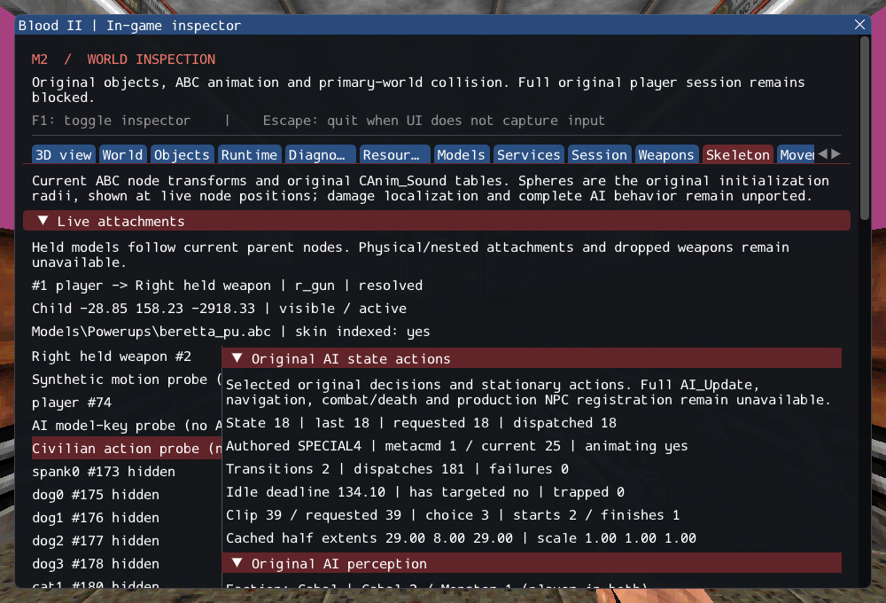

# M2: original AI state decisions and stationary actions

Project commit: `7f2c1a644716e297fda3904c47d630d1c9079d73`.

M2 remains **incomplete**. Selected original CivilianAI and CultistAI decision
rules now execute with AI_Mgr transitions, animation selection and stationary
commands. This prepares real NPC integration; it does not make the 16 authored
NPCs supported or close the playable-session gate.

## Implemented and inspected

- Original state names/numbers, 120-second idle delay, last-state exclusions,
  command reset and trapped/vertical velocity rules.
- Cultist health/sight/height decisions and source EscapeRun fallthrough;
  civilian authored-state, scared latch and hide retention.
- Original idle/talk/special animation commands, source command-ID sharing and
  completion behavior, plus civilian idle and eight special action handlers.
- Explicit failure for missing actions, tables/clips, bad identities and failed
  perception; blocked shape changes leave the body and playback intact.
- Read-only in-game inspection of current/previous/requested state, command steps,
  deadlines, clip requests, starts/completions, dimensions and failure reasons.

The existing atomic foot-anchored resize replaces the old SetObjectDims2. That is
a documented engine adaptation, not a claim of original collision parity. No new
dependency, ECS, duplicated physics integrator or commercial asset is introduced.
Source rules and all limits are specified in
[the service contract](../../contracts/ai_state_contracts.md) and
[source ledger](../sources/m2_ai_state_sources.json).

## Verification

Eleven new scenarios cover transitions, prefix parsing, commands, shape clearance,
subclass decisions, civilian actions, scheduled dispatch, failed services and
lifetime, plus private catalog/session checks. The lifetime scenario includes
removal during the first animation key with deferred destruction and no second
key callback. The private catalog exercises 240 clips across six real NPC models
and 19 available special slots; absent slots fail. Two SubwayA action runs each
advance 16 seconds, allowing the real 7.533-second subway clip to finish normally.

The existing GPU character scenario additionally runs a labelled female-civilian
SPECIAL4 action probe: real animation completion/restart while ImGui is hidden,
then fresh identity and successful execution after reload. The isolated diagnostic
scheduler is not the original AI_Update and does not count as a world NPC.

GCC Debug: **372/372**, 167.74s. Inspector-free GCC Release:
**372/372**, 101.71s. Each suite contains 292 synthetic headless,
53 private headless and 27 serial GPU checks. Targeted Clang ASan/UBSan with leak
checks: **115/115 headless** (AI, characters, player/locomotion, attachments and
object/model services), sequential, 137.77s. No final compiler,
sanitizer or Vulkan validation findings were observed.

Commands run from Blood2 (external content root in ignored local configuration):

```sh
cmake --build --preset debug -j4
ctest --test-dir build/debug --output-on-failure -j4
cmake --preset local-release
cmake --build --preset release -j4
ctest --test-dir build/release --output-on-failure -j4
cmake -S . -B build/sanitize
cmake --build build/sanitize -j4
ASAN_OPTIONS=detect_leaks=1:halt_on_error=1 UBSAN_OPTIONS=halt_on_error=1 \
  ctest --test-dir build/sanitize -R '^(objects|services|player|locomotion|character|character_audio|character_motion|ai_keys|ai_sight|attachments|ai_target|ai_perception|ai_state)\.' --output-on-failure -j1
./build/debug/blood2 --inspect-player
./build/debug/blood2 --start-game
```

Player inspection exits 0; complete startup remains blocked with exit 6. Linux
Wayland/Vulkan on NVIDIA GeForce RTX 3060 Laptop was checked; other platforms,
XR and retail behavior were not. All 10,923 inventoried reference files and six
reference repositories remain unchanged. Eleven changed/new C++ files pass
clang-format 23.1.3; local documentation targets were checked. Commercial assets,
dependency revisions and shaders are unchanged.

The [execution ledger](evidence/m2-ai-state.json) retains logs, hashes and the exact
project patch. [Source integrity](evidence/m2-ai-state-source-integrity.json) records
the reference checks. The capture shows a diagnostic action instance only:



## Remaining M2 gate

SubwayA source accounting remains **187 created, 4 transferred sounds,
372 editor-only, 17 unsupported, 0 failed**, with seven generated SelfTriggers.
Five CivilianAI, ten CultistAI, Gideon and ExitTrigger remain unsupported.

Next work still needs the complete original NPC initialization/update path,
weapon choice, movement/navigation, attacks, damage/death reactions and scripts,
as well as required client FX and exit/session behavior. Perception and selected
state methods are reusable implementations; they are not substitutes for these
missing services. No unsupported action has been turned into a successful stub.
The [observable M2 criteria](../../history/Roadmap/03_milestones.md) remain unchanged.
