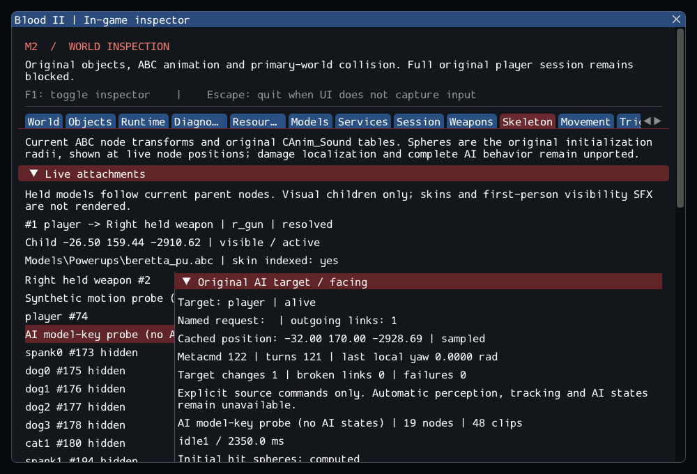

# M2 — Original explicit AI target links and facing

M2 remains **incomplete**. This increment integrates the original AI_Mgr explicit
named-target/link and facing commands, with checked lifetime, pose failures and
in-game inspection. It prepares the missing NPC implementations; diagnostic
probes do not count as authored CivilianAI, CultistAI or Gideon instances.
See [contracts](../../contracts/ai_target_contracts.md),
[source selections](../sources/m2_ai_target_sources.json) and
[the unchanged exit gate](../../history/Roadmap/03_milestones.md#m2--connect-world-session-and-gameplay-services).

## Implemented behavior

- Original SetNewTarget link ownership, SetTarget first named match and its
  compensating Metacmd decrement. Same-target assignment does not refresh position;
  missing names retain the previous target. Targets are independent objects.
- Original MC_FaceTarget/MC_FacePos stored-position and local-up yaw behavior.
  Explicit position sampling selects one statement from AI_Update, not its state
  machine. Pitched/rolled actors retain the source rotation convention.
- Target MID_LINKBROKEN clears the identity through the existing deferred callback
  chain. Checked identities replace unsafe direct target writes; rejected new links
  retain the previous target. Invalid/coincident directions and counter overflow
  fail without claiming a completed turn.
- GetObjectPos has a typed result for invalid identities/unresolved attachments.
  Target samples and CanSee check it instead of querying a zero fallback as a real
  position. Earlier callers may still ignore it, preserving existing output behavior.
- Inspector target/lifetime, cached position, local-yaw/command and error records,
  available for hidden/inactive/missing models. GPU checks execute target/facing
  commands outside the UI and verify fresh identity after world reload.

Current checked transforms replace the unported MoveObj aggregate's cached
transform. No timing, retail engine enumeration, physics or full NPC equivalence
is claimed. Autonomous perception/target retention, track/smell links, AI state
transitions, scripts, navigation and attacks are still unavailable.

## Verification

Commands from Blood2 (private data paths remain in ignored local configuration):

```sh
cmake --preset local-debug
cmake --build --preset debug -j4
ctest --test-dir build/debug --output-on-failure -j4
cmake --preset local-release
cmake --build --preset release -j4
ctest --test-dir build/release --output-on-failure -j4
cmake -S . -B build/sanitize
cmake --build build/sanitize -j4
ASAN_OPTIONS=detect_leaks=1:halt_on_error=1 UBSAN_OPTIONS=halt_on_error=1 \
  ctest --test-dir build/sanitize -L headless --output-on-failure -j1
```

GCC Debug passed **332/332** in **140.87s**; inspector-free GCC
Release passed **332/332** in **83.33s**. Clang ASan/UBSan/leak
checks passed **309/309 headless sequentially** in **612.12s**,
without findings. Each complete non-sanitized suite includes 263 synthetic headless,
46 private headless and 23 serial GPU cases. The 12 changed/new C++ files pass
clang-format 23.1.3; final builds are warning-free. The 10,923 inventoried reference
files and six reference repositories are unchanged. --inspect-player exits 0;
--start-game retains the required exit 6.

The reviewed GPU capture shows the real player as the probe's live target, exactly
one outgoing link, a sampled position, command/turn counts and zero target failures.
Hidden simulation and fresh identity after reload pass with and without ImGui.
Logs, source comparisons, patch and hashes are retained in the
[evidence ledger](evidence/m2-ai-target.json). Blood2 commit: `c1b35c80c12d396c6c602c51b66c24a6c56ea19b`.



Nine new behavioral tests cover named/duplicate/case selection; cached versus
refreshed positions and command counts; cardinal, tilted, vertical and inactive
facing; invalid handles/names/numbers/counter limits; failed link/list/rotation
services; unresolved attachment poses; deferred/reentrant callbacks and repeated
unload. Existing model-key tests now exercise real linked target removal.

Private tests sample 240 animation midpoints across six actual NPC models,
checking that facing does not advance clocks or emit model keys. Two SubwayA
cycles exercise player departure/re-entry, target callback clearing, new identity
binding and complete world teardown. Synthetic service traces are retained with
the test output; no private assets are committed.

The GPU scenario checks the explicit target's current horizontal direction and
one engine link while hidden, plus original animation/audio/held-model checks.
The inspector-free build uses the same simulation checks. This is controlled
command execution, not an autonomous enemy selecting or chasing the player.

## Remaining gate

SubwayA remains 187 live-created source entries, four transferred world-owned
sounds, 372 editor-only, 17 unsupported and zero failed, plus seven SelfTriggers.
The 17 missing entries are five CivilianAI, ten CultistAI, Gideon and ExitTrigger.
A default player still adds one held Beretta child on its first inventory update.
Required client FX and other original services remain unavailable; --start-game
must continue to exit 6. M3–M8 remain later milestones; no M2 criterion is relaxed.
