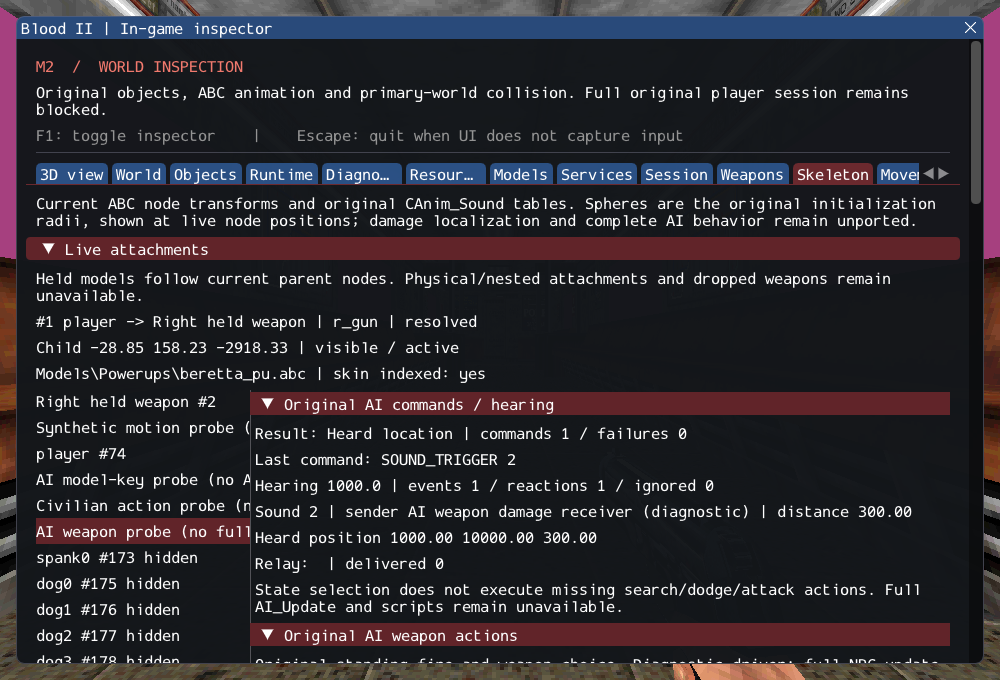

# M2 continuation: original AI commands and hearing

**Implemented bounded source paths; M2 remains incomplete.** Original AI trigger
commands now connect state/target selection, animation, real WAV playback and named
relay. Original sound broadcasts reach both faction lists; player playback attempts
send notifications even when the sound file is missing. The inspector distinguishes
message deliveries, ignored sounds, actual reactions and failures.

[Contracts](../../contracts/ai_trigger_contracts.md) document preserved boundary,
ordering and source quirks, checked lifetime and explicit unsupported scripts.
[Source hashes/ranges](../sources/m2_ai_trigger_sources.json) record provenance.

## Verification

Nine new scenarios exercise hearing boundaries, the original reversed gunfire class
check, impact guards, state/target command early returns, malformed input, recursive
relay, two-faction broadcasts, callback removal, real synthetic WAV/ABC playback,
player alerts after failed sound attempts and two real SubwayA load/unload cycles.
The prior character-audio tests now require successful alert processing rather than
an unavailable-service counter. Existing assertions on audible playback remain.
The GPU character case also verifies the original hearing transition while the UI
is hidden and after reload, alongside the previous weapon/damage checks.

GCC Debug: **393/393**, 168.65s. Inspector-free GCC Release:
**393/393**, 101.91s. Each contains 310 synthetic headless,
56 private headless and 27 serial GPU checks. Targeted Clang ASan/UBSan with leak
checks: **145/145**, 230.64s, including 24 private cases.
After the full Debug run, strict integer sound-radius validation and single failure
counting were refined; **19/19** final Debug hearing/audio checks pass in
4.99s. Release and sanitizer suites include these final refinements.
No final compiler, sanitizer or Vulkan finding was observed.

Commands from Blood2 (private paths stay in ignored local configuration):

```sh
cmake --build --preset debug -j4
ctest --test-dir build/debug --output-on-failure -j4
ctest --test-dir build/debug -R '^(ai_trigger\.|character_audio\.)' --output-on-failure -j4
cmake --preset local-release
cmake --build --preset release -j2
ctest --test-dir build/release --output-on-failure -j4
cmake -S . -B build/sanitize
# Build the 16 executable targets selected by the sanitizer test expression.
cmake --build build/sanitize -j2 --target ai_trigger_tests ai_fire_tests ai_model_key_tests ai_perception_tests ai_sight_tests ai_state_tests ai_target_tests attachment_tests character_animation_tests character_audio_tests character_motion_tests locomotion_tests object_contract_tests player_tests services_tests weapon_tests
ASAN_OPTIONS=detect_leaks=1:halt_on_error=1 UBSAN_OPTIONS=halt_on_error=1 \
  ctest --test-dir build/sanitize -R '^(objects|services|weapons|player|locomotion|character|character_audio|character_motion|ai_keys|ai_sight|attachments|ai_target|ai_perception|ai_state|ai_fire|ai_trigger)\.' --output-on-failure -j1
./build/debug/blood2 --inspect-player
./build/debug/blood2 --start-game
```

Inspection exits 0; complete startup still exits 6. Two private SubwayA cycles
record two hearing reactions each, one delivered message per player sound attempt,
including the deliberate missing WAV, and zero alert failures. All 10,923 inventoried
reference files and six reference repositories are unchanged. Ten changed/new C++
files pass clang-format 23.1.3. Local Markdown targets were checked. Linux
Wayland/Vulkan on NVIDIA GeForce RTX 3060 Laptop was exercised; other platforms,
XR and retail parity remain unverified.

The [execution ledger](evidence/m2-ai-triggers.json) records logs, hashes and the exact
project patch. [Reference preservation](evidence/m2-ai-triggers-source-integrity.json)
and the diagnostic capture are retained:



## Remaining gate

SubwayA remains **187 created, 4 transferred sounds, 372 editor-only, 17 unsupported,
0 failed**, plus seven SelfTriggers. Five CivilianAI, ten CultistAI, Gideon and
ExitTrigger remain unsupported. Required NPC initialization/AI_Update, deactivation
and visibility, navigation, scripts, death, attack states and client FX still block
complete session startup. This increment does not claim that selecting SearchVisual
or Dodge executes either action. Automatic weapon sound/impact callers are still
unported. No reference repository or commercial resource is modified.
