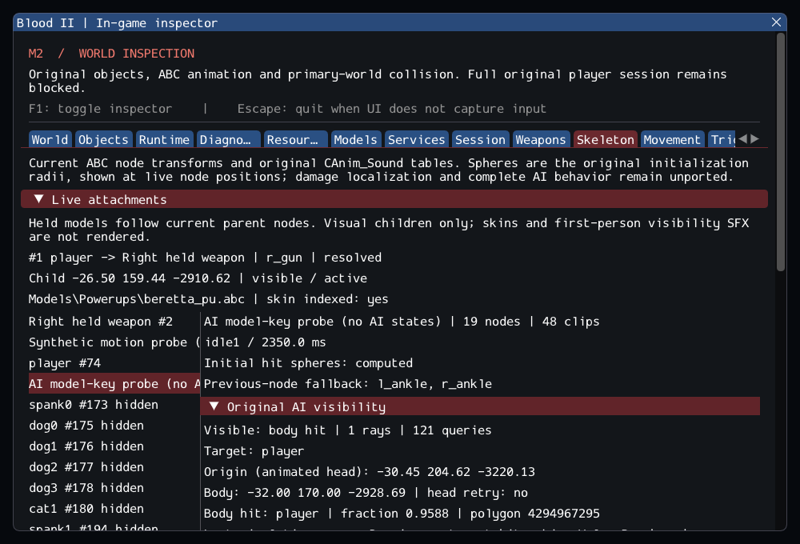

# M2 — Original held weapons and attachment transforms

M2 remains **incomplete**. This increment connects the original held Beretta/knife
paths to actual animated parent-node transforms, with checked lifetime and inspection.
The selected world still lacks 17 required source objects and other required services.
See [contracts](../../contracts/attachment_contracts.md),
[source provenance](../sources/m2_attachment_sources.json) and
[the unchanged exit gate](../../history/Roadmap/03_milestones.md#m2--connect-world-session-and-gameplay-services).

## Implemented behavior

- Original CWeapon ShowHandModel/CreateHandModel/destruction, selected inventory
  current-hand and switch behavior, and player dead-hand removal. Both hands use
  original WeaponData paths and optional handheld clips. Missing r_gun/l_gun uses
  the source's origin attachment and hidden request.
- Typed CreateAttachment/RemoveAttachment/FindAttachment and attached node queries;
  copied names/offsets, shared current-node sampling, one-level visual children and
  monotonically allocated IDs. Child geometry follows simulation with UI hidden.
- Safe independent removal and deferred original ownership, slot changes, death,
  entry/selection resource preflight and world unload. The engine does not own an
  attached child merely because a relation exists.
- Skeleton inspection of all live relations, identities, node/fallback, actual
  position, resolution, activity/visibility and model/skin resources. The existing
  graphical skeleton scenario checks hidden updates and identity invalidation.

The source's unsafe precreate-to-update fallthrough is intentionally excluded;
the first scheduled held-model update applies its visibility request. Child/raw
weapon back-pointers become checked identities. The replacement engine supports
visual attachments only and explicitly rejects independent physical motion,
chains and duplicate ownership. Original dropped weapon physics/pickup spawning,
client hand-visibility SFX, server view-model objects and save/restore are pending.

## Validation

Commands from Blood2 (private paths are in ignored local presets/cache):

```sh
cmake --preset local-debug
cmake --build --preset debug -j 4
ctest --test-dir build/debug --output-on-failure -j 4
cmake --preset local-release
cmake --build --preset release -j 4
ctest --test-dir build/release --output-on-failure -j 4
cmake --build build/sanitize -j 4
ASAN_OPTIONS=detect_leaks=1:halt_on_error=1 UBSAN_OPTIONS=halt_on_error=1 \
  ctest --test-dir build/sanitize -L headless --output-on-failure -j1
```

GCC Debug passed **323/323** in **141.49s**; inspector-free GCC
Release passed **323/323** in **83.24s**. Clang ASan/UBSan/leak
checks passed **300/300 headless sequentially** in **616.85s**,
without findings. The suites contain 256 synthetic headless, 44 private headless
and 23 serial GPU cases. Final builds are warning-free and 34 changed/new C++
files pass clang-format 23.1.3. The 10,923 reference files and six reference
repositories remain unchanged. --inspect-player succeeds; --start-game retains exit 6.

The GPU capture was reviewed: the real player's Beretta follows r_gun and its
actual transform/resource state is displayed. Hidden simulation, fresh relation
identity after reload and earlier animation/audio/movement assertions pass.
An initial test run overlapped two full compilations and hit the existing movement
GPU deadline. That run was interrupted and retained; all final suites ran without
concurrent builds, with unchanged timeouts and expectations. The inspector-free GPU check initially
overwrote its old identity after reload; the corrected probe retains the first ID.

Logs, source comparisons, patch and hashes are retained in the
[evidence ledger](evidence/m2-attachments.json).
Blood2 commit: `184245acc44d027e1335b49f99625e04071e18c7`.



Synthetic cases cover root/node offsets, rotation order, scaled parent nodes,
attached child node queries, hidden/inactive poses, missing-node replacement,
invalid/physical/cyclic inputs, allocation exhaustion, independent endpoint
removal, callback removal, switch/death/dual-hand ownership and failed model loads.
No malformed input, unsupported physical relation or missing resource produces a
successful placeholder. Seven older session tests now require 189 post-update
objects and exactly one relation, accounting for the new owned Beretta. Their
source-entry, timing, motion, audio and teardown assertions remain unchanged.

The private catalog checks **652 clip-midpoint/hand combinations** across Caleb
and six NPC models. The male civilian and Gideon lack both gun nodes: **160 cases**
exercise the original origin fallback; **492** use real gun nodes. These are pose
queries, not AI integration or evidence that civilians should carry Berettas.
Two SubwayA cycles exercise actual player hands, knife selection and cleanup.

The default player's first inventory update adds one owned hand-model child.
SubwayA source accounting remains **187 created, four transferred world sounds,
372 editor-only, 17 unsupported, zero failed**, plus seven SelfTriggers. Runtime
counts before/after entry are still 194/197; after consuming nine Keys and creating
the held Beretta they are 185 without a player / 189 with the default player.
Required CivilianAI, CultistAI, Gideon, ExitTrigger and client FX/services remain
missing. --start-game must keep exit 6; M3–M8 remain planned. Retail attachment
rendering/timing, non-Linux platforms and XR have not been verified.
