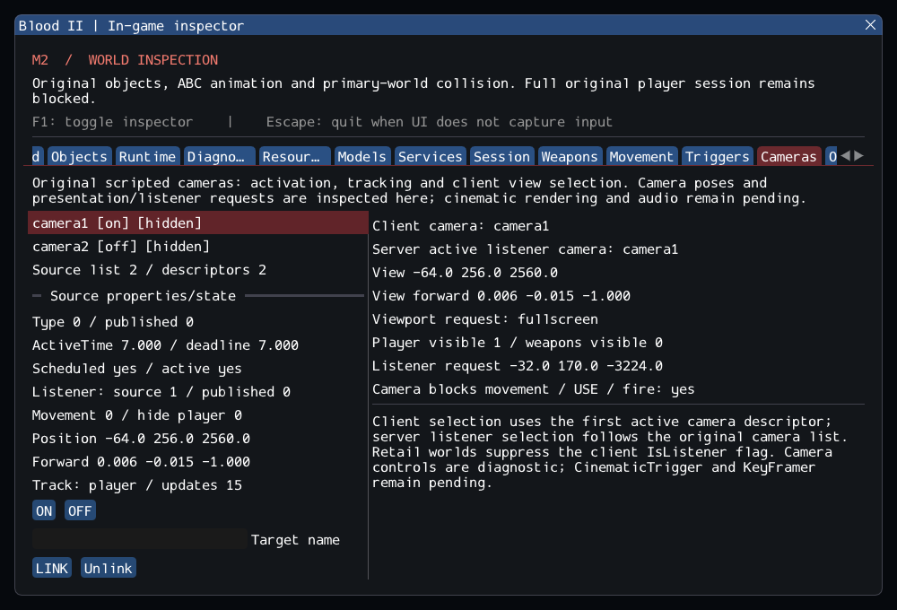

# M2 — Original scripted cameras (in progress)

15 October 2026. **M2 is still open.** Following [mission objectives](m2_objectives.md),
this increment integrates CameraObj and selected original client camera rules.
Reference repositories, dependency pins and external commercial assets are unchanged.

## Delivered behavior

- Original properties/defaults, inherited filtering, ON/OFF/LINK, positive timed
  activation, strict expiry and the source unlink/scheduling behavior.
- Target tracking, checked links and deferred cleanup; source server camera-list
  selection and separate client selection from typed persistent descriptors.
- Original client movement permission, hide-player/view-weapon requests and the
  legacy retail-world listener exception, visible separately from source IsListener.
- Real player movement/USE/fire gates, including a FIRE_KEY emitted after camera
  activation. Gravity continues through the existing single shared-body integration.
- A Cameras inspector showing hidden/off cameras, target/pose, schedule, source
  versus published flags, selected view, visibility/listener requests and queued
  original ON/OFF/LINK messages. Rendering/audio requests are labelled as pending.

[Contracts](../../contracts/camera_contracts.md) and
[source selections](../sources/m2_camera_sources.json) document deliberate
adaptations: typed metadata instead of SFX packets, validated properties, checked
retarget cleanup, deterministic direction math and stable client creation order.
The original static list remains scoped to the runtime's single bound session.

## Private content and validation

The catalog creates **61/61 CameraObj entries** across **57 readable worlds**, with
zero camera rejection. It verifies ON/OFF selection and cleanup; this is class
coverage, not campaign/cinematic-script validation. `worlds/16_bridge.dat` retains
its existing strict malformed-world failure.

SubwayA has **144 created source entries + 7 owned SelfTriggers**, **372 editor-only**,
**64 unported**, zero failed: 151 instances before player entry, 154 after it.
Both authored cameras now exist. Original start-point/trigger entry activates
camera1 for seven seconds then camera2 for five seconds, blocking player input
until just after twelve simulation seconds. Private tests assert this
natural intro and its expiry before the previous walking/crouching/firing checks.
The first regression run exposed six older scenarios issuing input during the new
intro; their setup now waits through original callbacks, without forcing OFF or
changing the original behavioral assertions. Corresponding GPU gameplay scenarios
wait at entry/re-entry too. Normal application entry retains the authored sequence.
The movement private case now executes 2,160 additional intro ticks over its three
reload cycles. An initial sanitized run exceeded its old 30-second timeout; its
finite budget is now 60 seconds, with every original movement assertion retained.
No parser bound, other test timeout or dependency revision was changed.

The camera-specific GPU smoke explicitly activates one and links
it to the actual player, checks tracking/view/movement restrictions while hidden,
and checks the restored camera after unload/re-entry. It does not claim that the
entire cinematic script or KeyFramer motion works. The natural intro activation
and expiry are checked separately in the private catalog.

Six synthetic cases cover defaults/filtering, timing/unlink, tracking/retarget and
pending removal, distinct server/client selection, player gates/late-fire behavior
and validation/session ownership. The private catalog and a serial GPU case are
added to the regression suite. GCC Debug passed **184/184** in **83.90s**; GCC Release without ImGui passed **184/184** in **46.34s**. Clang ASan/UBSan/leak checks passed **170/170 headless** in **186.45s**, without findings.
Final logs/hashes, including the initial regression failures, are in the
[evidence ledger](evidence/m2-cameras.json).
The configured suite contains 151 synthetic headless, 19 private headless and
14 serial GPU cases. All 31 changed C++ files pass formatting; final incremental
builds have no warnings. The 10,923 inventoried reference files are unchanged
and all six reference repositories remain clean. All 1,227 local Markdown targets resolve.
Blood2 commit: `352c67bb373e67bdcad60a3de136353442a1888c`.

Commands, from `Blood2/`:

```sh
cmake --preset local-debug
cmake --build --preset debug -j4
ctest --preset debug --output-on-failure -j4
cmake --preset local-release
cmake --build --preset release -j3
ctest --preset release --output-on-failure -j4
cmake -S . -B build/sanitize -G Ninja -DCMAKE_BUILD_TYPE=Debug \
  -DCMAKE_C_COMPILER=clang -DCMAKE_CXX_COMPILER=clang++ \
  -DBLOOD2_INSPECTOR=OFF -DBLOOD2_SANITIZERS=ON -DBLOOD2_GPU_TESTS=OFF \
  -DBLOOD2_TEST_DATA_DIR="/path/to/Blood II"
cmake --build build/sanitize -j2
ASAN_OPTIONS=detect_leaks=1:halt_on_error=1 UBSAN_OPTIONS=halt_on_error=1 \
  ctest --test-dir build/sanitize -L headless --output-on-failure -j2
./build/debug/blood2 --inspect-player
./build/debug/blood2 --start-game  # still exits 6: required services/classes missing
```



## Remaining gate

External view poses, viewport type, player/weapon visibility and listener positions
are inspection data/presentation requests. Cinematic rendering, letterbox/FOV,
audio playback/listener, server camera visibility/interest updates, KeyFramer,
CinematicTrigger, other camera modes/gadgets and save/restore remain pending.
Stable client descriptor order replaces the old SFX slot allocator; exact slot
reuse and engine orientation parity are not proven against the retail executable.
World transitions, actors/AI and other required classes/services still block M2.
Only Linux/Wayland/Vulkan was exercised; no additional-platform or XR claim is made.
