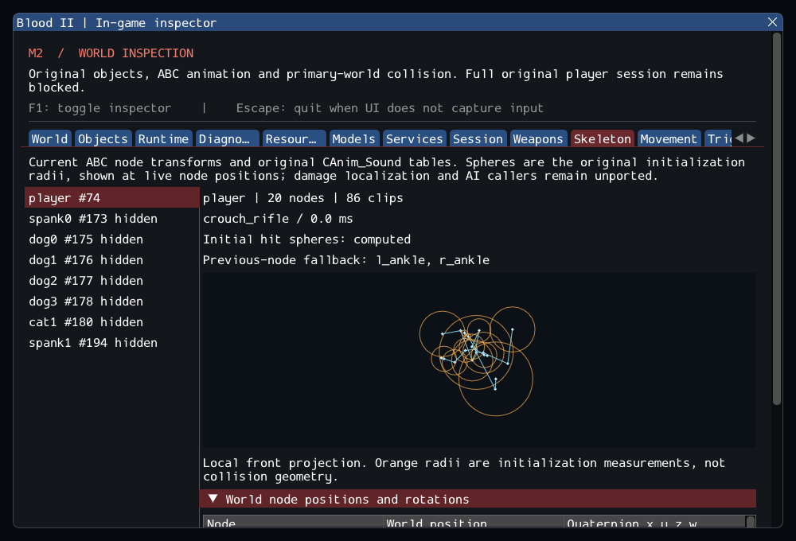

# M2 continuation — original character animations and model nodes

M2 remains incomplete. Original CAnim_Sound now supplies player animation indices,
including the complete animation lookup/fallback table used by later AI work.
The model service returns actual animated world node positions and rotations;
the source's eighteen hit-sphere radii are measured and inspectable. This is a
prerequisite for the remaining original characters, not an AI implementation.
See [contracts](../../contracts/character_animation_contracts.md) and
[source ledger](../sources/m2_character_animation_sources.json).

All 219 original lookup assignments and their order were compared mechanically.
The original >999 threshold, missing first-slot behavior, left/right strafe alias,
humiliation misspellings/order, unfilled zero slots and ForceAnimation's temporary
clip zero remain intact. Locomotion now consumes the stored original indices;
its existing collision, crouch, stairs and event behavior remains tested.

The new node service shares interpolation with the existing full skeleton and
vertex sampler, walks only the queried node's ancestors without heap allocation,
and applies the current object transform. It returns explicit failure for missing
or ambiguous names, stale/pending objects, invalid clocks/scales and out-of-range
coordinates. No cache can retain a previous pose or model. Source sphere formulas
are preserved; the original uninitialized-first-node case now fails safely with
a diagnostic. The radii are not yet used for hit localization or collisions.

The private catalog exposed two real format restrictions: the male cultist's
idle1/pelvis quaternion has squared norm 15227.486328; the female cultist's
idle2/r_gun norm is about 0.000042. Both are finite nonzero rotations. The reader
now normalizes these values in double precision at decode, instead of imposing an
arbitrary norm window. Synthetic tests also normalize maximum/subnormal finite
float values and continue rejecting zero/NaN/infinity; structural budgets are
unchanged. This fixes actual required enemy assets without substituting poses.

The Skeleton tab lists hidden/inactive and unavailable models, current skeletons,
world node transforms, measured radii and all animation-table entries. A dedicated
GPU smoke uses the real player and movement/crouch scenario, verifies node queries
while the UI is hidden and after lifecycle transitions, and captures this panel.

## Validation

Commands from Blood2:

```sh
cmake --preset local-debug
cmake --build --preset debug -j4
ctest --preset debug --output-on-failure -j4
cmake --preset local-release
cmake --build --preset release -j3
ctest --preset release --output-on-failure -j4
cmake --build build/sanitize -j2
ASAN_OPTIONS=detect_leaks=1:halt_on_error=1 UBSAN_OPTIONS=halt_on_error=1 \
  ctest --test-dir build/sanitize -L headless --output-on-failure -j1
```

GCC Debug passed **273/273** in **136.23s**. GCC Release without ImGui
passed **273/273** in **82.65s**. Clang ASan/UBSan/leak checks passed
**250/250 headless sequentially** in **523.71s**, without findings.
The suite contains 216 synthetic headless, 34 private headless and 23 serial GPU
cases. Final builds are warning-free; 19 changed/new C++ files pass clang-format
23.1.3. The 10,923 reference files and six reference repositories are unchanged.
--inspect-player succeeds; --start-game still exits 6. The capture was reviewed.

The private catalog exercised **326 clips and 6,410 node queries across seven
models**. Caleb and the civilian/cultist models lack l_ankle/r_ankle; Gideon also
lacks ru_arm/lu_arm. The original preceding-node fallback is retained and shown
explicitly, rather than describing every standard node as present. There are
227 stored animation slots, with missing slots visible in the inspector.

Logs, initial failures, source comparisons, source integrity, patch and hashes
are retained in the [evidence ledger](evidence/m2-character-animation.json).
Blood2 commit: `014e32b9dd105ef81fb4f875837175fddb39b6ee`.



The remaining SubwayA gate is unchanged: **187 created source entries, 4 transferred
world sounds, 372 editor-only, 17 unsupported, zero failed**, plus 7 SelfTriggers.
Runtime counts remain 194/197 before/after player, then 185/188 after consuming
nine Keys. Missing source instances are 5 CivilianAI, 10 CultistAI, Gideon and
ExitTrigger; required services such as actual client FX also remain absent.
--start-game must still fail with exit 6. M3–M8 stay planned.

No retail executable comparison, AI behavior, actual hit localization, attachment,
blend, voice-helper or non-Linux/XR support is claimed by this increment.
