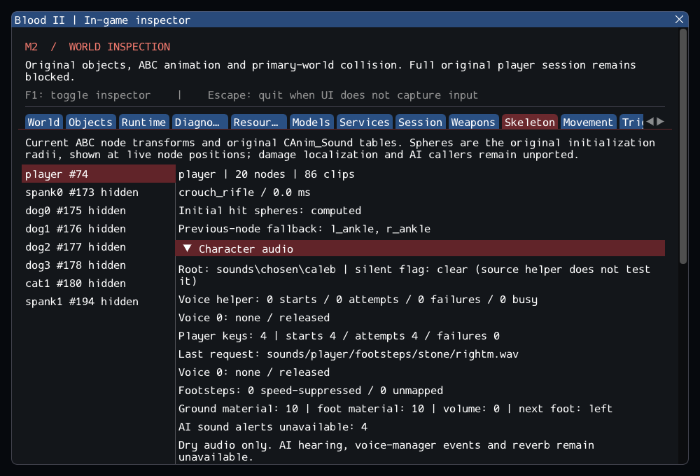

# M2 continuation — original character audio and footsteps

Original CAnim_Sound voice helpers and CPlayerObj animation sounds now use the
real bounded WAV mixer. Busy character voices refuse overlap; player sounds
interrupt their predecessor before attempting replacement. Actual playback,
failure, completion and removal are inspectable independently of ImGui.
[Contracts](../../contracts/character_audio_contracts.md) and the
[source ledger](../sources/m2_character_audio_sources.json) record the
source selections and return-value/lifetime adaptations.

The supplied Caleb model contains footstep keys, so this continuation also
connects original footstep selection. The DAT reader retains baked texture
material flags separately from collision flags; support carries them through
MoveMgr's typed position message. Original material names, speed threshold,
left/right alternation and first liquid at the feet determine the actual WAV.
Unsupported material identifiers do not become generic footsteps. The point
query deliberately preserves the source's lack of a Hidden check.

The first private test assumed Caleb had non-footstep sound keys; it found only
footsteps. The implementation was expanded to execute those real callbacks,
rather than inventing a model event or presenting a synthetic key as authored.
The non-footstep path remains covered by synthetic callback tests. AI hearing
still lacks its original lists/receivers, and the inspector reports each missing
alert operation. These counters are not successful service replacements.

The private resource catalog finds 46 Caleb sound keys, all footsteps, and decodes
34 of 36 original material/side/gender paths. Male carpet left/right paths are
absent. Across 2,723 SubwayA surfaces, 2,163 baked materials match current DTX user
flags; 560 retain baked zero despite nonzero DTX metadata. The engine consumes
baked flags, so the port preserves them instead of assigning a guessed material.
The early equality assumption was corrected to test these observed differences.

GCC Debug passed **283/283** in **138.78s**. GCC Release without ImGui
passed **283/283** in **84.85s**. Clang ASan/UBSan/leak checks passed
**260/260 headless sequentially** in **560.94s**, without findings.
The suite contains 224 synthetic headless, 36 private headless and 23 serial GPU
cases. Final builds are warning-free; 21 changed/new C++ files pass clang-format
23.1.3. The 10,923 reference files and six reference repositories are unchanged.
--inspect-player succeeds; --start-game still exits 6. The capture was reviewed.

Each private SubwayA cycle completes the original cinematic intro and produces
three real stone-footstep starts while walking. The GPU scenario observes audio
with hidden UI and again after reload, with real decoded samples submitted to
SDL's dummy playback stream. The visible capture shows four completed player
sounds, their actual path/material and four explicitly unavailable AI alerts.

Logs, initial failures, source comparisons, source integrity, patch and hashes
are retained in the [evidence ledger](evidence/m2-character-audio.json).
Blood2 commit: `9dc89ec673be67d0ecc31044983b27019c8ce41b`.



Reproduce with the local Debug/Release presets and CTest; configure the existing
Clang sanitizer build with inspector/GPU disabled and run headless tests
sequentially. `--skeleton-smoke` now checks actual footstep audio while hidden and
after reload, using `SDL_AUDIODRIVER=dummy` for automated output. The private
installation remains external and dependencies stay at their existing pins.

Commands executed from `Blood2/`:

```sh
cmake --preset local-debug
cmake --build --preset debug -j4
ctest --preset debug --output-on-failure -j4
cmake --preset local-release
cmake --build --preset release -j3
ctest --preset release --output-on-failure -j4
cmake -S . -B build/sanitize -G Ninja -DCMAKE_BUILD_TYPE=Debug \
  -DCMAKE_C_COMPILER=clang -DCMAKE_CXX_COMPILER=clang++ \
  -DBLOOD2_INSPECTOR=OFF -DBLOOD2_SANITIZERS=ON -DBLOOD2_GPU_TESTS=OFF \
  '-DBLOOD2_TEST_DATA_DIR=/home/yann/.steam/steam/steamapps/common/Blood II/'
cmake --build build/sanitize -j2
ASAN_OPTIONS=detect_leaks=1:halt_on_error=1 UBSAN_OPTIONS=halt_on_error=1 \
  ctest --test-dir build/sanitize -L headless --output-on-failure -j1
./build/debug/blood2 --inspect-player
./build/debug/blood2 --start-game  # Expected exit 6: M2 gate remains blocked.
```

M2 is **incomplete**. SubwayA source counts stay 187 created, 4 transferred world
sounds, 372 editor-only, 17 unsupported, zero failed; seven owned SelfTriggers
remain separate. CivilianAI, CultistAI, Gideon, ExitTrigger, actual client FX,
attachments and required services are still pending. `--start-game` must remain
blocked. No retail executable, non-Linux platform or XR parity is asserted.
