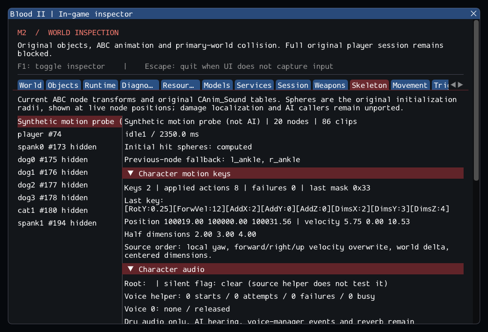

# M2 continuation — original character motion keys

M2 remains incomplete. The original CBaseCharacter animation-key motion branch
now executes through checked services, with bounded Sparam parsing and in-game
inspection. Rotation, forward/right/up velocity replacement, collision-aware
world displacement and centered dimension changes preserve source ordering.
CPlayerObj retains its original exclusion from this base branch. See
[contracts](../../contracts/character_motion_contracts.md) and
[source ledger](../sources/m2_character_motion_sources.json).

Malformed numeric/XYZ bundles fail before mutation. Service failures stop later
actions and retain earlier successful ones, with an applied mask and failure
text. A touch callback that removes the character cannot be followed by a write
to its pending record or another key callback. No second physics integration,
AI placeholder registration or new dependency was added.

The seven examined required-character models contain **326 clips and 193 keys**,
including **147 bracket keys**, but **zero motion keys**. The private test dispatches
those actual markers and verifies that missing AI sound/fire/extra behavior stays
explicit. Motion semantics are therefore validated with synthetic fixtures, not
claimed as observed enemy behavior. The GPU scenario labels its extra object
"Synthetic motion probe (not AI)" and exercises a second key with the UI hidden,
then destruction and a fresh probe after reload. Existing player movement, pose,
audio and lifetime assertions remain intact.

## Validation

Commands from Blood2:

```sh
cmake --preset local-debug
cmake --build --preset debug -j4
ctest --preset debug --output-on-failure -j4
cmake --preset local-release
cmake --build --preset release -j3
ctest --preset release --output-on-failure -j4
cmake --build build/sanitize -j2
ASAN_OPTIONS=detect_leaks=1:halt_on_error=1 UBSAN_OPTIONS=halt_on_error=1 \
  ctest --test-dir build/sanitize -L headless --output-on-failure -j1
```

GCC Debug passed **290/290** in **147.23s**. GCC Release without ImGui
passed **290/290** in **85.43s**. Clang ASan/UBSan/leak checks passed
**267/267 headless sequentially** in **564.80s**, without findings.
The suite contains 230 synthetic headless, 37 private headless and 23 serial GPU
cases. Final builds are warning-free; 11 changed/new C++ files pass clang-format
23.1.3. The 10,923 reference files and six reference repositories are unchanged.
--inspect-player succeeds; --start-game still exits 6. The capture was reviewed.

The visible GPU capture shows two synthetic keys, eight applied actions, no
failures, actual position/velocity and centered half dimensions. The existing
real player movement, crouch, node transforms, footstep audio and teardown checks
also pass; the probe does not count as an authored AI instance.

Logs, source comparisons, source integrity, patch and hashes are retained in the
[evidence ledger](evidence/m2-character-motion.json).
Blood2 commit: `0cdfe7e5f5c1d4c33612974c9060ab92875d4764`.



The unchanged SubwayA gate is **187 created source entries, 4 transferred world
sounds, 372 editor-only, 17 unsupported and zero failed**, plus 7 SelfTriggers.
Runtime counts remain 194/197 before/after player, then 185/188 after nine Keys.
Missing source instances are 5 CivilianAI, 10 CultistAI, Gideon and ExitTrigger.
Required client FX, attachments and other services also remain missing;
--start-game remains blocked with exit 6. M3–M8 remain planned.
