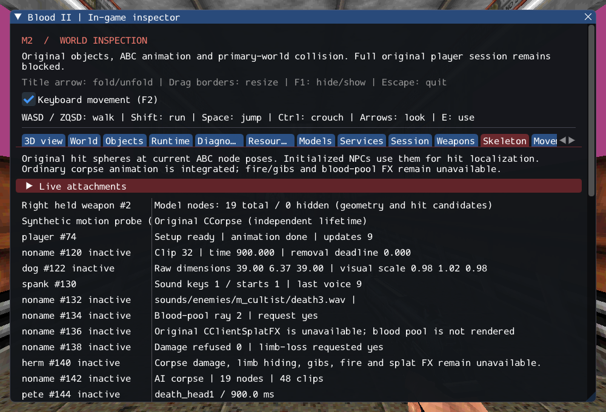

# M2 — Character node visibility and player model restoration

The original named ResetNodes operation now changes per-instance model state,
SDL_GPU geometry and NPC hit candidates. The supported CPlayerObj Load tail applies
its model setup, node reset, original flags and zero velocity after selected fields
load, without fresh health/ammo grants or client association. Respawn also executes
the original node reset at its separate source call site.

This remains a restoration prerequisite. **M2 and NEW_LEVEL remain incomplete**:
engine body/animation/scheduling, remaining player fields, saved client data and
association, safe destination replacement, Gideon and required FX still need work.
SubwayA accounting stays 203 created, four transferred sounds, 372 editor-only,
one unsupported and zero creation failures.

See [contracts](../../contracts/character_node_contracts.md),
[source ledger](../sources/m2_character_nodes_sources.json) and
[execution ledger](evidence/m2-character-nodes.json).

## Verified behavior

The source resets 21 standard names plus contiguous `_extraN` names, stopping at
the first gap; it does not walk skeletal children. Missing bases still allow extras.
The engine validates names/lifetime, supports all 256 model nodes, and keeps masks
outside shared resources. Sparse vertex node IDs map to actual preorder slots.
A triangle with any hidden vertex is omitted by the replacement rendering policy;
retail rasterization parity is not established. Poses and attachments remain available.

Hit selection now honors hidden standard nodes, including the source's retained
visibility value for missing names and random fallback when every node is hidden.
Unavailable queries refuse damage before health mutation. Hidden nodes therefore
neither create collision holes nor guarantee immunity.

Load uses its exact original flags without SHADOW and clears velocity while retaining
acceleration and selected saved values. It does not invent body dimensions or run
Respawn. The operation can leave partial setup on failure; a future orchestrator
must discard that unassociated staged owner. General checkpoint/transfer success
is not inferred from these tests.

Five new node tests plus an additional AI hit test cover missing/ambiguous/stale
queries, inactive instances, node 255, base/extra gaps, preflight, mask/index failures,
triangle omission, model replacement, raw stat retention and rejected restoration.
Three external SubwayA cycles copy the earlier partial records to an independent
unassociated restore player, hide its head, reset it to all 941 Caleb triangles,
rebuild held models and remove every generated child. This is a diagnostic restore,
not a completed exit. The existing GPU character smoke repeats hide/reset while UI
is hidden and after reload. GPU pixel checks prove group disappearance and return.

## Validation

GCC Debug passes **530/530** (168.96s); inspector-free GCC
Release passes **530/530** (42.32s). Each full matrix includes
**503 headless checks (75 private) and 27 GPU checks**.
Clang ASan/UBSan/leak checks pass **92/92** (74.68s)
covering the new mask/restoration paths, model snapshots, hit localization, object,
player, aggregate, service and attachment lifetime. The focused first run passed 7/7,
including GPU pixels and external Caleb restoration.

`--inspect-player` exits 0; `--start-game` remains explicitly blocked (exit 6).
20 changed C++ files pass clang-format 23.1.3;
2,151 local Markdown links resolve.
All 10,923 reference inventory files and six reference repositories remain unchanged.
Only Linux/Vulkan is verified; the stored inspector capture was visually reviewed.

Commands from Blood2:

```sh
cmake --build build/debug -j4
ctest --test-dir build/debug --output-on-failure -j4
cmake --build build/release -j2
ctest --test-dir build/release --output-on-failure -j4
cmake --build build/sanitize -j2 --target character_nodes_tests model_view_tests ai_hit_tests player_state_tests player_tests inventory_state_tests destructable_state_tests object_contract_tests exit_tests services_tests attachment_tests weapon_tests ai_perception_tests
ASAN_OPTIONS=detect_leaks=1:halt_on_error=1 UBSAN_OPTIONS=halt_on_error=1 \
  ctest --test-dir build/sanitize -R '^(character_nodes|model_view|ai_hit|player_state|player|inventory_state|destructable_state|objects|exits|services|attachments|ai_perception)\.|^weapons\.(inventory|lifetime|rollback)$' --output-on-failure -j1
```


The inspector shows actual per-node visibility, hidden counts/triangles and selected
Load-tail status. The saved frame is diagnostic inspection, not completed gameplay.


