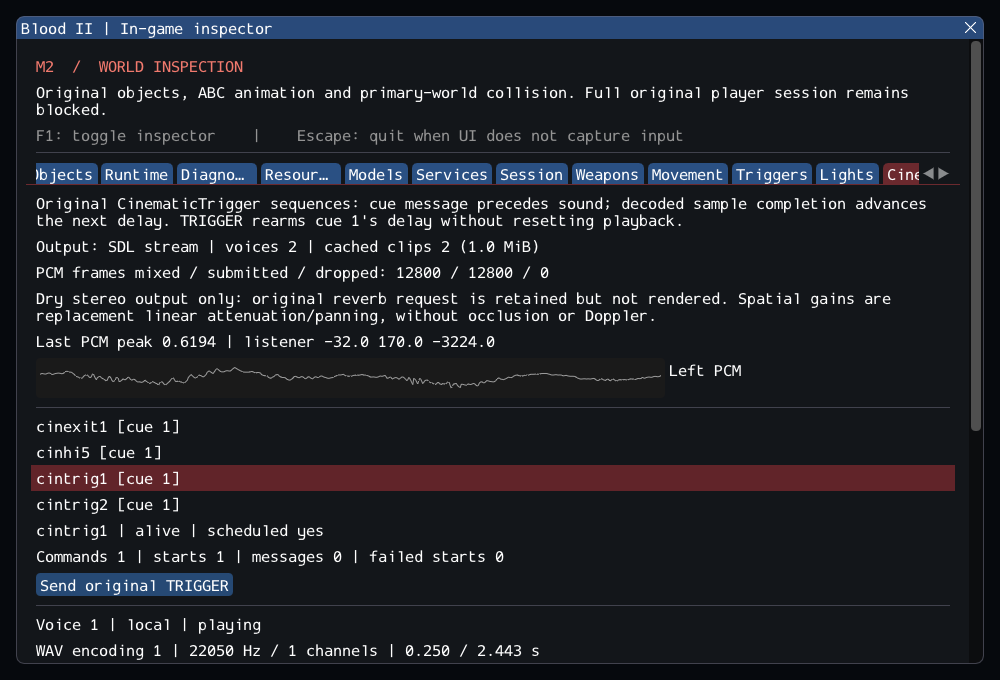

# M2 continuation — Original cinematic cues and WAV audio

**16 October 2026. M2 remains incomplete.** Original CinematicTrigger now drives
real decoded audio voices through typed services. This increment adds the necessary
sound-completion clock, bounded dry mixer/SDL output and inspection. It does not
complete general sound emitters, reverb, music, cinematic rendering or the M2 gate.
See [contracts](../../contracts/cinematic_contracts.md),
[source selections](../sources/m2_cinematic_sources.json) and
[previous train-path evidence](m2_worldpaths.md).

## Original behavior and new services

The selected source retains all ten cues and their authored properties, inherited
filters, trigger rearming without reset, message-before-sound order, completion
polling, subsequent delays, empty-cue removal and local/attached speaker selection.
The engine must finish actual decoded samples before advancing a cue. A failed
sound retries rather than using an invented duration. The source's named-list
leak is fixed; owned strings/monotonic IDs, callback liveness checks and deferred
destruction replace unsafe legacy ownership. Restore remains explicitly rejected.

New code validates RIFF/chunks and PCM8/16 or MS/IMA ADPCM, bounds encoded/decoded
sizes and caches, and uses the existing pinned SDL decoder. Dry stereo output uses
linear resampling and bounded spatial attenuation/panning. Original reverb intent
is retained but visibly unsupported. Ordinary interactive runs open SDL playback;
a device failure leaves visible offline sample clocks. Tests use offline or dummy
audio, so successful PCM submission is not an audible hardware quality claim.

The listener follows the completed client pose, preserving retail camera-listener
suppression. Voice ticking precedes object callbacks, newly started voices advance
next tick, and neither timing nor teardown depends on ImGui. Owners release voices;
lost speakers complete them. Unload clears clips, voices, queued samples and counters.
The output stream closes before global SDL shutdown.

## Private content findings

The cinematic catalog covers **57 readable worlds, 79 controllers and 201 cue
references**. **198 references decode successfully, all PCM.** Thirty-nine cue
occurrences contain a terminal odd data padding byte excluded from RIFF's length;
one (`sounds/enemies/civilian/spot11.wav`) omits that terminal pad. The reader permits
only these bounded terminal-pad variants; all payloads remain complete and arbitrary
trailing/truncated data still fails. Synthetic tests retain rejection coverage.
The existing `16_bridge.dat` structural failure is unchanged.

Three authored paths are absent from the mounted installation:

- `sounds/chosen/caleb/msc12cal.wav` in `02_cityhubb`.
- `sounds/chosen/caleb/laugh1_calb.wav` in `03_museum`.
- `sounds/chosen/caleb/kill/laugh1_cal.wav` in `09_abandoned_buildings`.

They remain explicit failures; no aliases or replacement assets were invented.
The catalog counts references, not unique files or completed cinematic sequences.

SubwayA now has **164 created source entries, 7 owned SelfTriggers, 372 editor-only
entries, 44 unported entries and zero rejected entries**. Runtime counts are
**171/174 before/after player entry**, then **162/165 after nine Keys are consumed**.
Four newly instantiated CinematicTriggers explain the difference from the prior
snapshot. The private test enters/exits the real local shell/player twice, starts
`cintrig1` through its original trigger, and verifies actual WAV playback state:
22,050 Hz, 53,872 frames, 2.44317 seconds. The separate `cinhi5` scenario copies its
exact DAT properties and completes both authored crash cues in isolation. It does
not claim that the full level event chain or Gideon AI has been reconstructed.

## Inspector and verification

The Cinematics tab shows inactive/hidden controllers, all ten cues and resource
presence, current index/schedule, command/message/start/failure counters, voice
format/duration/cursor, speaker/gains, real mixed PCM, cache and output/drop errors.
A queued diagnostic button sends the original TRIGGER. The GPU scenario uses the
actual SubwayA cue, hidden UI, resize, unload/reload and handle invalidation, with
SDL's dummy playback backend. The inspector-free application exercises the same
simulation and output path.



Verification commands (run inside `Blood2/`):

```sh
cmake --preset local-debug
cmake --build --preset debug -j4
ctest --preset debug --output-on-failure -j4
cmake --preset local-release
cmake --build --preset release -j3
ctest --preset release --output-on-failure -j4
cmake -S . -B build/sanitize -G Ninja -DCMAKE_BUILD_TYPE=Debug \
  -DCMAKE_C_COMPILER=clang -DCMAKE_CXX_COMPILER=clang++ \
  -DBLOOD2_INSPECTOR=OFF -DBLOOD2_SANITIZERS=ON -DBLOOD2_GPU_TESTS=OFF \
  '-DBLOOD2_TEST_DATA_DIR=/home/yann/.steam/steam/steamapps/common/Blood II/'
cmake --build build/sanitize -j2
ASAN_OPTIONS=detect_leaks=1:halt_on_error=1 UBSAN_OPTIONS=halt_on_error=1 \
  ctest --test-dir build/sanitize -L headless --output-on-failure -j1
```

GCC Debug passed **225/225** in **98.46s**; GCC Release without ImGui passed **225/225** in **52.20s**. Clang ASan/UBSan/leak checks passed **207/207 headless sequentially** in **453.27s**, without findings.
The suite contains 183 synthetic headless, 24 private headless and 18 serial GPU
cases. All 27 changed/new C++ files pass clang-format 23.1.3; final builds are warning-free.
All 10,923 inventoried reference files are unchanged and the six reference repos
are clean. Final full regressions include archive-presence labels and active voice details,
plus the allocation-only snapshot correction after two ASan timeout attempts.
The final capture was reviewed. Raw logs, source integrity, patch and hashes are
in the [evidence ledger](evidence/m2-cinematics.json).
Blood2 commit: `84fac9b1a94b59d717be1319e1a4539876b46e41`.

The ten new checks comprise seven synthetic cases (decode, mixer, spatial, sequence,
lifetime, failures and dummy device), private catalog and SubwayA cases, and the GPU
case. Existing exact class-count assertions are updated by four; the blocked-startup
assertion still requires failure and reports 44 missing classes. No timeout or exit
gate was relaxed. The existing private weapon test exceeded 90 seconds in the
first ASan run and an isolated retry. Reserving slot-count capacity once in
`Objects::snapshot` removed repeated vector growth without changing IDs, ordering
or callbacks. The same isolated scenario then passed in 84.16 seconds; all three
build variants were rebuilt and their complete suites rerun. All reference files/repositories and external game assets remain
untouched; only project code, synthetic fixtures and metadata/evidence are retained.

## Remaining gate

SubwayA still lacks required AI, general Sound/RandomSoundFX, DetailSprite,
CClientExplosionSFX and ExitTrigger entries. Their audio, effects, level-transition,
attachment and other required service paths are not complete. Other movers, angular
paths, complete combat/player rules and existing physics fidelity gaps remain.
`run_world` continues to reject complete gameplay. Linux/Wayland/Vulkan and dummy
SDL audio are the tested environment; retail executable comparison, audible device
quality, Windows/macOS/mobile and XR are unverified. The M2 heartbeat remains active.
