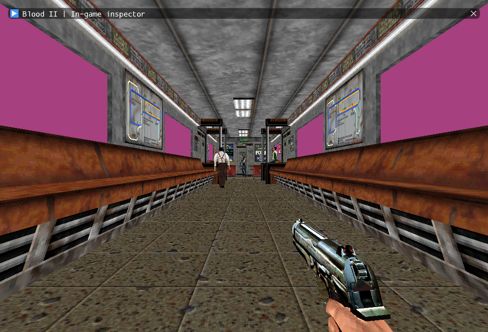

# Collapsible inspector and default keyboard controls

M2 remains incomplete. This is an application usability change on top of the
original MoveMgr and existing typed player input, not another movement integrator.

The inspector now uses Dear ImGui's native title-bar collapse arrow. It can be
folded to a title bar, unfolded, dragged and resized. Initial placement fills the
available window with a margin; subsequent frames retain the user's geometry,
constrained to the current display size. F1 still hides/shows the inspector,
including reopening it after the close button. Geometry is session-local; there
is no new saved settings format.

Keyboard movement starts enabled in both inspector and inspector-free builds,
including entry through Session. Previously only `--view-world` and selected
smoke paths enabled it at startup. F2 and the checkbox in the common inspector
header toggle it explicitly; the choice survives folding, hiding and player
re-entry. The controls are:

| Physical keys | Action |
| --- | --- |
| WASD / AZERTY ZQSD | Walk |
| Shift | Run |
| Space | Jump |
| Ctrl | Crouch |
| Arrow keys | Look |
| E | Original USE |

The header explains entry and cinematic movement restrictions. SubwayA's
original two-camera introduction still blocks commands for just over twelve
simulation seconds. No camera is forcibly disabled or shortened. Mouse look,
mouse weapon bindings and a complete gameplay session are outside this change.

Only focused-window key events participate. Text editing suppresses keyboard
commands, focus loss clears keys, and game keys do not also navigate ImGui.
Collapsed/hidden text fields cannot retain input capture. Panel commands clear
when the inspector is folded or hidden. UI state never stops simulation, audio,
rendering, or the original MoveMgr; the single shared body integration is unchanged.

## Verification

GCC Debug and inspector-free GCC Release build successfully. **84 distinct
selected checks** pass in Debug across the initial run and focused rerun;
Release passes **84/84** in one run (33.03s). This selection contains
**57 headless checks (6 private) and 27 GPU checks**. Targeted
Clang ASan/UBSan/leak checks pass **20/20** (91.43s), including two
private scenarios. Changed C++ passes clang-format 23.1.3; local Markdown links
resolve and all 10,923 reference inventory files / six reference repositories
remain unchanged.

The initial wider Debug run had two graphical failures (`gpu.movement`,
`gpu.viewport`) with missing input frames. Their exact cause was not
established. Both pass an isolated rerun after adding focus/input diagnostics,
without changing movement rules, test expectations or focus handling. The
initial logs are retained; these real-window tests depend on display/focus state.
The earlier focused run passed 21/21, including native title-arrow folding.

Commands from Blood2:

```sh
cmake --build build/debug -j4
ctest --test-dir build/debug -R '^(objects|player|movement|locomotion|interaction|cameras|world_view|gpu)\.' --output-on-failure -j4
ctest --test-dir build/debug -R '^gpu.(movement|viewport)$' --output-on-failure -j1
cmake --build build/release -j2
ctest --test-dir build/release -R '^(objects|player|movement|locomotion|interaction|cameras|world_view|gpu)\.' --output-on-failure -j4
cmake --build build/sanitize -j2 --target movement_tests interaction_tests
ASAN_OPTIONS=detect_leaks=1:halt_on_error=1 UBSAN_OPTIONS=halt_on_error=1 \
  ctest --test-dir build/sanitize -R '^(movement|interaction)\.' --output-on-failure -j1
```

[Execution ledger and logs](evidence/m2-controls.json).



The UI smoke uses real Dear ImGui mouse events on the native title arrow; it
checks collapse height, re-expansion and live client updates with keyboard crouch
while collapsed. Keyboard commands enter via SDL events, without a preliminary
F2 opt-in. Existing walk/run/jump/crouch, hidden UI, reload, collision and lifetime
assertions remain. The smoke driver reads the pinned ImGui window layout only;
it does not alter player state or substitute for application input.

The original-game sources, commercial installation and dependency pins are
unchanged. Only Linux/Wayland/Vulkan was exercised. Pink train glass remains a
separate texture/transparency issue. NPC corpses/gibs, remaining classes/services,
required FX and the actual M2 exit criteria remain open.

Continuation: [keyboard fire and relative mouse](m2_player_controls.md) now addresses the missing fire/mouse bindings. The earlier omission is historical; NPC attacks, train glass and M2 remain open.
