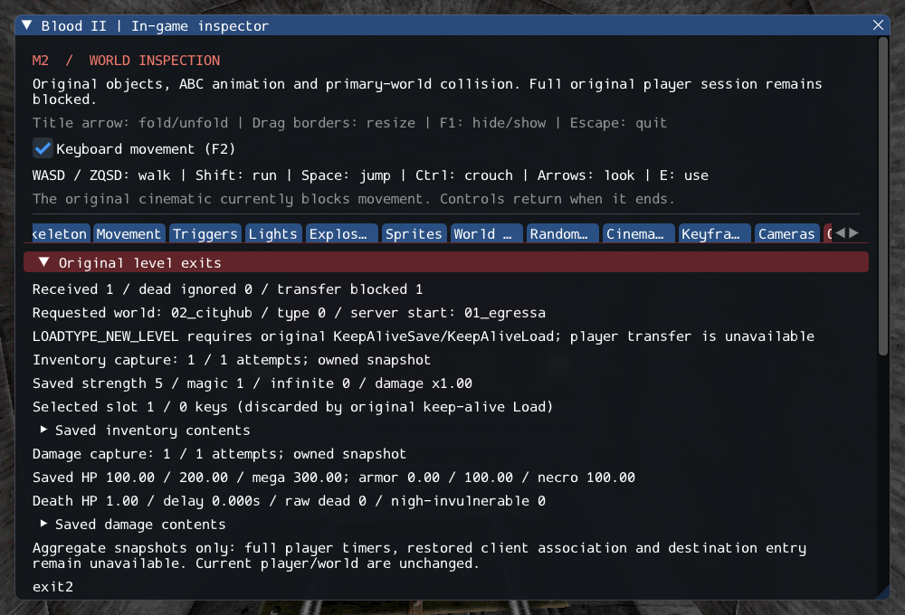

# M2 — Original damage state preservation

The original CDestructable Save/Load value fields now capture and restore health,
armor, caps, resistance, mass, damage/death metadata and owned trigger/spawn strings.
The source CanDamage sentinel, separate death-health accumulator, remaining death
delay and character-only nigh-invulnerability modifier are connected and inspected.
Restoration retains the destination owner/inventory and original list membership,
while rejecting invalid input before mutation and clearing unsaved attacker data.

Exit processing now captures damage alongside inventory with the inspector hidden
as well as visible. These remain separately labelled aggregate snapshots. **Full
player preservation and level transfer are still unavailable**: NEW_LEVEL refuses
before teardown. Remaining player/timer/client/object-state and destination work,
Gideon, required FX and other services keep M2 open. SubwayA counts are unchanged:
203 created, four transferred sounds, 372 editor-only, one unsupported, zero failed.

See [contracts](../../contracts/damage_state_contracts.md),
[source provenance](../sources/m2_damage_state_sources.json), and
[execution ledger](evidence/m2-damage-state.json).

## Preserved details and adaptations

CanDamage=false is encoded as health 1,000,000; Load infers the flag from the saved
number, without clamping health. Ordinary damage subtracts from the separate death
counter, Death zeros it, Heal/MegaHeal reset it, and SetHitPoints leaves it alone.
The counter can therefore be negative even for an alive object. Positive death
delay masks IsDead while preserving the raw dead guard; it decrements only after
death and remains a duration across changed clocks. Nigh-invulnerability applies
0.05 before armor for characters, with Death bypass and generic-owner exclusion.
This does not implement timed powerup collection or all damage rules.

Typed owned values replace message reads. Destination association is required;
old source identity is never serialized. The source's uninitialized last-location
byte now starts at zero and remains distinct from hit-node selection. Validation,
callback guards and explicit live-client refusal are safety adaptations. Existing
missing maximum-stat update clamps and other damage modifiers remain explicit.

## Verification

GCC Debug passes **518/518** (199.8s), and inspector-free
GCC Release passes **518/518** (105.11s). Each full matrix covers
**491 headless checks (73 private) and 27 GPU checks**.
Clang ASan/UBSan/leak validation passes **98/98** (283.77s),
covering damage/inventory preservation, original objects/player/exits/triggers,
shared services, weapons, pickups, AI hit reactions, corpses and brushes.

`--inspect-player` returns 0; `--start-game` retains explicit blocked exit 6.
Twelve changed C++ files pass clang-format 23.1.3. All 2,106 local Markdown links
resolve; all 10,923 reference inventory files and six reference repositories are
unchanged. The saved inspector frame was visually reviewed. Only Linux/Vulkan
is verified.

Commands from Blood2:

```sh
cmake --build build/debug -j4
ctest --test-dir build/debug --output-on-failure -j4
cmake --build build/release -j2
ctest --test-dir build/release --output-on-failure -j4
cmake --build build/sanitize -j2 --target destructable_state_tests inventory_state_tests object_contract_tests player_tests exit_tests trigger_tests services_tests weapon_tests pickup_tests ai_hit_tests corpse_tests brush_tests
ASAN_OPTIONS=detect_leaks=1:halt_on_error=1 UBSAN_OPTIONS=halt_on_error=1 \
  ctest --test-dir build/sanitize -R '^(destructable_state|inventory_state|objects|player|exits|triggers|services|weapons|pickups|ai_hit|corpses|brushes)\.' --output-on-failure -j1
```


Six new cases cover full value round trips and source removal/unload, intrusive
list uniqueness, actual restored damage/heal behavior, remaining death-delay clocks,
modifier ordering, sentinel boundaries, malformed values, unsupported spawns,
reentrant damage callbacks, stale owners and live-client refusal. Private tests run
three SubwayA cycles, restore both aggregates into a detached original CPlayerObj,
load a real held model, remove the source, then damage/heal the independent restored
owner and verify complete cleanup. They do not claim a full player/world transfer.

The existing GPU Objectives scenario checks damage capture during hidden UI and
reload while retaining the same current player/world. The screenshot exposes real
captured health/armor, limits, death counter and missing-transfer diagnostics.
The harness activates the authored exit path; this is not a completed playthrough.



## Next transfer work

Implement supported CPlayerObj Save/Load fields and relative timers, engine object
state and restored client association. Validate original named destination entry
and failure-safe world replacement before accepting NEW_LEVEL. Inventory and damage
aggregate snapshots alone must not bypass those requirements.
