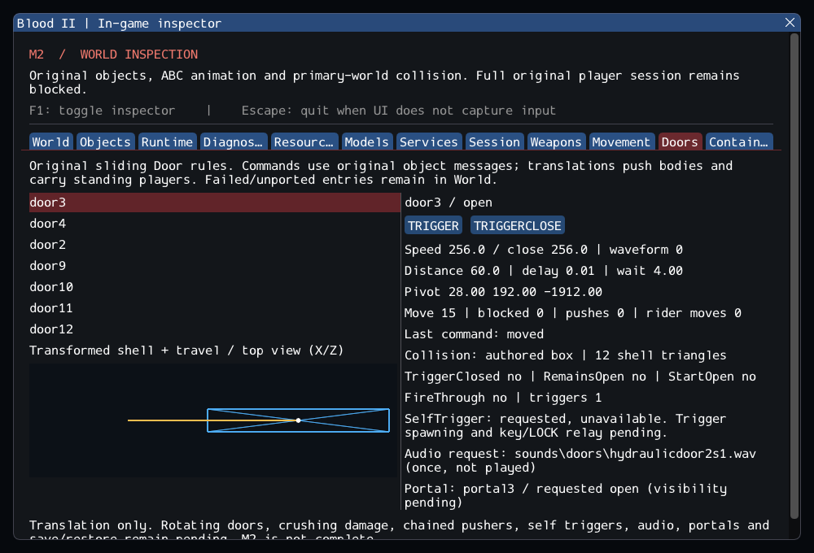

# M2 continuation — Sliding doors and translating world models

> Later extension: [m2_triggers.md](m2_triggers.md) connects SelfTrigger/key relay
> and sensor contacts for transported bodies. Results below are the door snapshot.

The clean Blood2 project now connects selected original **Door** rules to a
typed translating world-model service. Doors collide with bodies and weapon
rays, push bodies, carry standing players, and block atomically when transport
would hit another solid. The original shared player still integrates once.

This continues [m2_specialized_volumes.md](m2_specialized_volumes.md).
**M2 remains incomplete; this is not a playable game.** Trigger/self-trigger/key
relay, rotating doors, full combat and other required classes remain pending.

## What changed

- Original Door registration, properties, four-state machine, TRIGGER and
  TRIGGERCLOSE, delays, closing timers, StartOpen/RemainsOpen/TriggerClosed and
  four motion waveforms. Owned strings and typed calls replace legacy ABI needs.
- Named DAT model binding using checked base rings, closed geometry and authored
  rotation. The moving pivot is separate from its actual bounds center.
  BoxPhysics retains the original box choice; polygon mode queries the shell.
- A bounded replacement translation solver: continuous relative sweeps, fresh
  rider support, all-or-nothing position commits, and deferred original touches.
  A blocked door retries and cannot falsely report that it reached its endpoint.
  Moving objects can enter wall pockets through the source GOTHRUWORLD flag;
  pushed bodies cannot pass through the primary world.
- Shared collision queries for movement, clearance, support, stairs and firing.
  Consistent double SAT projections fix missed point rays on rotated faces.
  Original Door FireThrough applies to fire rays, while aim/body queries retain
  the door. Named world models are not reported as missing archive files.
- A Doors inspection tab with live state, geometry/travel, queued commands,
  blocker and pusher/rider counters, and explicitly pending sound/portal/trigger
  requests. Hidden/inactive objects and failed source entries remain inspectable.

[door_contracts.md](../../contracts/door_contracts.md) specifies the original
rules, new engine behavior and limits.
[m2_door_sources.json](../sources/m2_door_sources.json) records donor ranges
and hashes. The [implementation patch](evidence/m2-doors-implementation.patch)
is relative to specialized-volume commit `bbb1ba4`; this implementation is
committed as `b75c902`. No dependency or ECS
was added, and the existing reference projects remain untouched.

## Real content observations

The configured external base-game archives contain **698 Door entries** in
readable DAT files. The bounded catalog creates/removes **605** individually,
including **146 SelfTrigger requests** and **113 polygon-mode doors**.
It does not test whole-map interactions or automatic triggers.

**93 entries remain explicit failures:**

| Reason | Entries | Interpretation |
| --- | ---: | --- |
| Older multiplayer TypeAction property | 47 | Unrecognized schema; no guessed alias |
| Ambiguous case-insensitive named model | 19 | No arbitrary model selection |
| Missing named model | 12 | No fabricated collision shape |
| Open/non-manifold shell | 15 | Closed-shell solver limitation, including compound scenery named Buildings |

The known `worlds/16_bridge.dat` typed-property failure still prevents reading
that map. [The catalog log](evidence/m2-doors-catalog.log) identifies every
rejected entry; the private test asserts all four failure counts and rejects
unexpected reasons. These are limits of this implementation, not a declaration
that retail assets are corrupt.

Real data stores WaitTime=-1 and ClosingSpeed=-1. The port keeps the source
arithmetic: negative waits expire on the next open update; negative speeds
move away from the endpoint if that branch executes. They are not silently
converted into a guessed “never close” behavior. Retail executable comparison
remains unperformed.

All **seven SubwayA doors** bind and move under original trigger messages.
SubwayA now accounts for **30 created / 372 editor-only / 178 unported** source
objects, with all 580 entries retained. The private session scenario exercises
short translations for each door, close commands, player entry and unload/reload.
Synthetic cases test full endpoint transitions, reversals, blocked pushes and
rider transport. The GPU scenario shows a real SubwayA door opening while the
inspector is hidden, then resize, capture, unload/reload and teardown.

## Validation

Linux GCC Debug and inspector-free Release both compile and pass **108/108**:
88 synthetic headless cases, 12 private headless cases and eight SDL_GPU/Vulkan
window scenarios. Clang ASan/UBSan with leak detection passes **100/100**
headless cases. The [evidence ledger](evidence/m2-doors.json) records commands,
hashes and the implementation commit.

| Configuration | Result |
| --- | ---: |
| GCC Debug / Dear ImGui | 108/108 |
| GCC Release / inspector OFF | 108/108 |
| Clang ASan + UBSan + leak detection | 100/100 |

The six new synthetic cases cover state transitions/timers/waves, signed and
zero parameters, geometry/pivot/ray rejection, continuous pushing and atomic
blocking, shared-player riders/jump detachment, and callback removal/reentrancy.
The two new private cases cover the catalog and real SubwayA lifecycle.
Existing player/world expectations now include the seven created doors.
A final startup-diagnostic wording correction was rebuilt and its CLI test
rerun in all three configurations; gameplay remains explicitly blocked.

Changed C++ files pass clang-format 23.1.3. All **10,923** inventoried reference
files are unchanged, and the six reference Git worktrees are clean.
Other platforms, XR, textured rendering, audio playback and retail executable
behavior were not tested. No performance benchmark or retail physics parity
is claimed.

Commands from Blood2:

```sh
cmake --preset local-debug
cmake --build --preset debug -j4
ctest --preset debug --output-on-failure -j4

cmake --preset local-release
cmake --build --preset release -j4
ctest --preset release --output-on-failure -j4

cmake -S . -B build/sanitize -G Ninja -DCMAKE_BUILD_TYPE=Debug \
  -DCMAKE_C_COMPILER=clang -DCMAKE_CXX_COMPILER=clang++ \
  -DBLOOD2_INSPECTOR=OFF -DBLOOD2_SANITIZERS=ON -DBLOOD2_GPU_TESTS=OFF \
  '-DBLOOD2_TEST_DATA_DIR=/home/yann/.steam/steam/steamapps/common/Blood II/'
cmake --build build/sanitize -j4
ASAN_OPTIONS=detect_leaks=1:halt_on_error=1 UBSAN_OPTIONS=halt_on_error=1 \
  ctest --test-dir build/sanitize -L headless --output-on-failure -j4
```

The local data path is a test configuration, not a production constant.
The selected SDL main, ImGui and spdlog pins are unchanged.



## Next continuation

Connect the original Trigger/self-trigger activation and key relay, then rotating
doors and remaining movers. SelfTrigger is currently visible as an unavailable
request. Audio is only recorded, and portal state does not control rendering.
No original blocking-priority arbitration, recursive pusher chains, crushing,
rotational CCD, non-solid sensor sweeps by movers or save restoration is claimed.
The atomic solver is new engine code, not validated retail physics.
