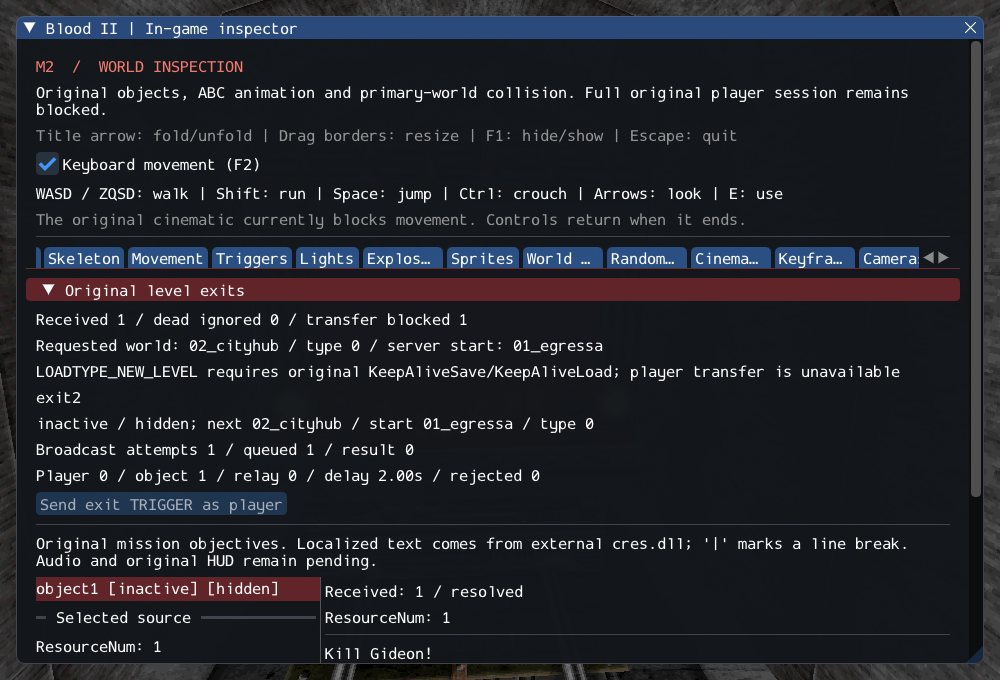

# M2 — Original ExitTrigger and shell exit requests

The authored SubwayA `exit2` targets `02_cityhub` at `01_egressa`. Its ExitTrigger
now runs original activation/property rules,
copies its destination start name into the server shell and delivers a typed exit
message to the client shell. The client applies the original dead-player guard and
constructs a NEW_LEVEL load request. The inspector shows both source and client
state, including hidden/inactive triggers and explicit refusal diagnostics.

**Level transfer remains incomplete.** The original server path requires
KeepAliveSave/KeepAliveLoad to preserve player state between worlds. Those services
are not integrated yet, so the decoder refuses NEW_LEVEL before changing the world,
player, inventory or audio. This is an observable unsupported boundary, not a
successful exit or a fresh-game replacement. M2 remains open.

SubwayA now has **203 created entries, four transferred sounds, 372 editor-only,
one unsupported (Gideon), zero failed** out of 580. Initial runtime counts are
225 before player entry and 228 after; the first tick consumes nine Keys and creates
eleven held models, giving 230 instances and eleven attachments. Class coverage
does not imply required service coverage or complete gameplay.

See [contracts](../../contracts/exit_contracts.md),
[source selections](../sources/m2_exit_sources.json) and
[execution ledger](evidence/m2-exits.json).

## Preserved details

The source declares EndEpisode but reads EndOfEpisode; the port preserves both
names without aliasing them. The latter, when supplied, wins over SubWorld.
Nonempty start names are copied before broadcast, even on failed delivery.
Zero reset time leaves the trigger inactive. Immediate activation broadcasts once;
the delayed branch retains its different slot conditions and virtual dispatch.
Empty destinations report invalid data; dead players ignore the payload.
The actual SubwayA exit rejects direct player activation, accepts the referring
Trigger as an object, and waits two seconds in an otherwise empty message slot.
Private/GPU checks exercise this authored delay through normal session updates;
the upstream level-completion chain is not claimed.

Typed owned strings replace raw packets and source string lifetimes. Checked
player identities and queue bounds remain enforced. Failed transfer preserves the
loaded session, avoiding the destructive effect of starting a fresh game with
reset weapons/ammo. Original menu/music/loading presentation is deferred with
transfer rather than claiming those services exist.

## Verification

GCC Debug covers **507 passing checks** after a corrected targeted rerun:
the initial full run passed 503 and failed four fixture/expectation checks;
the subsequent focused run passed all 11 checks, including those four.
Inspector-free GCC Release passes **507/507** in one full run
(37.21s). Each configuration covers **480 headless
checks (71 with private data) and 27 GPU checks**.
Clang ASan/UBSan/leak checks pass **63/63**
(96.42s), covering exits, triggers, objects, world/session,
player, objectives and shared services.

The initial test fixtures assumed a different destination and direct/immediate
player activation. Reading the actual source properties corrected these expectations
to `02_cityhub` / `01_egressa`, the authored referring object and its two-second delay.
Two old expectations also needed the additional source object's runtime/service
counts. Initial failure logs are retained; no original rule, required assertion or
M2 acceptance gate was weakened.

`--inspect-player` exits 0; `--start-game` remains blocked with exit 6.
All 32 changed C++ files pass clang-format 23.1.3 and Git whitespace checks.
Local Markdown links resolve. All 10,923 inventory reference files and six
reference repositories remain unchanged. Linux/Vulkan only is verified.
The saved inspector image was visually reviewed: original destination, inactive
hidden source, delayed broadcast and KeepAlive refusal are readable.



Commands from Blood2:

```sh
cmake --build build/debug -j4
ctest --test-dir build/debug --output-on-failure -j4
ctest --test-dir build/debug -R '^(exits\.|world.private|cli.world_modes|gpu.objectives)' --output-on-failure -j1
cmake --build build/release -j2
ctest --test-dir build/release --output-on-failure -j4
cmake --build build/sanitize -j2 --target exit_tests trigger_tests world_tests player_tests object_contract_tests services_tests objectives_tests
ASAN_OPTIONS=detect_leaks=1:halt_on_error=1 UBSAN_OPTIONS=halt_on_error=1 \
  ctest --test-dir build/sanitize -R '^(exits|triggers|world|player|objects|services|objectives)\.' --output-on-failure -j1
```

## Next required work

Implement original supported keep-alive data and restoration, named start-point
selection and safe shell transfer, then verify a real destination without erasing
current state on failure. Gideon, required FX, further NPC/death actions and other
session services still block M2. The roadmap's original exit gate is unchanged.
