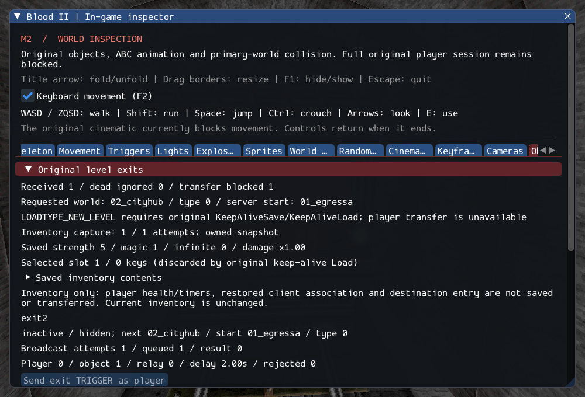

# M2 — Original inventory preservation prerequisite

The supported original CInventoryMgr Save/Load branches now capture and restore
owned inventory state. Restoration recreates Beretta/knife weapons, restores raw
ammo even with infinite ammo enabled, and preserves selected slots/attributes.
The source's keep-alive rule removes keys; ordinary aggregate restoration retains
them. Weapon firing clocks and held identities restart as original reconstruction
from weapon types requires.

The exit request path captures the active player's inventory independently of the
UI. Its contents and errors appear in the Objectives inspector. A failed restore
leaves the previous inventory intact, with staged children cleaned through deferred
lifetime rules. Snapshots survive their source player/world and carry no handles.

**This is not a completed level transfer.** Health/damage state, relative player
timers, other supported player fields, restored client association and destination
start-point entry still need integration and failure-safe world replacement.
The NEW_LEVEL refusal is retained. Nothing resets the live player to default
weapons/ammo to simulate success. Source-object counts remain 203 created, four
transferred sounds, 372 editor-only, one unsupported (Gideon), zero failed.
Required FX, remaining NPC/services and actual M2 acceptance remain open.

See [contracts](../../contracts/inventory_state_contracts.md),
[source provenance](../sources/m2_inventory_state_sources.json), and
[execution ledger](evidence/m2-inventory-state.json).

## Verification

GCC Debug passes **512/512** (199.07s). Inspector-free GCC
Release covers **512 passing checks across the full run and one isolated rerun**:
the full run passed 511/512 (83.84s), then unchanged gpu.character passed 1/1
(4.11s). Its initial log records window focus loss and zero keyboard movement;
no assertions, focus protections or production code were changed for the rerun.
Both logs are retained. Each full matrix covers
**485 headless checks (72 private) and 27 GPU checks**.
Clang ASan/UBSan/leak validation passes **59/59** (83.99s),
covering inventory preservation, original objects/player/exits/triggers, shared
services, attachments and selected weapon ownership/rollback paths.

`--inspect-player` returns 0; `--start-game` retains explicit blocked exit 6.
Nine changed C++ files pass clang-format 23.1.3. Local Markdown links resolve;
all 10,923 reference inventory files and six reference repositories are unchanged.
The saved inspector frame was visually reviewed. Only Linux/Vulkan is verified.

Commands from Blood2:

```sh
cmake --build build/debug -j4
ctest --test-dir build/debug --output-on-failure -j4
cmake --build build/release -j2
ctest --test-dir build/release --output-on-failure -j4
ctest --test-dir build/release -R '^gpu.character$' --output-on-failure -j1
cmake --build build/sanitize -j2 --target inventory_state_tests object_contract_tests player_tests exit_tests trigger_tests services_tests weapon_tests attachment_tests
ASAN_OPTIONS=detect_leaks=1:halt_on_error=1 UBSAN_OPTIONS=halt_on_error=1 \
  ctest --test-dir build/sanitize -R '^(inventory_state|objects|player|exits|triggers|services|attachments)\.|^weapons\.(inventory|lifetime|rollback)$' --output-on-failure -j1
```


The first focused run exposed a test fixture trying to initialize an already bound
session after unload. The test now reuses the initialized adapter and mounted
resources, then restores into a new detached object. Its source-lifetime and
cleanup assertions remain unchanged; the initial failure log is retained.

Private checks run three SubwayA cycles, snapshot a live player's dual Beretta,
ammo and a labelled diagnostic key, restore the inventory into a detached original
CPlayerObj, load both real held models, remove the source, and verify independent
ownership and complete unload. This tests real resources and original aggregate
restoration, not destination gameplay. The GPU exit scenario captures inventory
with the inspector hidden and after reload without changing the live player.



## Remaining transfer work

Port supported original player and CDestructable Save/Load fields, including
relative-clock semantics and explicit refusal of unavailable fields. Restore
client association without replaying fresh-game Respawn initialization; validate
named destination entry and required resources before committing world replacement.
Do not enable NEW_LEVEL until observable preservation and rollback tests pass.
