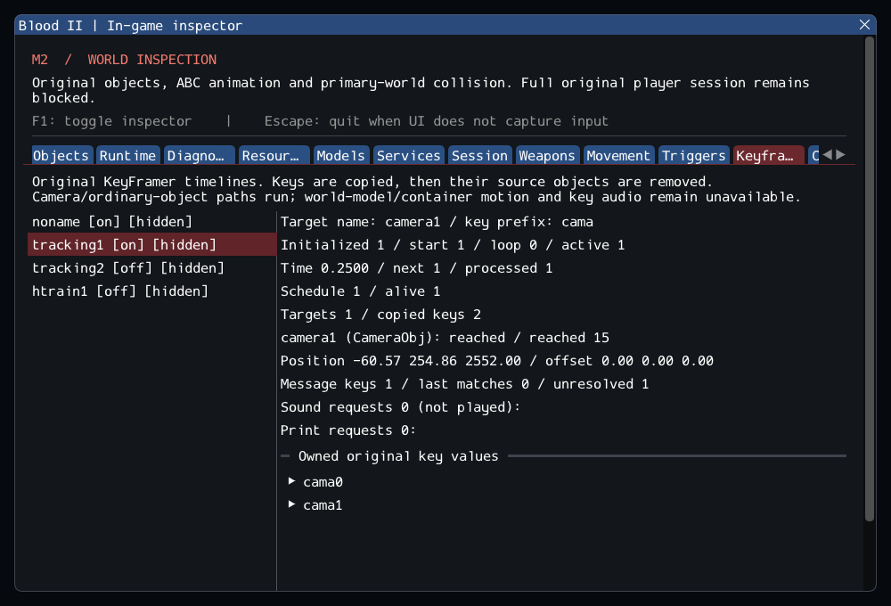

# M2 — Original KeyFramer paths (in progress)

16 October 2026. **M2 remains open.** This continuation follows
[scripted cameras](m2_cameras.md), integrating original KeyFramer/KeyData path rules
into the independent project. References, dependency pins and commercial data are
unchanged. [Contracts](../../contracts/keyframer_contracts.md) and
[source selections](../sources/m2_keyframer_sources.json) describe the exact subset.

## Delivered behavior

Original delayed initialization, contiguous named Key discovery, copied poses/events,
relative timestamps, activation, loops, linear position interpolation and component
rotation offsets now drive cameras/ordinary objects. Linked cameras retain tracking
rotation. Source quirks remain observable: early ON is ignored, Resume does not rearm
a stopped schedule, looping discards overshoot, and completion does not snap to the
last key. Named key messages execute through the original trigger helper.

Keys are copied before deferred removal. Bounded value storage and checked target
links fix stale parallel offsets after target removal. Reentrant state changes stop
the current traversal. Typed interpolation and movement validate complete poses;
contact removal prevents a subsequent rotation write. World models, containers and
client-controlled bodies report Unavailable before mutation. Sound/BPrint values
are inspectable requests; no audio success or fabricated playback timing is returned.

The Keyframes inspector includes hidden/inactive controllers, owned copied keys,
time/schedule/events, actual target positions/offsets, motion results, missing
message targets and explicit unplayed sound requests. The GPU smoke checks actual
SubwayA camera motion with UI hidden and after reload. Lifetime count snapshots
compare the same post-initialization phase, retaining exact equality assertions.

## Content and validation

All **94 KeyFramer controllers** and **383 Keys** in **57 readable worlds** create in
the catalog, alongside the 61 CameraObj targets. Controllers copy **375 keys**;
eight unused keys remain. No empty or malformed path is reported. **44 controllers
lack targets in this camera/key-only catalog**; other target classes are deliberately
not instantiated by that catalog, so this is not full-session coverage. The existing
strict `worlds/16_bridge.dat` rejection remains unchanged.

SubwayA has **148 created source entries + 7 owned SelfTriggers**, **372 editor-only**,
**60 unported**, zero failed. Runtime counts are **155 before player / 158 after**;
the first normal update consumes nine Keys, leaving **146 / 149 live objects**.
The source-entry count remains historical load evidence. Both camera paths run;
tracking1's first key exposes the unresolved Gideon script. The GlowingLight target
set remains absent and the happytrain brush path explicitly reports unavailable
motion. Neither is counted as working gameplay.

Nine synthetic cases and the catalog cover source quirks, ownership/bounds,
reentrant messages, linked-camera offsets, collision clipping and deferred contact
removal. Two actual SubwayA reloads check numeric camera interpolation/client pose,
key consumption, natural camera1/camera2 intro expiry and unchanged train pose after
a rejected motion request. The initial catalog test used absolute session time after
visiting 57 worlds; its assertion now measures elapsed time from each entry, as the
existing camera fixture does. Production clock/timers were unchanged. The first full
regression run also exposed a null dereference in the old private door test: its
all-object snapshot spanned simulation steps that now consume Keys. A GDB backtrace
identified that test line. It now snapshots only Door identities before advancing,
then checks each door is still live; all motion/cleanup assertions remain. The new
duplicate-key fixture was corrected to assert first **returned-list** order (the
existing service prepends matches), not first creation order. No production name
ordering or motion behavior was changed to satisfy those fixtures.

GCC Debug passed **195/195** in **88.39s**; GCC Release without ImGui passed **195/195** in **50.22s**. Clang ASan/UBSan/leak checks passed **180/180 headless** in **216.81s**, without findings.
The configured suite contains 160 synthetic headless, 20 private headless and 15
serial GPU cases. All 24 changed C++ files pass clang-format 23.1.3; final builds
have no warnings. All 10,923 inventoried reference files remain unchanged, and the
six reference repositories are clean. All 1,251 local Markdown targets resolve.
A supplemental catalog probe confirms 94 initialized controllers and eight surviving
Keys, plus 419 reached updates for camera1 and 120 for camera2 in each SubwayA
reload. Its reproducible source delta, raw outputs, failure/backtrace evidence and
artifact hashes are included in the [evidence ledger](evidence/m2-keyframers.json).
Blood2 commit: `04b18c17f3eea36f2a51ee9d739d10257fbe16f7`.

Commands, from `Blood2/`:

```sh
cmake --preset local-debug
cmake --build --preset debug -j4
ctest --preset debug --output-on-failure -j4
cmake --preset local-release
cmake --build --preset release -j3
ctest --preset release --output-on-failure -j4
cmake -S . -B build/sanitize -G Ninja -DCMAKE_BUILD_TYPE=Debug \
  -DCMAKE_C_COMPILER=clang -DCMAKE_CXX_COMPILER=clang++ \
  -DBLOOD2_INSPECTOR=OFF -DBLOOD2_SANITIZERS=ON -DBLOOD2_GPU_TESTS=OFF \
  -DBLOOD2_TEST_DATA_DIR="/path/to/Blood II"
cmake --build build/sanitize -j2
ASAN_OPTIONS=detect_leaks=1:halt_on_error=1 UBSAN_OPTIONS=halt_on_error=1 \
  ctest --test-dir build/sanitize -L headless --output-on-failure -j2
./build/debug/blood2 --inspect-player
./build/debug/blood2 --start-game # still exits 6
```



## Remaining M2 requirements

World/container path physics, CinematicTrigger, GlowingLight, Gideon/AI, sound
playback, cinematic rendering, transitions, attachments and remaining required
classes/services are still missing. KeyFramer creation alone does not close their
service gaps. Save/restore, original BPrint presentation and exact retail engine
math/physics parity remain unverified. Only Linux/Wayland/Vulkan is exercised;
other platforms and XR remain unvalidated. The heartbeat must continue until the
actual roadmap exit criteria pass; M2 is not marked complete by these tests.
