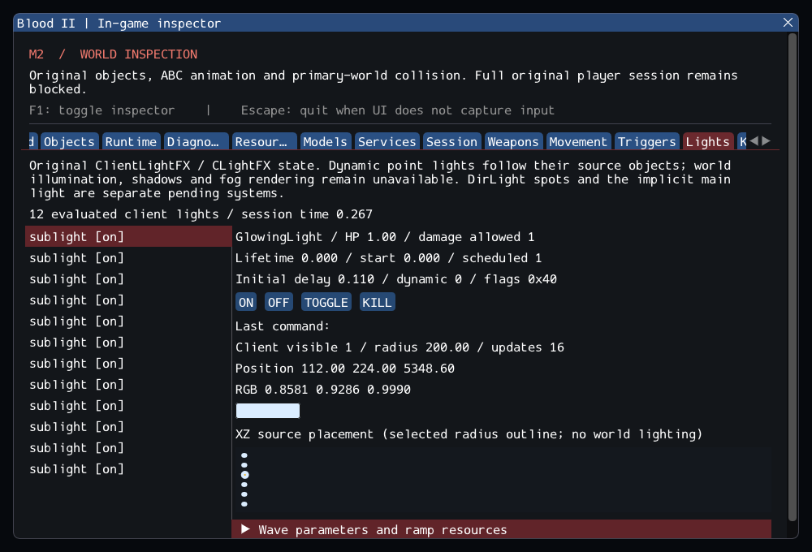

# M2 — Original dynamic lights (in progress)

16 October 2026. **M2 remains open.** Following [KeyFramer paths](m2_keyframers.md),
this increment connects original ClientLightFX, its thirteen waveform/compatibility
subclasses and selected client CLightFX evaluation. See [contracts](../../contracts/light_contracts.md)
and [source selections](../sources/m2_light_sources.json). References, SDL and
other dependency pins and commercial assets remain unchanged.

## Delivered behavior

Original properties, color/phase conversion, lifetime scheduling, ON/OFF/TOGGLE,
CDestructable damage/death and B2BaseClass filtering run through typed services.
Owned client point-light records execute original wave tables/formulas, follow
source movement and apply original visibility/color/radius rules independently of
the inspector. Source quirks are preserved: case-sensitive command prefixes,
initially-off lights do not acquire a lifetime schedule after ON, and a NONE
radius stays at its minimum after OFF/ON. Negative waveform phases wrap safely
instead of indexing before an original table. Portable seeded jitter is an engine
adaptation, not retail RNG parity. Restore and invalid descriptors fail explicitly.

The Lights inspector exposes hidden/off/inactive sources, lifetime/health/flags,
normalized wave settings and plots, evaluated RGB/radius/position, queued original
commands, resource diagnostics and an XZ placement/radius overlay. **World lighting,
shadows and fog are not rendered by this increment.** Ramp resource strings are
retained; the source's unused PlayRampSound is not presented as played audio.
DirLight spots and the implicit main directional light remain separate pending work.

## Content and checks

The installed catalog contains **72** supported dynamic light entries across
**57 readable worlds**: 16 ClientLightFX, 1 Flicker3WaveLightFX, 3 Flicker4WaveLightFX,
9 FlickerLight, 42 GlowingLight and 1 StrobeWaveLightFX. All create and pass OFF/ON
updates and cleanup; two start off, none filter/reject. The existing bounded
`worlds/16_bridge.dat` rejection is unchanged.

SubwayA now creates **160 source entries + 7 SelfTriggers**, with **372 editor-only**,
**48 unported**, zero failed. Counts before/after player entry are **167/170**;
the first normal update consumes nine Keys, leaving **158/161**. The twelve
GlowingLight objects now bind to the original looping sublight KeyFramer and their
client positions follow its motion. Their authored radius remains 200 and red
channel approximately 0.858121: the ranges are constant, so this is motion evidence,
not a claim of pulsing. Synthetic fixtures verify changing waves separately.
The other KeyFramer motion exclusions and unresolved Gideon message stay explicit.

A separate comparison confirms all **384 numeric samples** in the five original
flicker/strobe arrays are unchanged; its hashes/results are retained in the evidence.
Eight synthetic cases cover defaults/aliases, all waveform families/boundaries,
negative phases/clamps, commands, lifetime quirks, damage/death chains and pickup
spawning, checked publication, linked motion/removal, filtering and repeated teardown.
The private catalog also checks two full SubwayA reloads. Existing exact source and
runtime count assertions are updated only for the twelve newly created lights.
The first damage fixture used a null attacker, which the existing typed damage
contract correctly rejects; it now supplies a live sender/attacker. No production
damage validation or behavior was weakened.
The initial two-worker sanitizer run passed 188 cases but hit the existing
90-second limit in weapons.private. The identical scenario passed alone in
85.69 seconds (85.20 seconds user CPU, 450,936 KiB peak RSS). Its three full
reloads and assertions were retained. The final sanitizer suite runs sequentially
to avoid competing tests; no timeout was increased. Both runs and the isolated
measurement are retained in the evidence. The final sequential weapons case
took 89.07 seconds, so its remaining margin under 90 seconds is narrow; parallel
sanitizer timing is not claimed reliable for this expanded scene.

GCC Debug passed **205/205** in **106.17s**; GCC Release without ImGui passed **205/205** in **49.80s**. Clang ASan/UBSan/leak checks passed **189/189 headless sequentially** in **431.80s**, without findings.
The configured suite contains 168 synthetic headless, 21 private headless and 16
serial GPU cases. All 25 changed/new C++ files pass clang-format 23.1.3; final
builds have no warnings. All 10,923 inventoried reference files remain unchanged,
and the six reference repositories are clean. All 1,272 local Markdown targets resolve.
After the full Debug run, the Lights panel was compacted so RGB and the placement
map fit before collapsible parameters; the affected GPU case was rebuilt/retested
and its final capture reviewed. Simulation did not change. Raw suite, focused,
GPU, catalog and startup results and hashes are in the [evidence ledger](evidence/m2-lights.json).
Blood2 commit: `97e8bfbee699ec7f71956c04b9b8ebd99035455e`.

Commands from `Blood2/`:

```sh
cmake --preset local-debug
cmake --build --preset debug -j4
ctest --preset debug --output-on-failure -j4
cmake --preset local-release
cmake --build --preset release -j3
ctest --preset release --output-on-failure -j4
cmake -S . -B build/sanitize -G Ninja -DCMAKE_BUILD_TYPE=Debug \
  -DCMAKE_C_COMPILER=clang -DCMAKE_CXX_COMPILER=clang++ \
  -DBLOOD2_INSPECTOR=OFF -DBLOOD2_SANITIZERS=ON -DBLOOD2_GPU_TESTS=OFF \
  -DBLOOD2_TEST_DATA_DIR="/path/to/Blood II"
cmake --build build/sanitize -j2
ASAN_OPTIONS=detect_leaks=1:halt_on_error=1 UBSAN_OPTIONS=halt_on_error=1 \
  ctest --test-dir build/sanitize -L headless --output-on-failure -j1
./build/debug/blood2 --inspect-player
./build/debug/blood2 --start-game  # Still exits 6.
```



## Remaining M2 gate

48 required SubwayA source entries remain unported. World/container KeyFramer
motion, CinematicTrigger, Gideon/AI, general client FX/audio, transitions,
attachments and other required services remain incomplete. Computed light state
and the inspection overlay do not satisfy a future world-illumination service.
Save/restore and exact retail math/physics/RNG parity remain unverified. Only
Linux/Wayland/Vulkan is exercised; other platforms and XR stay unvalidated.
The heartbeat remains active until the actual roadmap acceptance criteria pass.
