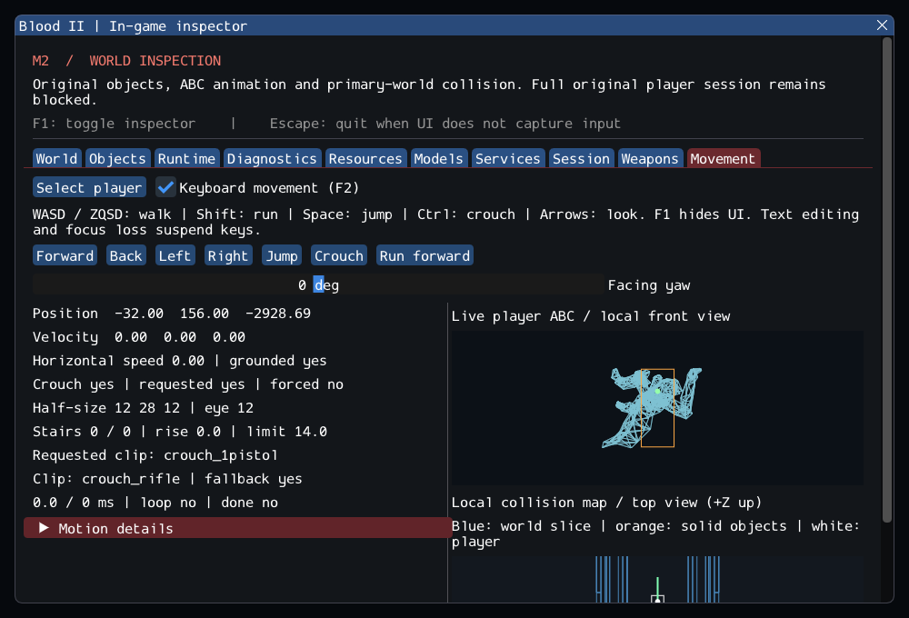

# M2 Continuation — Stairs, Crouch and Original Player Animation

> Historical increment: [m2_containers.md](m2_containers.md) supersedes the pending
> container/liquid/ladder statements below. Its complete-gameplay gate remains open.

15 October 2026. **M2 remains in progress.** Blood2 now connects original
CPlayerObj locomotion selection and MoveMgr crouch rules to the shared local
player, checked animation dimensions, a bounded stair solver and live inspection.
The complete original session/gameplay gate is still open.

## Delivered behavior

- Walk/run, strafe, idle, jump, crouch/crawl and corresponding firing body clips
  follow selected original `UpdateAnim`/`Do*Anim` branches. Playback and model-key
  callbacks use the actual player record, independently of the inspector.
- Original `CAnim_Sound::CheckAnims` fallback handles names absent from retail
  Caleb. The inspector shows the requested name and the resolved clip. For this
  installation, standing movement resolves to rifle clips; crouch resolves to
  `crouch_rifle`. Missing knife firing clips fall back to two-pistol clips.
- Crouch changes collision dimensions using ABC `AnimDims`, anchors the feet,
  halves movement speed and uses the original reduced jump impulse. Standing
  requires clearance; a blocked release keeps crouch, short camera/shot origin
  and reduced speed. Alive player resets beneath a ceiling preserve that stance.
- Grounded `FLAG_STAIRSTEP` bodies climb clear steps using up/forward/down sweeps.
  Low ceilings, excessive heights, unsupported/upward motion and disabled flags
  reject stepping. The limit depends on the current body dimensions. Accepted
  contacts retain deferred removal; failed probes produce no phantom touches.
- The Movement panel displays the live ABC pose, collision box/eye, clip/time,
  stance/clearance, stair attempts and accepted rise, with the existing collision
  map and motion diagnostics. **F2** enables physical WASD/ZQSD, Shift run,
  Space jump, **Ctrl crouch** and arrow-key look; **F1** hides inspection.

The installed Caleb uses standing half dimensions **12/42/12** and crouching
**12/28/12**; eye offsets are the original **36/12**. Default walk/run speeds are
**280/420**, crouched speeds **140/210**, jump impulses **600/450**. Synthetic
models use different dimensions to verify that these come from resources.



This screenshot is the actual player in the Subway world. It shows a crouched
body, a requested pistol clip resolving to `crouch_rifle`, and the live wireframe.
It is diagnostic geometry, not textured gameplay rendering.

## Source boundaries and adaptations

The [source ledger](../sources/m2_locomotion_sources.json) records source
ranges and SHA-256 hashes. [locomotion_contracts.md](../../contracts/locomotion_contracts.md)
describes retained rules, ordering changes and deliberate omissions.

The original client/server duplicate physics model is replaced by the existing
single checked body. A typed `PlayerControls` request routes through the server
shell; `ResizeObject` commits a clear shape atomically instead of temporarily
shrinking a second model or partially pushing objects. Feet, accepted stance,
camera and weapon alignment agree within the same frame. A failed standing
attempt cannot discard the crouched shape or reset its clip as a side effect.

Blood II's complete stair implementation is unavailable. The stair solver is
new engine code. The default half-height limit has evidence in later LithTech;
that generation's solver and additional half-unit tolerance were not imported.
Retail feel/parity and special non-step surfaces remain unverified. Source
left-strafe naming is preserved. The source fire-jump state assignment and the
old client/server crouch delay are explicitly corrected at this local boundary.

No dependency or runtime target was added. SDL stays at the recorded `main`
revision; there is no ECS. Runtime C++ namespaces now use **OpenBlood2**; original
global SDK/game classes retain their names. The user's `.clang-format` and
`.editorconfig` are versioned. Formatting was applied with clang-format 23.1.3
and verified with `--dry-run --Werror`. Dependency pins and all six reference
repositories remain unchanged; all **10,923** inventory file hashes match.

## Validation

Executed on the existing Linux x64, GCC/Clang, Wayland and SDL_GPU Vulkan setup.

| Configuration | Synthetic headless | Private headless | GPU | Result |
| --- | --- | --- | --- | --- |
| Debug, inspector enabled | 68 | 8 | 5 | **81/81 pass** |
| Release, inspector disabled | 68 | 8 | 5 | **81/81 pass** |
| Clang ASan/UBSan with leak checks | 68 | 8 | — | **76/76 pass** |

Logs: [Debug](evidence/m2-locomotion-ctest-debug.log),
[Release](evidence/m2-locomotion-ctest-release.log),
[sanitizers](evidence/m2-locomotion-ctest-sanitize.log),
[retail clips and dimensions](evidence/m2-locomotion-retail-clips.log),
[source integrity](evidence/m2-locomotion-source-integrity.json),
[build/commit manifest](evidence/m2-locomotion.json).

Seven new synthetic cases exercise box and triangle stairs, descent,
over-height/ceiling/flag/crouch/airborne rejection, feet and eye consistency,
blocked standing and alive reset, reduced speeds/jump, clip looping/keys,
missing chains, input/lifetime and callback removal. The private test verifies
actual Caleb clips, dimensions, crouch/stand and movement in `01_SubwayA`.
The GPU movement smoke now asserts exactly **55 forward**, **10 jump**,
**20 run** and **45 crouch** input frames, hidden stance changes, a decoded live
body pose, unload/re-entry and resource restoration. All earlier object, reader,
player, weapon and movement regressions still pass. The final capture was
visually checked; the core clip/stance diagnostics are visible at 1000×680.

```sh
cd Blood2
cmake --preset local-debug
cmake --build --preset debug -j4
ctest --preset debug --output-on-failure
cmake --preset local-release
cmake --build --preset release -j4
ctest --preset release --output-on-failure

cmake -S . -B build/sanitize -G Ninja -DCMAKE_BUILD_TYPE=Debug \
  -DCMAKE_C_COMPILER=clang -DCMAKE_CXX_COMPILER=clang++ \
  -DBLOOD2_INSPECTOR=OFF -DBLOOD2_SANITIZERS=ON -DBLOOD2_GPU_TESTS=OFF \
  -DBLOOD2_TEST_DATA_DIR="/path/to/Blood II"
cmake --build build/sanitize -j4
ASAN_OPTIONS=detect_leaks=1:halt_on_error=1 UBSAN_OPTIONS=halt_on_error=1 \
  ctest --test-dir build/sanitize -L headless --output-on-failure
```

## Commits

The implementation commit is `13b1165` in the independent `Blood2/`
repository. The previously uncommitted M2 work was checkpointed as `007d5ca`;
namespace/format changes are isolated in `9ac915d`. Workspace documentation and
validation evidence are committed separately in the root repository.

## Remaining M2 work

The Subway source-entry accounting remains 18 supported world objects, 372
editor-only entries and **190 missing runtime objects**. `--start-game` still
rejects the incomplete session. Containers/liquids/ladders, moving/rotating world
models/platforms, pushing/crush/depenetration, pickups, complete combat, injury
and death transitions, blending, audio, camera effects and textured rendering
remain outside this increment. Retail stair and movement feel has not been
compared by running the original executable. Windows, macOS, mobile and XR were
not tested. DirLight/implicit-main-light notes in the earlier audit remain valid.
