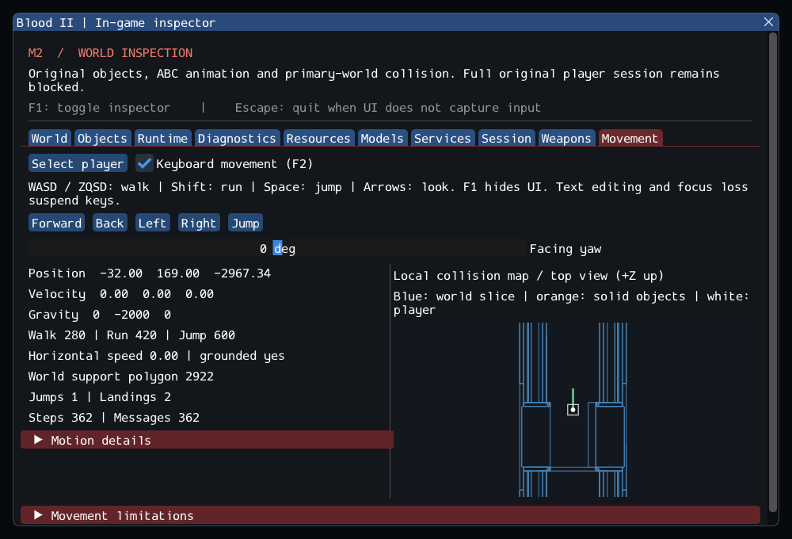

# M2 Continuation — Original MoveMgr and Player Movement

> Current continuation: [m2_locomotion.md](m2_locomotion.md) adds stairs, crouch
> clearance and original player body animations. The results and omissions below
> describe their earlier implementation snapshot.

15 October 2026. **M2 remains in progress.** The new Blood2 project executes
selected original MoveMgr standing movement through the original local shells
and CPlayerObj: walking, running, strafing, jumping, gravity, grounding and
collision. The in-game inspector exposes the actual moving body. This remains
an inspection harness, not playable Blood II.

## Delivered

- Original digital control flags, flattened facing vectors, acceleration/drag,
  run multiplier, diagonal allowance, jump/release and dry-land slope branches.
  Default Caleb walks at 280 units/s, runs at 420 and jumps with a 600-unit/s
  impulse. Physics/forced-position messages initialize the controller.
- Typed MoveMgr → server shell → CPlayerObj → swept collision path. A checked
  local player body replaces duplicated client/server physics objects. Generic
  physics skips associated players, preventing double integration. Forced
  positions retain original byte move codes and clear motion; stale/nonfinite
  requests fail.
- Primary-world triangles and live solid object boxes stop/slide the body.
  Support queries distinguish uphill motion from jumping away from a surface,
  invalidate removed supports and detect walking off edges. Touch callbacks can
  remove the player safely; movement, weapon input and client state detach.
- **Movement** inspection: commands, position/velocity, dimensions, acceleration,
  gravity, source speeds, ground normal and identity, jump/landing counts, timing
  and a local map of actual collision geometry. Controls and simulation work with
  the inspector hidden and in the inspector-free build.

No new runtime target, dependency, ECS or reference-project build dependency was
added. Dependency revisions remain pinned. Commercial content stays external.

## Source reuse and explicit adaptations

The [source ledger](../sources/m2_movement_sources.json) and
[selected-source comparison](evidence/m2-movement-original-adaptations.patch)
identify original MoveMgr, shared flags, slope helper and shell/player routing.
The [movement contracts](../../contracts/movement_contracts.md) describe all
supported and omitted branches; earlier implementation ledgers remain historical.

Blood II's complete physics implementation is unavailable. The new integrator
uses constant-acceleration displacement and substeps no larger than 1/120 s,
retaining MoveMgr's 0.1 s frame cap and exposing discarded time. It resolves small
displacements, constrains inward gravity on supported walkable slopes and sleeps
residual horizontal velocity below the source drag cutoff. A single local body
eliminates the prediction leash and its teleport fallback; typed velocity is not
compressed into legacy packet shorts. These adaptations are documented behavior,
not a claim of bit-identical retail physics. The original executable was not
launched for a movement-feel comparison.

## Validation

Executed on Fedora Linux x64, GCC 16.2.1, Clang 22.1.8, Wayland and SDL_GPU Vulkan
on the NVIDIA RTX 3060 Laptop GPU. Other platforms and XR were not tested.

| Configuration | Synthetic headless | Private headless | GPU | Result |
| --- | --- | --- | --- | --- |
| Debug, inspector enabled | 61 | 7 | 5 | **73/73 pass** |
| Release, inspector disabled | 61 | 7 | 5 | **73/73 pass** |
| Clang ASan/UBSan, leak checks | 61 | 7 | — | **68/68 pass** |

Logs: [Debug](evidence/m2-movement-ctest-debug.log),
[Release](evidence/m2-movement-ctest-release.log),
[sanitizers](evidence/m2-movement-ctest-sanitize.log).
The final compact inspector layout and keyboard/UI routing were rebuilt and
checked with the [movement suite](evidence/m2-movement-gpu-ui.log),
[all Debug GPU scenarios](evidence/m2-movement-gpu-debug-final.log), and
[sanitizer movement follow-up](evidence/m2-movement-followup-sanitize.log). Project builds reported
no warnings, and sanitizer runs reported no memory, undefined-behavior or leak
errors in these exercised paths. GPU/driver code is not sanitizer coverage.

The nine new synthetic cases exercise walking/running/diagonals/opposite input,
jump height and hold/release, solid boxes and ceilings, primary-world walls and
ramps, removed supports and ledges, stale/invalid messages and force resets,
30/60/120 Hz consistency and double-integration prevention, callback removal and
re-entry, and SDL focus/text/window routing. Regression coverage includes all
prior object, resource, animation, player and weapon suites.

Private tests use the configured external Blood II installation, patched
`01_SubwayA`. Three complete load/move/unload cycles each produce **186.661 units**
of horizontal displacement, **57.9285 units** of vertical rise in that geometry,
one jump and two support acquisitions (including entry settling), with **320**
movement messages. See [retail trace](evidence/m2-movement-retail-details.log).
The unobstructed synthetic jump peaks between 85 and 95 units. These figures
describe the tested paths, not campaign coverage or original-executable parity.

The GPU scenario injects SDL key events, walks/jumps/lands while the inspector is
hidden, checks exactly 55 forward-input frames and 10 held-jump frames, then
unloads and re-enters. Movement keys cannot also activate ImGui buttons.
Object/string counts and checked selection
are restored. SubwayA accounting remains 580 source entries: 18 instantiated,
372 editor-only and 190 required runtime entries missing; player entry adds
three server objects. The local MoveMgr adds no duplicate registry object.

The [snapshot](evidence/m2-movement.json) records project hashes, dependency pins
and tool versions. All **10,923** inventoried reference files are unchanged and
all six reference repositories remain clean:
[source integrity](evidence/m2-movement-source-integrity.json).

```sh
cd Blood2
cmake --preset local-debug
cmake --build --preset debug -j8
ctest --preset debug --output-on-failure
cmake --preset local-release
cmake --build --preset release -j4
ctest --preset release --output-on-failure

cmake -S . -B build/sanitize -G Ninja -DCMAKE_BUILD_TYPE=Debug \
  -DCMAKE_C_COMPILER=clang -DCMAKE_CXX_COMPILER=clang++ \
  -DBLOOD2_INSPECTOR=OFF -DBLOOD2_SANITIZERS=ON -DBLOOD2_GPU_TESTS=OFF \
  -DBLOOD2_TEST_DATA_DIR="/path/to/Blood II"
cmake --build build/sanitize -j4
ASAN_OPTIONS=detect_leaks=1:halt_on_error=1 UBSAN_OPTIONS=halt_on_error=1 \
  ctest --test-dir build/sanitize -L headless --output-on-failure
```

## Inspect it

```sh
./build/debug/blood2
# Session -> Enter player inspection -> Movement -> enable keyboard (F2).
./build/debug/blood2 --movement-smoke --capture build/movement.png
ctest --preset debug -L movement --output-on-failure
```

Physical **WASD / ZQSD** walks, **Shift** runs, **Space** jumps and arrows look.
Panel buttons can also supply commands. F1 hides the inspector while keyboard
movement continues; editing text or losing focus suspends keyboard input.
Motion details and limitations expand for further inspection. The top view is
a collision diagnostic, not a replacement game renderer.



## Remaining M2 gate

Stairs, crouch/animation-driven body dimensions, liquids, ladders, conveyors,
moving/rotating world models, platform following, pushers, full movement states,
fall damage, material friction and locomotion animation selection remain open.
The standing body keeps `(12,41,12)` half dimensions. Full shell/gameplay flows,
required world/AI/pickup classes, remaining combat, audio/effects and autosave
also remain incomplete. `--start-game` still fails with code 6. M3 has not begun.
