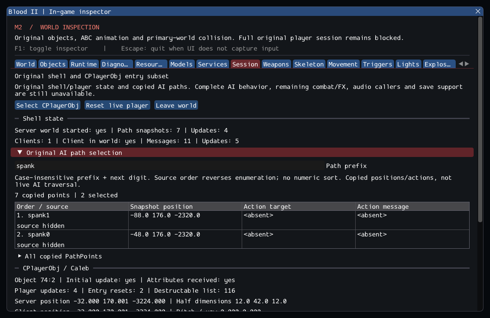

# M2 continuation — original AI path selection

M2 remains incomplete. Original PathMgr snapshot and prefix selection now connect
to the shell and Session inspector. PathListData uses owned values, preserving
optional actions and safe copies across source destruction. See
[contracts](../../contracts/path_manager_contracts.md) and
[source ledger](../sources/m2_path_manager_sources.json).

The source's AddToSortedList starts at a null-data sentinel and inserts every
match at the front: its actual result reverses enumeration. Numeric sorting would
change behavior. Prefix matching checks only the first suffix character for a
digit. SMELL points are not filtered and PathPoints are not removed by BuildPathList,
despite comments suggesting otherwise. GetNextObject now excludes inactive objects,
consistent with the SDK's separate inactive enumeration and later engine evidence.
The inspector's complete object enumeration remains unchanged.

Two private SubwayA cycles verify seven copied points, with queries returning
spank1/spank0, dog3/dog2/dog1/dog0 and cat1. All authored actions are absent in this
installation. This is path data and selection, not AI movement or script execution.
The existing GPU player scenarios compare real values while hidden and after
reload, require new live source identities, and preserve their player/lifetime checks.

## Validation

Commands from Blood2:

```sh
cmake --preset local-debug
cmake --build --preset debug -j4
ctest --preset debug --output-on-failure -j4
cmake --preset local-release
cmake --build --preset release -j3
ctest --preset release --output-on-failure -j4
cmake -S . -B build/sanitize -G Ninja -DCMAKE_BUILD_TYPE=Debug \
  -DCMAKE_C_COMPILER=clang -DCMAKE_CXX_COMPILER=clang++ \
  -DBLOOD2_INSPECTOR=OFF -DBLOOD2_SANITIZERS=ON -DBLOOD2_GPU_TESTS=OFF \
  -DBLOOD2_TEST_DATA_DIR="/home/yann/.steam/steam/steamapps/common/Blood II/"
cmake --build build/sanitize -j2
ASAN_OPTIONS=detect_leaks=1:halt_on_error=1 UBSAN_OPTIONS=halt_on_error=1 \
  ctest --test-dir build/sanitize -L headless --output-on-failure -j1
```

GCC Debug passed **307/307** in **139.98s**; GCC Release without ImGui
passed **307/307** in **84.75s**. Clang ASan/UBSan/leak checks passed
**284/284 headless sequentially** in **594.16s**, without findings.
The suite contains 244 synthetic headless, 40 private headless and 23 serial GPU
cases. Final builds are warning-free; 13 changed/new C++ files pass clang-format
23.1.3. The 10,923 reference files and six reference repositories remain unchanged.
--inspect-player succeeds; --start-game retains exit 6. The capture was reviewed.

The Session capture shows spank1 followed by spank0, their actual copied positions,
absent actions and hidden live sources. The seven-point snapshot is separately
expandable. The GPU log verifies hidden queries and fresh identities after reload;
no additional runtime actor or artificial path was introduced.

Logs, source comparisons, integrity, patch and hashes are retained in the
[evidence ledger](evidence/m2-path-manager.json).
Blood2 commit: `f6f090ef71116686cc17d5491dc2128ca9e8fcc3`.



SubwayA remains **187 created source entries, 4 transferred world sounds, 372
editor-only, 17 unsupported and zero failed**, plus 7 SelfTriggers. Runtime counts
stay 194/197 before/after player, then 185/188 after nine Keys are consumed.
Five CivilianAI, ten CultistAI, Gideon and ExitTrigger remain uninstantiated;
AI following/actions, attachments, FX and other required services keep --start-game
blocked with exit 6. M3–M8 remain planned. Retail ordering, other platforms and XR
are not verified by these Linux tests.
