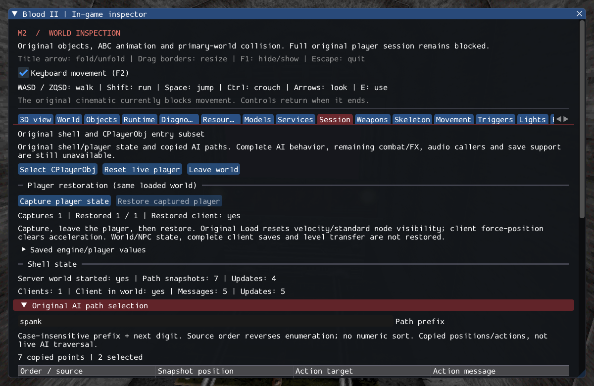

# M2 — Player engine restoration and restored client association

The supported living player's saved engine state now reaches a newly created
original CPlayerObj, then the original shells' saved-client branch. Health, armor,
ammo, raw attributes, body/pose, animation and scheduling survive this path without
Respawn or a start-point trigger. The client receives facing, eye/body, movement
physics and actual stats; movement and held/view models work after association.

The implementation also corrects first-update behavior: the original recalculates
movement/jump speeds, **not** attribute validation, resistance or health/armor caps.
Applying the old fresh-entry validation there would corrupt restored state.

See [contracts](../../contracts/player_restore_contracts.md),
[source ledger](../sources/m2_player_restore_sources.json) and
[execution ledger](evidence/m2-player-restore.json).

## Scope and behavior

Capture is an owned in-memory record with no old handles. Restoration requires the
same loaded world and no current client. It validates resources/geometry and stages
the original owner/aggregates before association. Failures discard that owner and
its generated children; they do not replace an active player or tear down the world.
The saved update delay is rebased. Contacts are recomputed. Original Load resets
standard hidden nodes/flags/velocity; client ForcePos resets acceleration. These
are source behavior, not losses accidentally hidden by a successful return.

The replacement engine boundary uses an explicit checked player identity in place
of HCLIENTREF enumeration. Client first-world state skips the fresh profile message;
no default health/ammo grants occur. The source first-update physics publication is
eager at association so the local MoveMgr can run immediately. It remains the only
player integrator. Dead/dying players and active powers with missing timers refuse
capture/restoration explicitly.

In **Session**, capture the player, leave, then restore. Inspect saved coordinates,
body size, clip/time, remaining deadline and stats, plus actual restore result and
client status. A snapshot survives a world reload but restores only the player;
world objects, NPCs, cinematic state and objectives are not rewound.

## Verification

Four new behavioral/lifetime/private cases cover raw attributes/caps, fresh-reset
exclusion, checked client generations, real movement, scheduling, malformed values,
blocked bodies and early/late rollback. Three external SubwayA cycles preserve
73 HP/17 bullets, rebuild Caleb's 941 triangles and held models, resume MoveMgr and
unload all ownership. Synthetic fixtures deliberately need no start point on restore.
`gpu.model_private` renders the restored player; `gpu.player_restore` checks hidden
updates and restoration after reload in both inspector and inspector-free builds.

GCC Debug passes **535/535** (170.81s); inspector-free GCC
Release passes **535/535** (43.22s). Each full matrix includes
**507 headless checks (76 private) and 28 GPU checks**.
Clang ASan/UBSan/leak checks pass **96/96** (79.64s)
covering restoration, player/aggregate/object/attachment lifetime, model state and
the relevant existing service paths. `--inspect-player` exits 0; `--start-game`
still exits 6 with the actual gameplay gate.

The first full Debug run caught fresh-client duplicate-init rejection; it was
corrected and the full matrix rerun. An earlier isolated model GPU run segfaulted
after printing successful rendering/shutdown checks. It did not recur under GDB,
in five standalone repetitions or the final full matrices; its cause is **unconfirmed**
and the original log remains in the evidence. No driver fix or retail parity is claimed.
The restore UI smoke initially exposed the source's independent 20-second smell
lifetime: its fixture now reloads before initial restoration so both comparisons
have the same world phase. The exact object-count assertions remain unchanged.

16 changed C++ files pass clang-format 23.1.3;
2,171 local Markdown links resolve.
All 10,923 reference files and six reference repositories remain unchanged.
Only Linux/Vulkan is verified. The inspector image was visually reviewed: restore
controls, saved-value section, one completed restore and actual client association
are visible; the saved-value tree is folded in this capture.

Commands from Blood2:

```sh
cmake --build build/debug -j4
ctest --test-dir build/debug --output-on-failure -j4
cmake --build build/release -j2
ctest --test-dir build/release --output-on-failure -j4
cmake --build build/sanitize -j2 --target player_restore_tests character_nodes_tests model_view_tests ai_hit_tests player_state_tests player_tests inventory_state_tests destructable_state_tests object_contract_tests exit_tests services_tests attachment_tests weapon_tests ai_perception_tests
ASAN_OPTIONS=detect_leaks=1:halt_on_error=1 UBSAN_OPTIONS=halt_on_error=1 \
  ctest --test-dir build/sanitize -R '^(player_restore|character_nodes|model_view|ai_hit|player_state|player|inventory_state|destructable_state|objects|exits|services|attachments|ai_perception)\.|^weapons\.(inventory|lifetime|rollback)$' --output-on-failure -j1
```




## Remaining M2 gate

**M2 and NEW_LEVEL remain incomplete.** This is the supported local-player restore
path, not retail save files, full client/world preservation or a safe destination
transition. Next work still needs cross-world keep-alive orchestration, remaining
player/client state, Gideon and required FX/services. The unchanged M2 observable
acceptance gate must pass before completion. SubwayA source accounting remains
203 created, four transferred sounds, 372 editor-only, one unsupported, zero failed.
