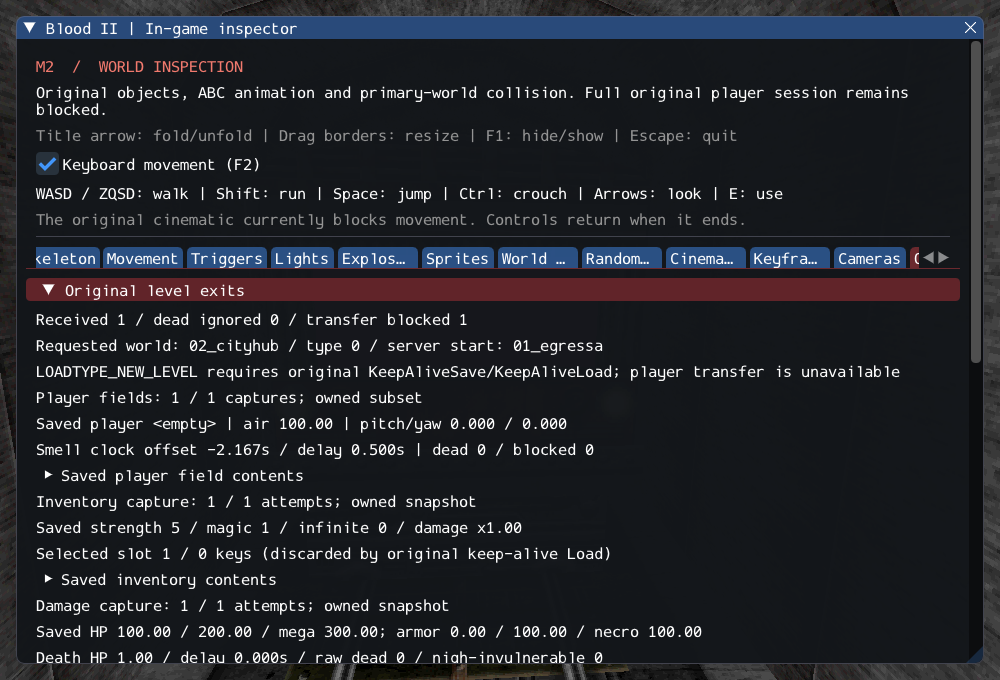

# M2 — Selected player fields and original restore initialization

The implemented CPlayerObj Save/Load value subset now owns player names/trigger
strings, raw attributes, air, movement/death fields and the relative smell clock.
The original savegame InitialUpdate branch binds aggregates/faction lists before
returning, without fresh health/ammo grants, a scent, body setup or scheduling.
Fields load independently of inventory/damage and never invoke Respawn.

Exit inspection captures these values alongside the previous two aggregates.
**Full player restoration and NEW_LEVEL remain blocked**: remaining player fields,
engine/model state, client saved data/association and safe destination replacement
are not provided by this value subset. Gideon, required FX and other services still
keep M2 open. SubwayA remains 203 created, four transferred sounds, 372 editor-only,
one unsupported and zero creation failures; normal entry counts are unchanged.

See [contracts](../../contracts/player_state_contracts.md),
[source selections](../sources/m2_player_state_sources.json) and
[execution ledger](evidence/m2-player-state.json).

## Source rules and adaptations

The smell timestamp saves relative to GetTime and rebases on Load; negative values
remain valid. Its periodic scent-spawning loop is not implemented by this work.
The player's dead flag remains separate from damage death and actually gates
pickup handling. Air retains the existing original recovery/drain path. Raw
attributes, health and ammo are not normalized or reset by LoadFields; the source
last-sent stat caches reset to zero. The original first-update flag is not saved.

Nullable owned strings retain null versus empty values. Staged allocation preserves
old state if either string fails. Bounds, unsupported-state rejection and callback
lifetime checks are explicit adaptations. Active powers reject capture/restoration
because the required expiration timers are unavailable. The new restore initialization
branch does not imply complete engine restoration or client association.

## Validation

GCC Debug passes **524/524** (198.75s), and inspector-free
GCC Release passes **524/524** (104.74s). Each full matrix covers
**497 headless checks (74 private) and 27 GPU checks**.
Clang ASan/UBSan/leak validation passes **72/72** (59.09s),
covering player fields, inventory/damage preservation, original object/player/exit
lifetime, services, attachments, AI faction/perception paths and selected weapon ownership.

`--inspect-player` returns 0; `--start-game` retains explicit blocked exit 6.
11 changed C++ files pass clang-format 23.1.3; 2,128 local Markdown links
resolve. All 10,923 reference inventory files and six reference repositories remain
unchanged. The saved inspector frame was visually reviewed. Only Linux/Vulkan
is verified.

Commands from Blood2:

```sh
cmake --build build/debug -j4
ctest --test-dir build/debug --output-on-failure -j4
cmake --build build/release -j2
ctest --test-dir build/release --output-on-failure -j4
cmake --build build/sanitize -j2 --target player_state_tests player_tests inventory_state_tests destructable_state_tests object_contract_tests exit_tests services_tests attachment_tests weapon_tests ai_perception_tests
ASAN_OPTIONS=detect_leaks=1:halt_on_error=1 UBSAN_OPTIONS=halt_on_error=1 \
  ctest --test-dir build/sanitize -R '^(player_state|player|inventory_state|destructable_state|objects|exits|services|attachments|ai_perception)\.|^weapons\.(inventory|lifetime|rollback)$' --output-on-failure -j1
```


Six new cases cover string/field ownership, clock rebasing, actual pickup refusal
and stat-cache republishing, restore initialization without fresh rewards, child/link
rollback, malformed inputs, live-client refusal, active powers, reentrant damage
callbacks, stale owners, exit capture and three private SubwayA reloads. The private
case composes player fields with the two saved aggregates on an unassociated owner,
loads real models/attachments, removes the source and checks independent air state.
Its air publication is expected to fail until a client is associated. Synthetic
cache tests use an explicitly diagnostic association, not the missing shell path.

The first focused run passed 4/6. Its fixtures incorrectly expected immediate null
on deferred creation failure and successful air/stat publication without a client.
The next run passed 5/6 after correcting deferred removal and explicit dry-position
setup; the remaining failure confirmed missing client publication. The final test
requires that failure as well as correct air recovery. Production code was not
changed to hide either service failure. All logs are retained.

The existing GPU exit scenario verifies the capture with UI hidden and after reload,
while keeping the same live player/world. It activates the authored exit path from
a harness and does not represent a completed playthrough or level transition.



## Next work

Complete the original player/client preservation boundary and engine restoration
before accepting a transfer. Preserve saved state through restored association and
named start entry; validate destination creation and rollback before replacing the
current world. Keep the remaining M2 classes/FX/services explicit.
