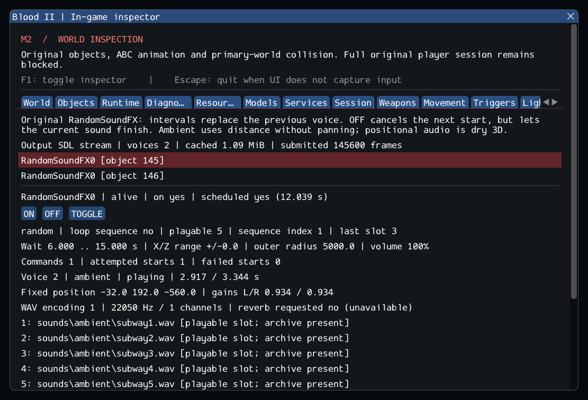

# M2 continuation — Original random sound emitters

**16 October 2026. M2 remains incomplete.** Original RandomSoundFX now drives real
fixed-position ambient/spatial audio through the existing bounded WAV/SDL path.
The original intervals, random/sequential rules, trigger prefixes and owned voice
lifetime are connected and inspectable. See [contracts](../../contracts/random_sound_contracts.md),
[source selections](../sources/m2_random_sound_sources.json) and the
[previous cinematic audio evidence](m2_cinematics.md).

## Source behavior and engine boundary

Initial activation uses the authored random wait interval. ON schedules a start
in 0.1 seconds; OFF disables scheduling but leaves the current voice to finish.
TOGGLE/ON/OFF use case-sensitive prefixes. Unknown payloads still rearm/reset an on
controller. Each update replaces its previous voice even if it is still playing.
Sequential mode advances after a failed resource start as well as a successful one,
and stops or wraps at the authored list length. First-empty-slot termination,
zero-wait disabling and byte conversion before volume clamping are preserved.
The original double FreeString is fixed with one release per owned message read.

The original code offsets X and Z independently within the authored range and
keeps Y unchanged; the resulting voice stays at that position after emitter motion.
A typed Local/Ambient/Spatial enum separates the three audio modes. Ambient attenuates
with distance without panning. Spatial output uses the existing dry attenuation and
panning; positional reverb intent is retained but remains unimplemented. This is
replacement mixing, not recovered retail engine audio. The portable seeded RNG is
repeatable within the tested build, not claimed identical to the retail sequence
or across standard-library implementations.

PlaySoundAt requires a live owner and a valid ambient/spatial request without an
attachment. Voice creation decodes actual mounted resources and returns explicit
failure for missing/malformed/over-budget input. Pending-owner removal, destructor
release, stale IDs and unload reuse the checked audio/object lifetime contracts.
No UI code advances game state. Negative/nonfinite/reversed/out-of-bound properties
and restore creation reject explicitly; save/load and cache callbacks are omitted.

The built-in Sound class remains unsupported. Inspection of its original source
shows that it starts a loop and immediately removes its object, optionally requesting
streaming. That requires a different, world-owned lifetime from this increment's
object-owned voices. No short-lived substitute was registered.

## Private data and actual session evidence

The catalog checks **57 readable worlds, 54 RandomSoundFX controllers and 223
playable sound references**. All controllers pass property creation. **188 sound
references decode and 35 are absent**, with no invalid present files. The missing
references cover 12 distinct authored paths (case/slash normalized below):

| World | Missing path(s) | Reference occurrences |
| --- | --- | ---: |
| 05_cdm | sounds/enemies/souldrudge/pain1.wav, pain2.wav, pain3.wav | 3 |
| 09_abandoned_buildings | sounds/ambient/steam3.wav; sounds/enemies/thief/th_walk_2.wav | 5 |
| 12_train_station | sounds/ambient/crowcaw.wav; sounds/ambient/thun7.wav | 10 |
| 13_downtown | sounds/ambient/.wav; sounds/ambient/thun1.wav, thun2.wav, thun3.wav | 16 |
| 21_laboratory | sounds/enemies/civilian/scream3.wav | 1 |

These are reference occurrences, not unique-file counts. No resource alias or
commercial replacement was created. The existing strict `16_bridge.dat` failure
remains unchanged. The [catalog log](evidence/m2-random-sounds-catalog.log) retains
all exact authored occurrences and decoding diagnostics.

Both SubwayA emitters are named `RandomSoundFX0`; inspector IDs distinguish them.
Both are initially on, ambient, random and use a 5,000-unit outer radius, volume
100 and zero position range. One chooses among five subway sounds at 6–15 second
intervals; the other chooses among six announcement sounds at 20–35 second intervals.
All eleven references decode. The private session test verifies the authored initial
schedules, sends original ON to both, advances their real voices and unloads/reloads
through the selected original shells/player twice. The synthetic tests separately
cover full sequential completion, looping, OFF tails and failed-start progression.

SubwayA now has **166 created source entries, 7 owned SelfTriggers, 372 editor-only,
42 unported and zero failed**. Runtime counts are **173/176 before/after player
entry**, then **164/167 after nine Keys are consumed**. Exact assertions in existing
session tests account for the two new controllers; the startup failure gate remains.
Remaining unported entries are CClientExplosionSFX (9), CivilianAI (5), CultistAI (10),
DetailSprite (12), ExitTrigger (1), Gideon (1) and Sound (4).

## Inspector and verification

The Random sounds tab shows hidden/inactive/pending emitters, distinct IDs for
duplicate names, current schedule and sequence state, attempts/failures, all ten
authored slots including ignored gaps, resource presence, decoded voice parameters,
fixed position, gains and SDL output status. Diagnostic commands queue original
messages. Archive presence does not imply successful decoding, and submitted frames
mean SDL accepted PCM, not that someone heard it.



Ten added checks cover seven synthetic cases (defaults, commands, sequence, random,
spatial, lifetime, failures), the private catalog and SubwayA session, and one serial
GPU case. The GPU scenario starts an actual authored emitter via ON, verifies actual
sample advancement and SDL dummy output while the inspector is hidden, resizes, and
repeats after unload/reload. It also runs without ImGui. The previous cinematic
regressions protect local and attached playback after introducing typed audio modes.

Commands run inside `Blood2/`:

```sh
cmake --preset local-debug
cmake --build --preset debug -j4
ctest --preset debug --output-on-failure -j4
cmake --preset local-release
cmake --build --preset release -j3
ctest --preset release --output-on-failure -j4
cmake -S . -B build/sanitize -G Ninja -DCMAKE_BUILD_TYPE=Debug \
  -DCMAKE_C_COMPILER=clang -DCMAKE_CXX_COMPILER=clang++ \
  -DBLOOD2_INSPECTOR=OFF -DBLOOD2_SANITIZERS=ON -DBLOOD2_GPU_TESTS=OFF \
  '-DBLOOD2_TEST_DATA_DIR=/home/yann/.steam/steam/steamapps/common/Blood II/'
cmake --build build/sanitize -j2
ASAN_OPTIONS=detect_leaks=1:halt_on_error=1 UBSAN_OPTIONS=halt_on_error=1 \
  ctest --test-dir build/sanitize -L headless --output-on-failure -j1
```

GCC Debug passed **235/235** in **111.98s**; GCC Release without ImGui passed **235/235** in **66.96s**. Clang ASan/UBSan/leak checks passed **216/216 headless sequentially** in **462.04s**, without findings.
The suite contains 190 synthetic headless, 26 private headless and 19 serial GPU
cases. All 29 changed/new C++ files pass clang-format 23.1.3; final builds are warning-free.
All 10,923 inventoried reference files are unchanged and the six reference repos are
clean. The final capture was reviewed. Raw logs, source integrity, patch and hashes
are in the [evidence ledger](evidence/m2-random-sounds.json).
Blood2 commit: `66bb0337758b0050ca26b3784a883545a35c63df`.

The initial Debug suite passed 234/235: one CLI assertion still expected 44 missing
objects. Startup correctly reported 42 and refused play. After correcting that exact
count, the CLI scenario and the complete Debug suite passed. No timeout, behavior
assertion or M2 acceptance criterion was weakened.

## Remaining M2 work

Built-in Sound loops and streaming, other sound callers, priority arbitration,
reverb/Doppler, original AI, client effects, transitions, attachments and other
required services still prevent complete session acceptance. Audio hardware quality,
retail executable parity and platforms other than the tested Linux setup are
unverified. The actual roadmap exit criteria and blocked `run_world` are unchanged.
