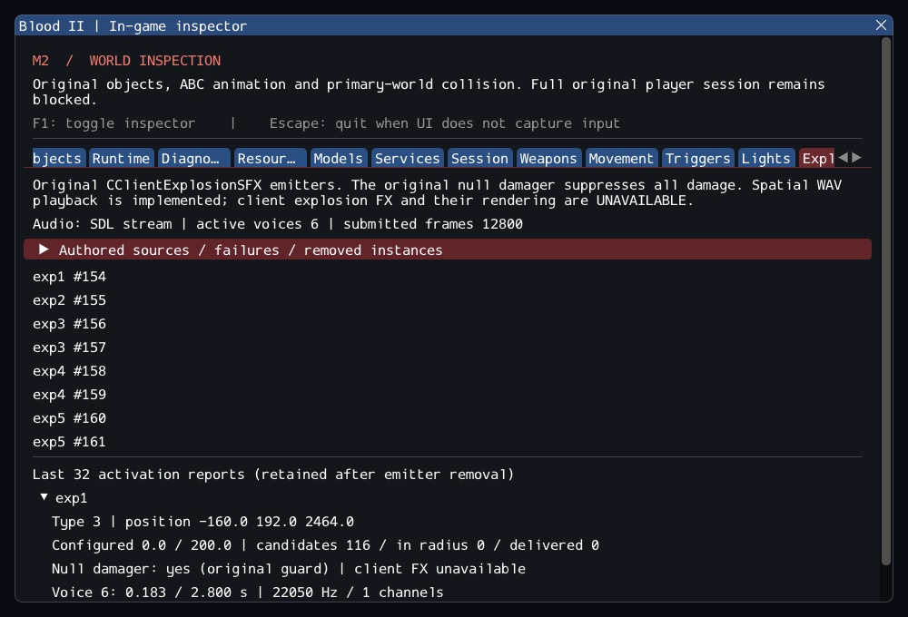

# M2 continuation — original scene explosion emitters

M2 remains incomplete. Original CClientExplosionSFX now executes authored properties,
case-insensitive TRIGGER, repeated activation before its scheduled removal and the
original CClientSFX/B2BaseClass callback chain. See [contracts](../../contracts/scene_explosion_contracts.md)
and [source ledger](../sources/m2_scene_explosion_sources.json).

The supplied source calls DamageObjectsInRadius with a null damager, which makes
DamageObject refuse every delivery. This is preserved and tested with nonzero
configured damage and targets inside the radius. Existing non-null brush blasts
retain their tested squared-distance falloff. The emitter also caches its initial
position; later motion does not move its effects. Triggering does not restart its
0.1-second update timer, and repeated commands can start overlapping voices.

PlaySoundFromPos now produces real decoded spatial WAV voices at the original
100/1000 radii, full volume and priority 2 metadata. The world owns these one-shots:
they survive source removal and automatically release their voice at completion.
Existing loop and source-owned sound lifetime remains unchanged. Output is dry;
reverb and priority arbitration remain missing. Activation reports retain the
unimplemented client-FX request explicitly as unavailable. This is a functional
server/audio subset, not simulated or rendered explosion FX.

The Explosions tab shows hidden/inactive emitters, source failures/removal, commands,
schedule, cached position, configured damage versus actual delivery and audio state.
The last 32 reports survive source removal and clear on unload. TRIGGER executes at
a frame boundary; normal simulation continues with ImGui hidden or compiled out.

## Private content observations

57 readable worlds contain 43 emitters, all accepted: 19 authored WAV references
decode; 24 point to the absent Sounds\exp_tnt.wav. No substitute path is invented.
Type distribution: 1 (3), 2 (10), 3 (19), 6 (7), 8 (3), 24 (1). The known 16_bridge
DAT structural rejection remains unchanged. Private commercial bytes stay external.

All nine SubwayA emitters use type 3, damage 0, radius 200, direction (0,1,0) and
sounds\weapons\howitzer\impact.wav. Source names are exp1 (2), exp2 (1), exp3 (2),
exp4 (2), exp5 (2). Census: **187 live-created source entries, 4 world sounds,
372 editor-only, 17 unported and zero failed**, plus 7 SelfTriggers. Runtime counts
before/after player are **194/197**, then **185/188** after consuming nine Keys.
Remaining unported entries are 5 CivilianAI, 10 CultistAI, 1 Gideon and 1 ExitTrigger.
Required services, especially actual client FX, still keep the M2 gate open.

## Validation

Commands from Blood2:

```sh
cmake --preset local-debug
cmake --build --preset debug -j4
ctest --preset debug --output-on-failure -j4
cmake --preset local-release
cmake --build --preset release -j3
ctest --preset release --output-on-failure -j4
cmake -S . -B build/sanitize -G Ninja -DCMAKE_BUILD_TYPE=Debug \
  -DCMAKE_C_COMPILER=clang -DCMAKE_CXX_COMPILER=clang++ \
  -DBLOOD2_INSPECTOR=OFF -DBLOOD2_SANITIZERS=ON -DBLOOD2_GPU_TESTS=OFF \
  -DBLOOD2_TEST_DATA_DIR="<external Blood II installation>"
cmake --build build/sanitize -j2
ASAN_OPTIONS=detect_leaks=1:halt_on_error=1 UBSAN_OPTIONS=halt_on_error=1 \
  ctest --test-dir build/sanitize -L headless --output-on-failure -j1
```

GCC Debug passed **264/264** in **119.01s**. GCC Release without ImGui passed
**264/264** in **71.50s**. Clang ASan/UBSan/leak checks
passed **242/242 headless sequentially** in **510.28s**,
without findings. The suite contains 210 synthetic headless, 32 private headless
and 22 serial GPU cases. Final builds are warning-free and changed C++ files pass
clang-format 23.1.3. All 10,923 inventoried reference files are unchanged and six
reference repositories remain clean. Capture reviewed; logs, initial failures,
source integrity, patch and hashes are in the [evidence ledger](evidence/m2-scene-explosions.json).
Blood2 commit: `30c5ce0c5926e257400827e665b75ad20858af4a`.

The original animation catalog test still exercises all 86 clips, callbacks and
vertices through the full session; it now advances each clip in steps no larger
than the existing 0.5-second physics bound, because newly loaded emitters overlap
conveyors. No engine catch-up limit, test timeout or acceptance gate was relaxed.

An initial sanitizer run timed out weapons.private at 90.12 seconds and was stopped
after that failure. Container queries now copy only IDs of bound volumes, preserving
fresh snapshot order and checked lifetime while avoiding unrelated effect lookups.
The unchanged weapon scenario then passed in **75.05 seconds**, and again in
**76.62 seconds** during the final complete sanitizer suite. All regression suites
were rebuilt and rerun after this allocation/query optimization; the original
timeout remains in place.

Synthetic cases test original rules, null/non-null damage, repeated commands,
position caching, inactive/removal/stale lifetime, sound failures, resource budgets
and cleanup. Private checks scan the full emitter catalog and run two complete
SubwayA/player cycles. The GPU scenario checks original activation and removal,
independent WAV playback and SDL frame submission while hidden and after reload.



No retail executable, non-Linux platform, XR, visual explosion or audible-device
parity is claimed. --start-game still fails with exit 6. M3–M8 remain planned;
this increment does not change the actual M2 acceptance criteria.
