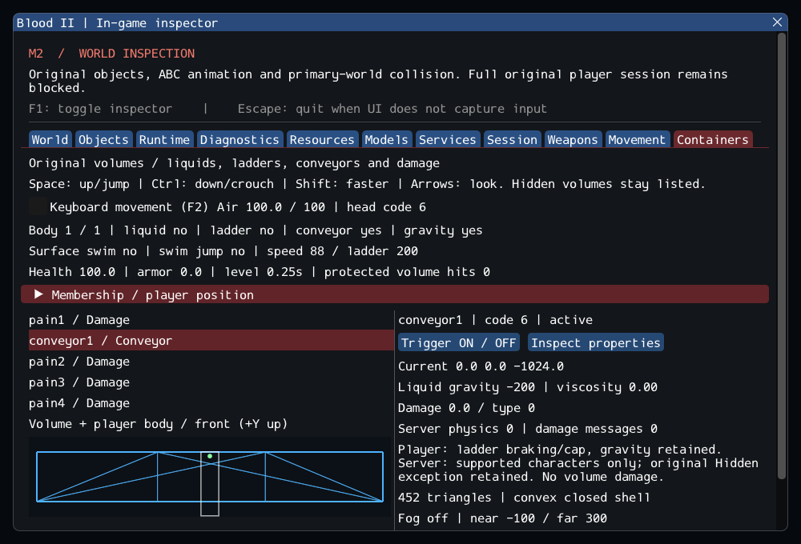

# M2 continuation — Conveyors, damage and freefall volumes

The clean `Blood2/` project now integrates selected original **Conveyor, Damage
and FreeFall** classes, including original MoveMgr conveyor behavior and the
player's initial protection against volume damage. This continues
[m2_containers.md](m2_containers.md). M2 remains in progress; `--start-game` still
rejects the incomplete session.

## Implemented

- Original registrations, inherited properties and constructors, with authored
  Code/DamageType overrides retained. FreeFall has zero liquid gravity, no air
  depletion, and the source's large default damage.
- Conveyor current, braking, speed caps and gravity/jump behavior through the
  original MoveMgr branches. The shared player integrates once. Generic server
  current applies only to supported characters; source differences between the
  client and server paths are documented and tested.
- Original CPlayerObj rejection of volume damage during the first two level
  seconds. A typed level clock preserves the existing monotonic scheduling
  clock and resets on world replacement, independently of player entry.
- Numeric damage values 9/10 and the high FreeFall dose through the existing
  typed damage path, without guessing a replacement identifier from the class
  name. The same original resistance/armor/health aggregate receives damage.
- Ingame inspection of the new classes, conveyor membership, current, damage,
  counters, health/armor and level protection. The existing geometry view,
  queued ON/OFF and checked player placement remain available.

Read [specialized_volume_contracts.md](../../contracts/specialized_volume_contracts.md)
for exact source rules, adaptations and omissions.
[m2_specialized_volume_sources.json](../sources/m2_specialized_volume_sources.json)
records eight source selections/references and hashes. The
[implementation patch](evidence/m2-specialized-volumes-implementation.patch)
is relative to the preceding container commit. The engine remains simple C++20;
no dependency, ECS or prototype codebase was added.

## Content findings

The configured external installation was used without copying commercial files.
A bounded scan of readable base/multiplayer DAT files created and destroyed
**103 additional original instances**: **38 Conveyor, 47 Damage, 18 FreeFall**.
Their actual closed shapes passed the existing geometry validation.

Five entries remain explicit failures: two Damage and two Conveyor entries
named `noname` in `worlds/14_subwayc.dat` have ambiguous models, and Damage `kkk`
in `worlds/20_powerstation.dat` has no model. The known typed-property failure in
`worlds/16_bridge.dat` still prevents reading that DAT. These are asserted,
named exceptions in the private test, not silently skipped arbitrary failures.

Retail FreeFall metadata uses DamageType=10 although the original registration
uses 8; Damage metadata also contains 9. The port retains these numeric values.
The source enum calls them Slow/Blind, but voodoo special actions are separate
weapon calls. Numeric volume damage does not fabricate those actions. Exact
retail executable behavior remains unverified.

`01_SubwayA` now accounts for **23 original / 372 editor-only / 185 unported**
source entries. The five new original instances are one Conveyor and four Damage
volumes. CityHub has **11 supported volume instances**, including six escalator
volumes. The existing canal and ladder checks still pass.

The private Subway test exercises short airborne conveyor overlap, with current
and gravity, then unload/re-entry. It also checks that late player entry does
not restart damage protection and a new world does. Grounded transport, jump
and airborne cap behavior are tested with synthetic collision fixtures. This
does not validate moving train/platform collision or complete retail escalator
traversal.

## Validation

Linux Debug and inspector-free Release both compile and pass the full suite.
The matrix consists of 82 synthetic headless cases, ten private headless cases
and seven real SDL_GPU/Vulkan window scenarios. Results and hashes are in
[evidence/m2-specialized-volumes.json](evidence/m2-specialized-volumes.json).

| Configuration | Result | Scope |
| --- | ---: | --- |
| GCC Debug / Dear ImGui | 99/99 | Headless, private content, seven GPU scenarios |
| GCC Release / inspector OFF | 99/99 | Same lifecycles, without ImGui |
| Clang ASan + UBSan + leak detection | 92/92 | Synthetic/private headless only |

Five new synthetic cases exercise defaults and rejection/cleanup, single player
conveyor integration and jumps, generic character/prop support differences,
high and authored-type damage/protection, and zero-gravity/air/exit behavior.
A new private case checks the 103 instances, five explicit model failures and
repeated real level/player lifecycle. A new GPU scenario checks Subway conveyor
movement with the UI hidden, resize, capture, unload/reload and clean shutdown.
All earlier object, reader, player, weapon, locomotion and liquid tests remain.

Changed C++ files pass clang-format 23.1.3. All 10,923 inventoried reference files
are unchanged and the six reference Git worktrees are clean. Other platforms,
XR, textured liquid effects and retail executable parity were not tested.



The 1000 × 680 capture shows the real conveyor shell, original source classes,
player state and explicit server/client behavior. The main view remains a
geometry inspector, not textured game rendering.

Commands, from `Blood2/`:

```sh
cmake --build --preset debug -j4
ctest --preset debug --output-on-failure -j4
cmake --preset local-release
cmake --build --preset release -j4
ctest --preset release --output-on-failure -j4

cmake -S . -B build/sanitize -G Ninja -DCMAKE_BUILD_TYPE=Debug \
  -DCMAKE_C_COMPILER=clang -DCMAKE_CXX_COMPILER=clang++ \
  -DBLOOD2_INSPECTOR=OFF -DBLOOD2_SANITIZERS=ON -DBLOOD2_GPU_TESTS=OFF \
  -DBLOOD2_TEST_DATA_DIR="/path/to/Blood II"
cmake --build build/sanitize -j4
ASAN_OPTIONS=detect_leaks=1:halt_on_error=1 UBSAN_OPTIONS=halt_on_error=1 \
  ctest --test-dir build/sanitize -L headless --output-on-failure -j4

./build/debug/blood2 --world 01_SubwayA --containers-smoke --capture build/conveyor.png
```

## Remaining gate

CraneControl, Minefield, liquid surfaces/underwater effects, keys, AI container
reactions and persistence remain unported. Doors, moving world models/platforms,
pushers, pickups, missing classes and complete combat/death behavior still block
M2. The next structural step is original doors and moving-world-model services,
with real geometry collision and explicit player interaction/lifetime tests.
These are planned work, not capabilities established by this increment.

## Commits

Implementation and project documentation: `bbb1ba4` in the independent
`Blood2/` repository. Workspace documentation and validation evidence are
committed separately in the root repository.
