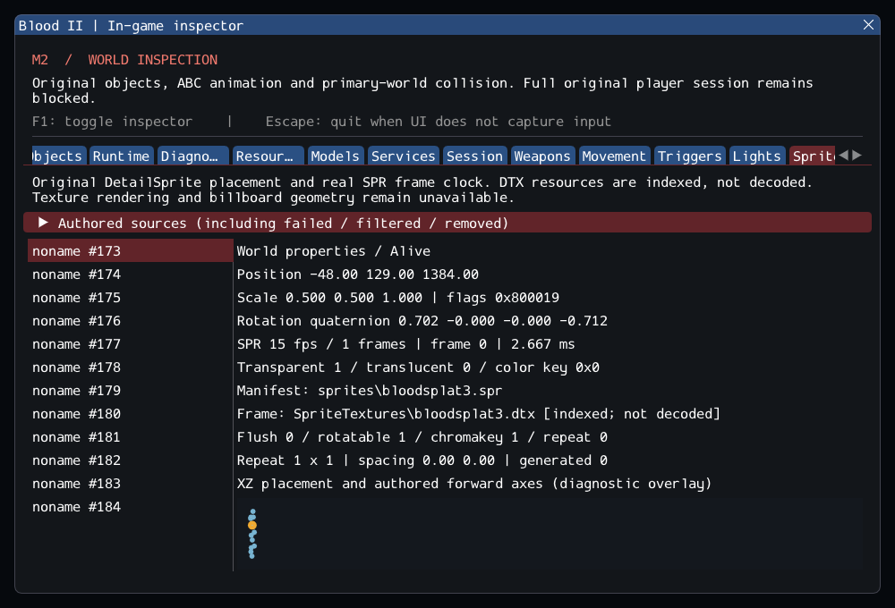

# M2 continuation — original DetailSprite and SPR resources

M2 remains incomplete. This increment integrates original DetailSprite into the
clean Blood2 project, with bounded SPR manifests, typed flush rays, independent
repeat lifetime and frame clocks. See [contracts](../../contracts/sprite_contracts.md)
and the [source ledger](../sources/m2_sprite_sources.json).

## Implemented and observed

Original world/string properties, runtime constructor differences, callback order,
flags and schedule cancellation are preserved. Flush moves to point + normal*0.25
without changing rotation. Repeats run only within FlushWithWorld, including misses,
in original column order. Runtime children inherit transforms/resources/flags and
survive parent removal or subsequent difficulty filtering. Counts and positions are
bounded; failed services and resources remain explicit failures.

CastWorldRay implements the source's world-only/ignore-nonsolid query through the
existing replacement collision index. SPR manifests decode five little-endian
header words and counted texture paths, with strict size/count/rate/path checks.
Mounted frame presence is checked before binding; texture pixels are not decoded.
Each active instance has a looping frame clock independent of visibility and UI.
The later-generation integer period is used with fractional millisecond carry;
retail Blood II timing equivalence has not been established.

The Sprites tab accounts for source failures and live/generated instances, original
properties, transforms/flags, flush result, repeat handles and current SPR frames.
An XZ placement/forward-axis overlay is diagnostic, not a sprite renderer.

SubwayA now has **178 live-created source entries, 4 transferred world sounds,
372 editor-only and 26 unported**, with no failures. Seven SelfTriggers give
**185/188** runtime objects before/after player entry; nine consumed Keys leave
**176/179**. All twelve DetailSprites use bloodsplat3.spr and its one referenced
bloodsplat3.dtx frame: 15 fps, transparent=true, translucent=false, color key 0.
They use scale 0.5, Y=129, Rotatable/Chromakey=true and Flush/Repeat=false.

The private catalog covers **57 readable worlds and 124 DetailSprite entries**:
120 referenced manifests parse and their frame resources exist; four references
are missing/empty. Strict creation rejects those four plus one old TypeAction
schema, leaving 119 accepted entries. Two accepted FlushWithWorld entries in
17_entrance hit real geometry; none of the catalog entries repeat. Three missing
Steamtunnels references incorrectly name .dtx paths, and one Temple entry has an
empty Filename with its path in Name. No aliases or guessed corrections are added.
16_bridge retains its previous DAT-reader failure. Commercial bytes stay external.

## Validation

Commands run from Blood2:

```sh
cmake --preset local-debug
cmake --build --preset debug -j4
ctest --preset debug --output-on-failure -j4
cmake --preset local-release
cmake --build --preset release -j3
ctest --preset release --output-on-failure -j4
cmake -S . -B build/sanitize -G Ninja -DCMAKE_BUILD_TYPE=Debug \
  -DCMAKE_C_COMPILER=clang -DCMAKE_CXX_COMPILER=clang++ \
  -DBLOOD2_INSPECTOR=OFF -DBLOOD2_SANITIZERS=ON -DBLOOD2_GPU_TESTS=OFF \
  -DBLOOD2_TEST_DATA_DIR="<external Blood II installation>"
cmake --build build/sanitize -j2
ASAN_OPTIONS=detect_leaks=1:halt_on_error=1 UBSAN_OPTIONS=halt_on_error=1 \
  ctest --test-dir build/sanitize -L headless --output-on-failure -j1
```

GCC Debug validated **255/255** across the full run (254/255) and final corrected CLI rerun (1/1), in **118.22s**; GCC Release without ImGui passed **255/255** in **70.29s**. Clang ASan/UBSan/leak checks passed **234/234 headless sequentially** in **519.55s**, without findings.
The suite contains 204 synthetic headless, 30 private headless and 21 serial GPU cases.
All 33 changed/new C++ files pass clang-format 23.1.3; final builds are warning-free.
After refining unnamed-instance labels, the final GPU sprite check passed 1/1
in 3.83s and its capture was reviewed. The weapons.private sanitizer scenario
took 88.27s against its unchanged 90s timeout; no acceptance budget was raised.
All 10,923 inventoried reference files are unchanged and the six reference repos
remain clean. The final capture was reviewed. Commands, logs, integrity checks,
patch and file hashes are in the [evidence ledger](evidence/m2-sprites.json).
Blood2 commit: `f2d86f74d3cdfd64a35374ce019f2c58048986ba`.
Tests cover malformed manifests, fractional/boundary clocks, flags/properties,
flush hit/miss/world-only filtering, repeat ordering/zero counts, parent removal,
difficulty filtering, explicit failures, cache override, stale IDs and unload.
Loader tests retain failed/filtered dispositions after reclamation. Private tests
exercise two complete shell/player cycles and all catalog entries. The GPU scenario
checks actual placement/resource/clock state while the inspector is hidden and
after reload, also with ImGui disabled in Release.



## Remaining M2 gate

Gameplay startup still fails explicitly: SubwayA retains 26 unported entries
(9 CClientExplosionSFX, 5 CivilianAI, 10 CultistAI, 1 ExitTrigger and 1 Gideon), plus
required services. DTX decoding, textured sprites/billboards/transparency/clipping,
full SpriteControl APIs, save/restore and retail timing/visual parity remain open.
No non-Linux platform, XR or retail executable comparison is claimed. The M2
acceptance criteria are unchanged; M3 playable slice, M4 rendering and subsequent
campaign milestones remain planned.
