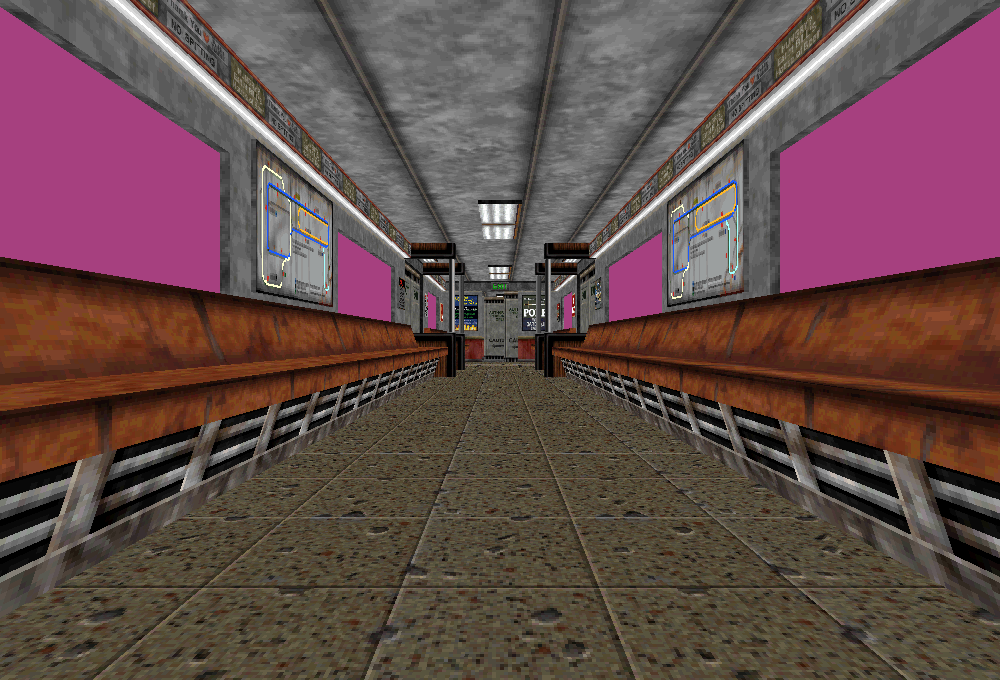

# M2 — Textured diagnostic world

**M2 remains incomplete.** The navigable SDL_GPU level now displays original DTX
base textures. Start it from Blood2 with `./build/debug/blood2 --view-world`.
The authored intro, existing original movement/cameras and F1 inspector remain.
This is an unlit inspection view; visible models/weapons, complete NPC behavior,
required FX and the transition service are still missing.

## Result

SubwayA resolves **52 distinct DTX resources with zero failures**, using **1,962,244
bytes of CPU RGBA payload**, including the diagnostic white slot. Existing geometry
and placement checks remain: 25,287 CPU vertices, 116 model ranges, 111 visible
instances, 7,441 triangles and 110 checked posed world models. Textures stay attached
to moving brushes. Transparent surfaces remain opaque magenta diagnostic markers;
the image below is not retail lighting or transparency parity.



The complete mounted corpus contains **3,820 decoded version -2 textures**, including
**1,450 with separate masks**, plus **five explicitly unsupported version-0 files**:
`skins/crate1.dtx`, `skins/grycret1.dtx`, `skins/metal1.dtx`, `skins/orgbrikb.dtx` and
`textures/greys/dull1_trans.dtx`. None is required by this world's visible surface
set. The decoder recognizes the version/layout, never those basenames.

[Texture contracts](../../contracts/texture_contracts.md) specify limits, malformed
input behavior, channel/mask assumptions, exact paths, UVs, batching and ownership.
The replacement reader was written after reviewing prototype parsers against actual
bytes. No donor renderer, dependency or heuristic format selection was imported.
The later LithTech -5 header is incompatible with these -2 assets. Commercial data
remains external; only test logs, hashes and visual evidence are committed.

## Validation

GCC Debug: **343/343**, 117.08s. Inspector-free GCC Release:
**343/343**, 33.0s. Each full suite contains 270 synthetic headless,
48 private headless and 25 serial GPU cases. Focused Clang ASan/UBSan/leak checks:
**9/9**, 11.03s, including the entire DTX corpus and two original
world/player cycles; the complete sanitizer suite was not rerun for this rendering
increment. No findings or final compiler/Vulkan validation warnings were observed.

Thirteen changed/new authored C++ files pass clang-format 23.1.3. Generated shaders
reproduce byte-for-byte with glslangValidator 16.2.0. All 10,923 inventoried reference
files and six reference repositories remain unchanged. Interactive startup and the
new inspector were captured; `--inspect-player` exits 0 and `--start-game` exits 6.
The real-world GPU smoke presents 230 world frames, uploads twice across reload,
prepares 1,471 material batches, and captures 650,653 non-background pixels out of
680,000 with ImGui excluded. This is correctness evidence, not a performance benchmark.

Commands run from Blood2:

```sh
cmake --build --preset debug -j4
ctest --test-dir build/debug --output-on-failure -j4
cmake --preset local-release
cmake --build --preset release -j4
ctest --test-dir build/release --output-on-failure -j4
cmake -S . -B build/sanitize
cmake --build build/sanitize -j4
ASAN_OPTIONS=detect_leaks=1:halt_on_error=1 UBSAN_OPTIONS=halt_on_error=1 \
  ctest --test-dir build/sanitize -R '^(texture|world_view)\.' --output-on-failure -j1
```

The new checks cover every truncated prefix of two synthetic textures, dimensions,
versions, sections/flags, mip and alpha lengths, palette channels, masks, path
normalization/deduplication, missing/corrupt resource diagnostics and UVs before
moving-model pivot subtraction. GPU readback verifies four known colors, wrapping
in both directions, top-row orientation, opaque RGB despite zero alpha, replacement
textures after unload and failed-upload cleanup. Existing depth, clipping, camera,
resize, movement and lifetime assertions remain intact. Private checks exercise the
whole mounted DTX corpus and two world/player entry/teardown cycles.

The first GPU attempt exposed an existing capture assumption: requested window
size was used as the swapchain blit extent before the compositor completed resize.
Capture now receives the dimensions returned by SDL acquisition, while offscreen
resize/pixel checks keep their original sizes and assertions. One intermediate
viewport run also failed a combined smoke assertion; diagnostic output was expanded,
and both final full suites passed. That isolated combined-assertion failure was not
reproduced; its precise cause is unproven. Failed logs are retained.

Current shaders remain Vulkan/SPIR-V only; nearest mip-zero, unlit opaque color is
intentional. Alpha-mask retail parity, texture filtering/color space, lightmaps,
transparent sorting, sky, sprite/model skins and other backends remain unverified
or unimplemented. The five unsupported layouts have no fallback. Texture decoding
and rendering do not provide gameplay completion credit.

## Gate

Source accounting remains 187 live-created entries, four transferred world sounds,
372 editor-only entries, 17 unsupported and zero source creation failures. Required
CivilianAI, CultistAI, Gideon, ExitTrigger and client FX keep the M2 gate open.
`--start-game` must still exit 6. M3–M8 remain later milestones.

The [evidence ledger](evidence/m2-textures.json) records checks, hashes and the exact
implementation commit (`6e162da0520d16ede0ca63b3499b44c6876e2734`). Next visible work is the already decoded ABC models/view
weapons, alongside the outstanding original session services.
