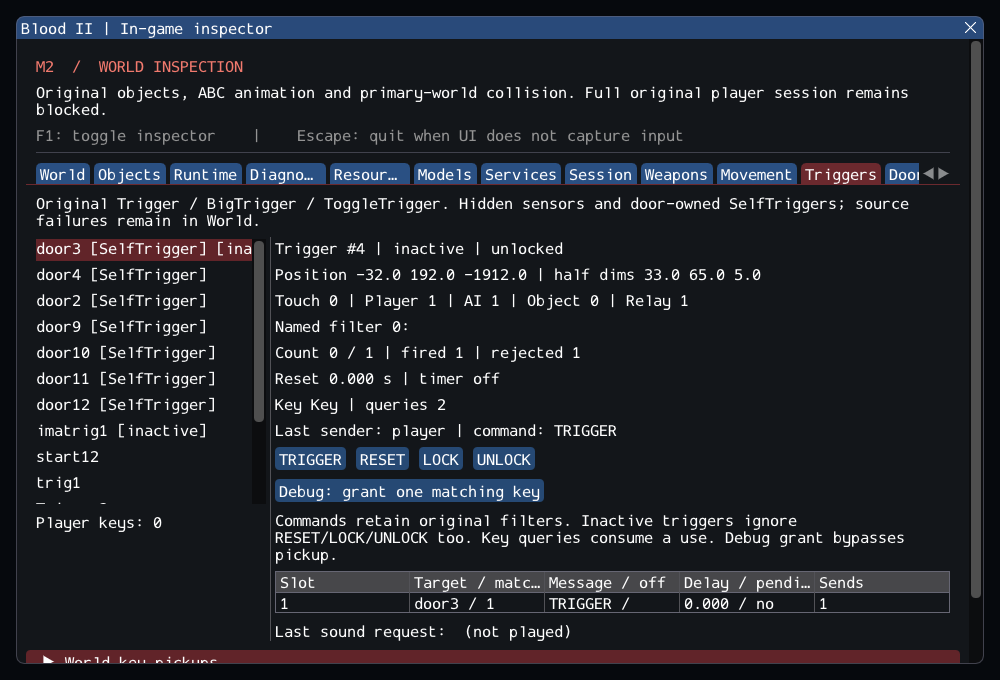

# M2 Continuation — Original Triggers and Keys

> Historical increment: [m2_interaction.md](m2_interaction.md) now connects
> player USE and RotatingDoor. The results below retain their original scope.

**15 October 2026. M2 is still in progress.** Original Trigger/BigTrigger/
ToggleTrigger, door-owned SelfTriggers, key inventory/query/consumption and
single-player KeyPickup now run in the new Blood2 project. They are inspected
in the Dear ImGui **Triggers** tab and through the **Doors** child link.
This is a source-based subset, not a complete playable session.

## Delivered behavior

- Ten target/message slots, delayed delivery, activation counters, reset timing,
  sender filters, named activation, LOCK/UNLOCK and ToggleTrigger on/off messages.
- SelfTrigger creation at the door's initial position, authored or default
  dimensions, original active-state transitions and lock relay. Explicit child
  ownership, checked links and deferred teardown prevent orphaned sensors.
- Original player key query and pickup branches, duplicate rejection, use counts
  and removal on the final use. Replies come from the actual player object,
  replacing the source's invalid inventory-aggregate cast.
- Selected KeyPickup/PickupObject contact, dimensions, ground placement, pickup
  trigger and single-player removal branches. Actual key model paths remain
  external resources. Missing models and untranslated ResourceNum names remain
  visible diagnostics.
- Contact dispatch when an accepted door translation pushes/carries a body
  through a nonsolid sensor. Blocked transactions cannot activate it. Nonsolid
  gravity objects now stop on the primary world, allowing keys to rest on floors.
- Inspection of live/inactive sensors, child ownership, positions/dimensions,
  filters, delays, target matches/missing targets, counters, locks, key queries,
  player keys and world pickup resources. Commands queue at a frame boundary.
  The explicit debug key grant is separate from original pickup rules.

[trigger_contracts.md](../../contracts/trigger_contracts.md) specifies the source
semantics and adaptations. [m2_trigger_sources.json](../sources/m2_trigger_sources.json)
records source selections and hashes. The previous
[door evidence](m2_doors.md) remains a historical snapshot.

## Preservation details

Locks are checked in the player's branch; allowed relays, AI and objects can
activate locked triggers. A key query consumes a use before the named filter
and activation counter. Inactive triggers ignore RESET/LOCK/UNLOCK as well as
TRIGGER. The original delayed ToggleTrigger path does not flip its on/off state.
Direct Door TRIGGER does not consult the child's lock. These source behaviors
were retained instead of imposing a different access-control design.

Retail data includes ResetTime=-1. The trigger adapter retains that value and
maps nonpositive reset delays to a disabled timer. Later LithTech explicitly
documents this timer convention; Blood II executable parity has not been tested.
Generic trigger target/messages support the original 200-character capacity,
including the long SteamTunnels AI command; that AI command is not executed by
an invented substitute AI implementation.

The stronger activation guard deliberately prevents recursive relay cycles
from repeatedly consuming keys or counters. Door-owned sensors become unusable
as soon as the parent is pending removal. Source B2BaseClass filtering gains an
inspection marker so initial-update removals are distinguishable from failures.
Key payloads are typed and owned, retain original message IDs and reject mixed,
malformed or stale-sender traffic. They are not a legacy network ABI.

## Installed content

The configured external patched Blood II installation was used read-only.
SubwayA now creates **38 source entries + 7 owned SelfTriggers**, with
**372 editor-only entries and 170 unported entries**, and no failed source
creation. Before player entry there are 45 runtime objects; entry adds the
player, its muzzle light and initial scent (48). Generated children are not
counted as source DAT entries.

The selected-class catalog covers **57 readable worlds**, with the previously
known unreadable `worlds/16_bridge.dat` retained as a failure:

| Original class | Authored entries | Created | Original filter | Schema rejection |
| --- | ---: | ---: | ---: | ---: |
| Trigger | 603 | 599 | 2 | 2 |
| BigTrigger | 89 | 84 | 1 | 4 |
| ToggleTrigger | 3 | 3 | 0 | 0 |
| KeyPickup | 13 | 13 | 0 | 0 |

Six multiplayer entries still use the older, unsupported `TypeAction` property;
no guessed property alias was added. The three filtered entries are original
game-mode exclusions. Creation counts do not claim complete gameplay or working
message targets in those worlds. The catalog instantiates selected classes in
isolation; complete-world startup remains blocked on other classes/services.

The installed game lacks the source default `models/powerups/key.abc`. Authored
pickups reference key_pu, keycard_pu, skullkey_pu and parachute_pu ABC files. The
GPU fixture reads LabKey's actual model/skin properties from CDM and gives it
the tested SubwayA door's key name. It does not silently substitute a model in
production. A separate private test loads CDM and picks up all **three authored
keys**, checking actual resources, inventory and teardown.

## Validation

| Configuration | Passed |
| --- | ---: |
| Linux GCC Debug / Dear ImGui | 119/119 |
| Linux GCC Release / inspector OFF | 119/119 |
| Clang ASan + UBSan + leak detection / headless | 110/110 |

An initial sanitizer run at `-j4` overlapped compilation and timed out in
`weapons.private` (30-second test limit), without a sanitizer diagnostic. The
full suite was rerun at `-j2` after compilation; both logs are retained.

The Debug/Release matrices contain 96 synthetic headless cases, 14 private
headless cases and nine serialized SDL_GPU/Vulkan scenarios. Eight new synthetic
cases cover timing/counts and malformed properties, toggle quirks, sender filters,
key pickup/consumption, SelfTrigger lifecycle, accepted/blocked sensor contacts,
recursive/removal behavior and typed-message validation. Existing original-object,
movement, weapon, container, door and player suites also run.

The new GPU scenario denies access without a key, picks up a key through real
contact, then consumes it/unlocks/opens the door while inspection is hidden.
It checks UI toggle, resize, capture, unload/reload and selection invalidation.
The same commands run in the inspector-free build. The capture was visually
checked; it shows the inactive, unlocked child, one activation, two queries and
zero remaining keys. It is a diagnostic UI, not rendered game graphics.

Commands run from Blood2:

```sh
cmake --preset local-debug
cmake --build --preset debug -j4
ctest --preset debug --output-on-failure -j4

cmake --preset local-release
cmake --build --preset release -j4
ctest --preset release --output-on-failure -j4

cmake -S . -B build/sanitize -G Ninja -DCMAKE_BUILD_TYPE=Debug \
  -DCMAKE_C_COMPILER=clang -DCMAKE_CXX_COMPILER=clang++ \
  -DBLOOD2_INSPECTOR=OFF -DBLOOD2_SANITIZERS=ON -DBLOOD2_GPU_TESTS=OFF \
  '-DBLOOD2_TEST_DATA_DIR=/home/yann/.steam/steam/steamapps/common/Blood II/'
cmake --build build/sanitize -j3
ASAN_OPTIONS=detect_leaks=1:halt_on_error=1 UBSAN_OPTIONS=halt_on_error=1 \
  ctest --test-dir build/sanitize -L headless --output-on-failure -j2
```

[Execution ledger](evidence/m2-triggers.json),
[source integrity](evidence/m2-triggers-source-integrity.json) and
[adaptation patch](evidence/m2-triggers-adaptations.patch) retain reproducible
evidence. Changed C++ follows clang-format 23.1.3; all 10,923 inventoried reference
files are unchanged and all six reference repositories are clean. SDL main,
Dear ImGui and spdlog pins are unchanged. Only Linux/Wayland/Vulkan was tested;
no retail executable comparison, performance claim, other platform or XR claim
is made.



## Remaining M2 gate

The inspector sends direct trigger messages; the original player's 82-unit USE
ray and ordinary interaction bindings remain to be connected. Rotating doors,
complete AI/other classes, general pickups, audio/localized feedback, portals,
FX and save/restore remain pending. KeyPickup covers the selected single-player
branch; it does not introduce the general item framework. Direct moving-world-
model sensor contacts and complete retail physics arbitration are not implemented.
The next continuation should connect original USE interaction and rotating doors.
`--start-game` still fails explicitly on incomplete gameplay services.
