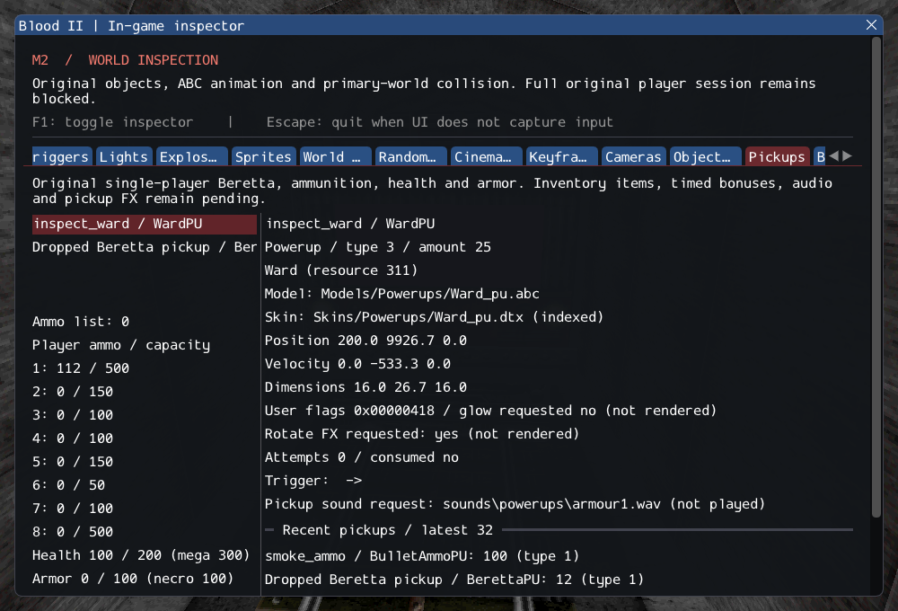

# M2 — Original NPC weapon drops and Beretta collection

The original Cabal lethal-damage branch now attempts an actual weapon drop.
The detached Beretta falls through the shared engine physics, becomes the original
BerettaPU on support, and can be collected through original player/inventory rules.
Its lifetime is independent of the NPC and of the deleted weapon. The Pickups
inspector exposes drops, failures, spawned pickups and collection state.

This completes a prerequisite for NPC death. **Corpses, gibs and the rest of death
handling remain unavailable**, so lethal NPC damage still suspends that actor with
an explicit diagnostic. M2 remains incomplete; required services are not bypassed.
See [contracts](../../contracts/weapon_drop_contracts.md) and the
[source ledger](../sources/m2_weapon_drop_sources.json).

The original left-hand-first rule, melee refusal, +150 forward/up launch,
one-second first support check, horizontal pickup facing, +10Y placement and
12-bullet NPC pickup are preserved. A nested Fire callback cannot destroy its
own weapon. The original rotation initialization defect is repaired explicitly.
Missing models or support services retain a stopped, inspectable dropped hand.
Player drop controls/view-state synchronization, pickup audio/voices and powerup
FX remain unavailable. Beretta collection itself is connected to player inventory.

## Verification

GCC Debug: **491/491**, 197.79s. Inspector-free GCC Release:
**491/491**, 104.14s. Each includes **395 synthetic headless,
69 private headless and 27 GPU** checks. Targeted Clang ASan/UBSan/leak checks:
**85/85**, 222.86s, including 12 private cases.
All ten new drop/collection cases pass. After the full suites, stronger pickup-settling
assertions were added; the ten cases were rebuilt and rerun in Debug, Release and
ASan/UBSan/leak modes, passing 10/10 in each. Production code was unchanged. Final builds are warning-free in the
changed code; no sanitizer finding is reported. The initial full Debug run's
sole failure was the documented old pickup-corpus count; the corrected exact
expectation and added Beretta assertion pass the final full suites.

Commands from Blood2:

```sh
cmake --build build/debug -j4
ctest --test-dir build/debug --output-on-failure -j4
cmake --preset local-release
cmake --build build/release -j2
ctest --test-dir build/release --output-on-failure -j4
cmake -S . -B build/sanitize
cmake --build build/sanitize -j2 --target weapon_drop_tests pickup_tests attachment_tests ai_hit_tests ai_runtime_tests object_contract_tests services_tests player_tests weapon_tests
ASAN_OPTIONS=detect_leaks=1:halt_on_error=1 UBSAN_OPTIONS=halt_on_error=1 \
  ctest --test-dir build/sanitize -R '^(objects|services|player|weapons|pickups|attachments|ai_runtime|ai_hit|weapon_drops)\.' --output-on-failure -j1
./build/debug/blood2 --inspect-player
./build/debug/blood2 --start-game
```

Inspection exits 0; full startup still exits 6. Changed/new C++ passes
clang-format 23.1.3 and local Markdown links resolve. All 10,923 inventoried
reference files and six reference repositories remain unchanged. Dependency
pins and the external commercial installation are preserved. GPU checks run
sequentially across configurations; Linux/Wayland/Vulkan is the only verified
platform here. Retail physics/RNG parity and other platforms/XR remain unverified.

The [execution ledger](evidence/m2-weapon-drops.json) retains commands, outcomes,
focused logs, integrity hashes and the exact committed project patch.



The focused cases cover original pickup values/ancestry, dual acquisition,
already-owned ammunition acceptance, full/zero-ammo refusal, dead-player and
forged-message guards, left-before-right drops, original impulse/dimensions,
attachment release, NPC removal/unload ownership, timed real falling and landing,
no-sliding contact placement, missing model/support failure, and actual nested
Fire -> damage -> attempted-drop/owner-removal callbacks.

The existing full pickup corpus now creates 1,259 pickups across 57 parsed worlds,
including one authored BerettaPU in `worlds/05_cdm.dat`. Its previous 1,258 expectation was updated
with a separate assertion for that exact new class; all 176 legacy TypeAction
rejections and 60 supported destruction spawns remain checked.

The private case uses a synthetic flat floor and instantiates a real CultistAI
with the external original ABC,
initializes its inventory/held model and sends typed lethal damage. It asserts
that the original drop runs while the missing death services remain a failure,
then removes the NPC and advances the independent hand until the real Beretta
pickup is created. This repeats with fresh checked identities. GPU pickup smoke
also includes a real Beretta pickup in the model scene and collects another while inspection is
hidden, then repeats after reload; the same path runs without ImGui.

SubwayA remains **202 created + 4 transferred sounds + 372 editor-only +
2 unsupported + 0 failed = 580 source entries**. Gideon, ExitTrigger, remaining
NPC actions/death and required FX keep the original M2 gate open. The user's
pink-glass and direct-input observations remain tracked in
[m2_ai_runtime.md](m2_ai_runtime.md); they were not used to redirect this increment.
