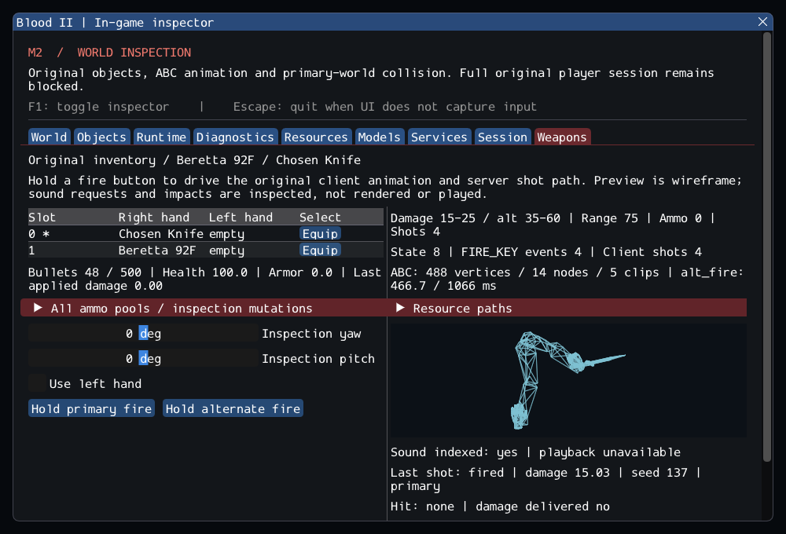

# M2 Continuation — Original Inventory, Beretta and Melee

> Current continuation: [m2_locomotion.md](m2_locomotion.md) adds stairs, crouch
> clearance and original player body animations. The results and omissions below
> describe their earlier implementation snapshot.

Historical snapshot: the later [MoveMgr continuation](m2_movement.md) supersedes statements below that player movement is absent. Its own documented limits still leave M2 open.

Date: 15 October 2026. **M2 remains in progress.** The new Blood2 project now owns
original inventory weapons and executes selected original client animation,
server vector-fire and damage-aggregate paths. The Beretta and Chosen Knife work
in the inspection harness; this is not yet playable Blood II.

## Delivered behavior

- Original initialization obtains the knife in slot 0 and Beretta in slot 1.
  Inventory owns weapon lifetimes, ammo/capacity tables and second-Beretta left
  slots. Unsupported weapons are rejected. Entry/model failures roll back;
  selection, removal and world reload preserve ownership contracts.
- Source weapon definitions, primary/alternate damage, spread, range, ammo use
  and client cadence are connected. Original draw/fire/end transitions and
  `FIRE_KEY` events drive typed messages to the shell and CPlayerObj. Melee's
  `fire`/`fire2` choice is retained.
- Segment queries hit the nearest primary-world triangle or live solid object
  box, excluding the shooter. Object hits reach original aggregate dispatch with
  typed damage. Resistance, armor absorption, health and dead-state calculations
  execute; pending destruction cannot free an active weapon call.
- The **Weapons** inspector shows slots/hands, every ammo pool, live models and
  animation keys, primary/alternate controls, aim, shot counts, hit references,
  damage and indexed sound requests. Model wireframes use the actual animated
  weapon vertices. Mutations are queued at frame boundaries. The Session panel
  remains the entry/exit view.

No dependency or ECS was added; the three runtime targets remain unchanged.
Original reference repositories and commercial archives are preserved. Details
and intentional adaptations are in the [weapon contracts](../../contracts/weapon_contracts.md),
[source ledger](../sources/m2_weapon_sources.json) and
[selected-source adaptation patch](evidence/m2-weapons-original-adaptations.patch).
The earlier [player evidence](m2_player.md) is a historical snapshot of entry
before this continuation, not a current assertion that weapons are absent.

## Retail observations

The configured external installation is `/home/yann/.steam/steam/steamapps/common/Blood II/`.
The patched SubwayA still accounts for 580 source entries: 18 instantiated,
372 editor-only and 190 missing required runtime entries. Entry adds the player,
muzzle-light object and scent, for 21 objects. Client view weapons are owned
resources and do not inflate that server object count.

| Resource | Decoded vertices | Clips | Verified fire markers |
| --- | --- | --- | --- |
| `Models/Weapons/Beretta_pv.abc` | 463 | 6 | Primary and alternate at 0 ms |
| `Models/Weapons/c_knife_pv.abc` | 488 | 5 | `fire`: 133/366 ms; `fire2`: 233/566 ms; alternate: 613 ms |

Beretta draw lasts 333 ms, primary 150 ms, alternate 200 ms with start/end clips.
Knife draw lasts 333 ms, its primary clips 566/966 ms, and alternate 1066 ms.
Each primary knife animation contains **two** fire markers: both execute, rather
than reducing an animation to one invented hit. All selected models and fire
sound references resolve from REZ. Skin/sound indexing does not imply decoding
or playback. [The private trace](evidence/m2-weapons-retail-details.log) records
the decoded clips/keys over three entry/fire/unload cycles.

These observations come from source and resource execution. The retail executable
was not launched; random sequences, visual/audio fidelity and full combat parity
have not been compared against it.

## Verification

Verified on Fedora Linux x64 with GCC 16.2.1, Clang 22.1.8, Wayland and SDL_GPU
Vulkan on the NVIDIA RTX 3060 Laptop GPU. No other-platform claim is made.

| Configuration | Synthetic headless | Private headless | GPU | Result |
| --- | --- | --- | --- | --- |
| GCC Debug / inspector | 52 | 6 | 4 | **62/62 pass** |
| GCC Release / no inspector | 52 | 6 | 4 | **62/62 pass** |
| Clang Debug / ASan + UBSan + leaks | 52 | 6 | — | **58/58 pass** |

Full run logs: [Debug](evidence/m2-weapons-ctest-debug.log),
[Release](evidence/m2-weapons-ctest-release.log),
[sanitizers](evidence/m2-weapons-ctest-sanitize.log).
Later checks added actual left-Beretta firing and failed-selection rollback,
then verified the compact Weapons panel: [Debug weapon suite](evidence/m2-weapons-followup-debug.log),
[Release weapon suite](evidence/m2-weapons-followup-release.log),
[sanitizer weapon suite](evidence/m2-weapons-followup-sanitize.log),
[final GPU panel](evidence/m2-weapons-gpu-ui.log).
Builds produced no warnings; the sanitizer runs reported no memory, undefined
behavior or leak error in these paths. GPU/driver code is not sanitizer coverage.

The [snapshot](evidence/m2-weapons.json) records source/project hashes, dependency
pins, compiler versions and test counts. All **10,923** inventoried reference
files retain their hashes, and all six reference repositories remain clean;
see [integrity evidence](evidence/m2-weapons-source-integrity.json).

```sh
cd Blood2
cmake --preset local-debug
cmake --build --preset debug -j8
ctest --preset debug --output-on-failure
cmake --preset local-release
cmake --build --preset release -j4
ctest --preset release --output-on-failure
```

The eight new synthetic cases cover inventory/dual ownership and capacities,
nearest segment/world hits, ammo/seed/invalid requests, melee range and no-ammo
behavior, resistance/armor/death guards, animation-driven client messages, removal
of shooter/target inside a hit callback, and repeated missing-view-model rollback.
Private tests fire both modes of both retail weapons, the actual left Beretta,
and sample their animated vertices across three clean load/unload cycles. The GPU test drives both weapons,
checks firing with the inspector hidden, then unloads/re-enters with the same
object/string counts. Sanitizers include these headless lifetime paths.

```sh
cmake -S . -B build/sanitize -G Ninja -DCMAKE_BUILD_TYPE=Debug \
  -DCMAKE_C_COMPILER=clang -DCMAKE_CXX_COMPILER=clang++ \
  -DBLOOD2_INSPECTOR=OFF -DBLOOD2_SANITIZERS=ON -DBLOOD2_GPU_TESTS=OFF \
  -DBLOOD2_TEST_DATA_DIR="/path/to/Blood II"
cmake --build build/sanitize -j4
ASAN_OPTIONS=detect_leaks=1:halt_on_error=1 UBSAN_OPTIONS=halt_on_error=1 \
  ctest --test-dir build/sanitize -L headless --output-on-failure
```

## Inspect it

```sh
./build/debug/blood2
# Weapons tab -> Enter player inspection -> Equip -> hold primary/alternate.
./build/debug/blood2 --weapons-smoke --capture build/weapons.png
ctest --preset debug -L weapons --output-on-failure
```

The hand checkbox selects an existing left weapon; the expandable ammo section
can obtain a second Beretta or add bullets through original inventory routines.
These actions are explicitly inspection mutations, not world pickups. F1 hides
inspection; simulation does not depend on the UI. The GPU smoke's capture is at
frame 181 after weapon use, rather than the normal third-frame capture.



## Remaining gate

M2 still needs required world/AI/pickup classes, movement and transformed world
collision. The selected vector weapon path does not implement surface-specific
penetration, liquid effects, damage impulses, AI limb/death/gib reactions, other
weapons/projectiles, attachments or a full HUD. Muzzle/view placement is the
inspection camera; original muzzle offsets and automatic dual-hand input remain
pending. Audio and impact effects are inspectable requests/results, not playback
or rendered effects. Portable local random generators deliberately replace the
original process-global CRT random stream. Windows, macOS, mobile and XR are
untested. `--start-game` still returns 6 for incomplete gameplay; M3 has not begun.
