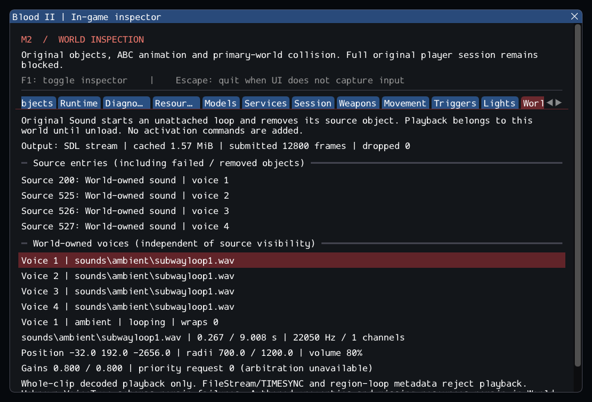

# M2 continuation — original world-owned Sound loops

M2 remains incomplete. This increment ports the built-in Sound from original
AppHeaders/engineobjects.c into the independent Blood2 project. It adds bounded
whole-clip playback with the original lifetime: start a fixed loop, then remove
the source object. See [contracts](../../contracts/world_sound_contracts.md) and
[source ledger](../sources/m2_world_sound_sources.json).

## Implemented and observed

The typed PlayWorldSound service validates a live source, resources, mode and
parameters, then transfers successful unattached playback to world lifetime.
Source removal, pending callbacks and handle generation remain checked; voices
and cache release on unload. The source's BaseClass ancestry, defaults, byte casts,
ambient/spatial selection, no-reverb intent and unconditional removal are retained.
C callbacks become normal C++ callbacks; runtime filenames initialize safely empty.

The mixer wraps actual sample frames with final-to-first linear interpolation,
including stereo and one-frame clips. Offline clocks and bounded SDL PCM output
share the same phase; stalls retain elapsed time and dropped-frame accounting.
Loop metadata is detected and explicitly refused for looping until region support
exists. FileStream/TIMESYNC is also rejected, never represented as a successful
streaming request. Priority intent is visible without claiming arbitration.

World entries distinguish transferred Sound sources from live original instances.
The new World sounds tab shows authored entries (including failures), actual voices,
source-independent positions, format, cursor, wraps, attenuation and output state.
Source properties and resource presence remain inspectable in World. Successful
source removal does not inflate the runtime-object count.

SubwayA has **166 live-created source entries, 4 transferred world sounds,
372 editor-only and 38 unported**, with no failures. Seven owned SelfTriggers give
173 initial runtime objects, or 176 after player entry; nine consumed Keys leave
164/167 respectively. The four loops share `sounds/ambient/subwayloop1.wav`:
198,623 mono frames at 22,050 Hz, approximately 9.008 seconds. Their volume is 80%,
inner/outer radii 700/1200, Ambient=true and FileStream=false. All four voices keep
separate fixed positions while sharing one decoded clip.

The catalog covers **57 readable worlds and 792 Sound entries**. All 777 present
references decode; 15 references are missing/empty, with no invalid present WAV
or loop-region metadata. Only fmt/data chunks occur. 302 entries request streaming.
Strict original-schema creation starts 7 loops, rejects 781 entries carrying the
unrecognized historical VoiceType property, and records 4 playback failures.
These counts overlap resource/streaming observations; they are not additive classes.
No VoiceType alias, guessed radius correction or missing-file substitution is added.
`16_bridge.dat` retains its existing strict DAT-reader failure.

## Validation

Commands run from Blood2:

```sh
cmake --preset local-debug
cmake --build --preset debug -j4
ctest --preset debug --output-on-failure -j4
cmake --preset local-release
cmake --build --preset release -j3
ctest --preset release --output-on-failure -j4
cmake -S . -B build/sanitize -G Ninja -DCMAKE_BUILD_TYPE=Debug \
  -DCMAKE_C_COMPILER=clang -DCMAKE_CXX_COMPILER=clang++ \
  -DBLOOD2_INSPECTOR=OFF -DBLOOD2_SANITIZERS=ON -DBLOOD2_GPU_TESTS=OFF \
  -DBLOOD2_TEST_DATA_DIR="<external Blood II installation>"
cmake --build build/sanitize -j2
ASAN_OPTIONS=detect_leaks=1:halt_on_error=1 UBSAN_OPTIONS=halt_on_error=1 \
  ctest --test-dir build/sanitize -L headless --output-on-failure -j1
```

GCC Debug passed **245/245** in **133.25s**; GCC Release without ImGui passed **245/245** in **66.57s**. Clang ASan/UBSan/leak checks passed **225/225 headless sequentially** in **477.90s**, without findings.
The suite contains 197 synthetic headless, 28 private headless and 20 serial GPU cases.
All 25 changed/new C++ files pass clang-format 23.1.3; final builds are warning-free.
All 10,923 inventoried reference files are unchanged and the six reference repos
remain clean. The final capture was reviewed. Commands, logs, integrity checks,
patch and file hashes are in the [evidence ledger](evidence/m2-world-sounds.json).
Blood2 commit: `452676e1eba9e19ba37e757cf471090949e68070`.
Synthetic coverage adds original defaults, wrapping/resampling, long stalls,
world versus object ownership, stale IDs, bounded failures and durable loader
accounting. The actual four SubwayA clips survive source removal, cross two loop
boundaries, produce nonzero PCM and unload over two full shell/player cycles.
The GPU scenario checks actual SDL submission while inspection is hidden and after
reload, including the inspector-free build. SDL uses its dummy audio driver;
this is not an audible hardware listening test.



## Remaining M2 gate

The original session still rejects gameplay startup: 38 SubwayA entries remain
unported (9 CClientExplosionSFX, 5 CivilianAI, 10 CultistAI, 12 DetailSprite,
1 ExitTrigger and 1 Gideon). Required engine/game services and complete gameplay
are still missing. Whole-clip Sound support does not close that gate. Streaming,
region loops, VoiceType schemas, priority arbitration, other audio callers/music,
reverb/Doppler/occlusion and save/restore remain open. No retail executable, other
platform, XR or world-rendering fidelity is claimed.
