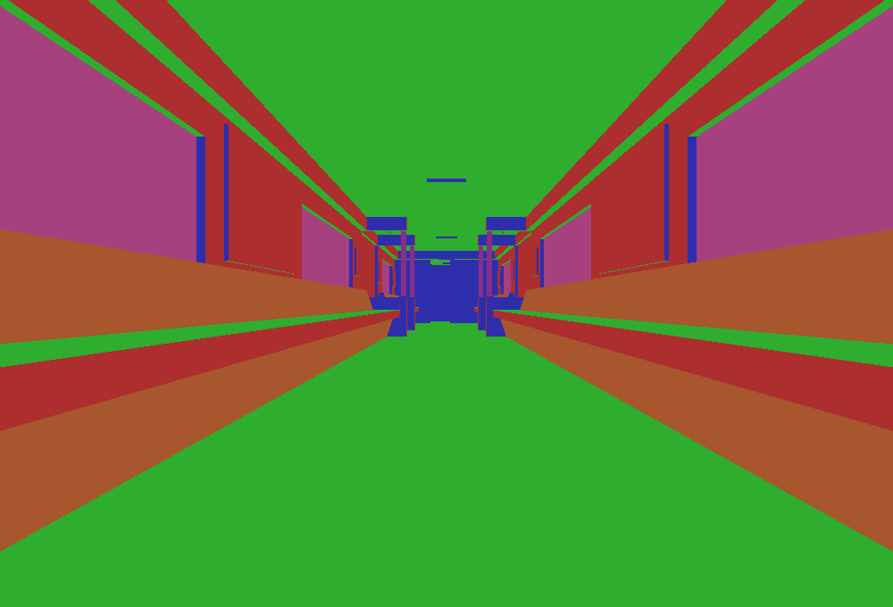

# M2 — Navigable diagnostic 3D world

**M2 remains incomplete.** The new project now draws the real selected level through
SDL_GPU, driven by the existing original player and scripted cameras. This closes
the former blank-background gap; it does not close the missing NPC, ExitTrigger,
client-FX or first-playable-slice gates.

From the Blood2 directory, with the existing ignored local content configuration:

```sh
./build/debug/blood2 --view-world
```

The original SubwayA intro runs first. After it releases control, use physical
WASD/ZQSD, arrows to look, Shift to run, Space to jump, Ctrl to crouch and E to USE.
F1 opens inspection; F2 toggles movement. The inspector-free Release executable
supports the same view and controls. This is a navigable diagnostic level, without
textures, visible characters/weapons or complete combat.

## Implementation

[World-view contracts](../../contracts/world_view_contracts.md) describe the bounded
base-ring mesh, authored/current transforms, checked visibility/lifetime and GPU
ownership. The primary model and 110 live visible world-model instances draw
**7,441 triangles in 111 draws** in the tested SubwayA state. The CPU cache contains
**25,287 vertices** across 116 model ranges; **442 invisible faces** are omitted.
Five model ranges remain unbound to rendered world objects, including excluded
containers. Those counts do not register or replace missing game objects.

The viewport reuses CBloodClientShell's actual camera selection, movement and eye
height, including the original intro and letterbox request. Original MoveMgr remains
the sole player integrator. Flat colors encode face orientation; transparent and
sky surfaces have explicit diagnostic colors. No main directional light is inferred.
The depth pass uses current swapchain dimensions and is independent of Dear ImGui.

The new CPU/GPU engine code and GLSL shaders are authored here. No prototype renderer
or dependency was imported. The current offline shader artifact is SPIR-V/Vulkan;
other backends explicitly reject world rendering pending their shader artifacts and
validation. SDL, ImGui and spdlog pins are unchanged. Geometry uploads happen once
per world revision; removal/hidden state and transforms are resolved each frame.

## Verification

GCC Debug passed **339/339** in **106.33s**;
inspector-free GCC Release passed **339/339** in
**37.35s**. Clang ASan/UBSan/leak checks passed
**314/314 headless cases sequentially** in
**640.52s**, without findings. Each complete non-sanitized suite
contains 267 synthetic headless, 47 private headless and 25 serial GPU cases.
A final Debug UI-only label/default-tab adjustment was rebuilt and its viewport,
depth and lifecycle cases rerun; Release includes that adjustment in its full suite.
All changed/new authored C++ files pass clang-format 23.1.3; generated SPIR-V headers
reproduce byte-for-byte. The final build logs contain no compiler warnings.
All 10,923 inventoried reference files and six reference repositories are unchanged.
--inspect-player exits 0; --start-game still exits 6; incompatible view/headless
options exit 2. Interactive startup and the new inspector panel were captured.

On Linux/Wayland/Vulkan (NVIDIA RTX 3060 Laptop), the real-world GPU smoke draws
230 world frames, uploads geometry twice across reload, recreates depth at 1000×680,
and reports hidden/unloaded/reloaded success. Its 680,000-pixel capture contains
680,000 non-background pixels with ImGui excluded. These are correctness checks,
not a frame-time benchmark.

Commands, from Blood2:

```sh
cmake --preset local-debug
cmake --build --preset debug -j4
ctest --test-dir build/debug --output-on-failure -j4
cmake --preset local-release
cmake --build --preset release -j4
ctest --test-dir build/release --output-on-failure -j4
cmake -S . -B build/sanitize
cmake --build build/sanitize -j4
ASAN_OPTIONS=detect_leaks=1:halt_on_error=1 UBSAN_OPTIONS=halt_on_error=1 \
  ctest --test-dir build/sanitize -L headless --output-on-failure -j1
```

The focused GPU test initially exposed disabled depth clipping in SDL's zeroed
rasterizer settings. Enabling depth clipping corrected the near-plane failure;
the assertion was retained. The first full Debug run also found two smoke harnesses
that append diagnostic world geometry after reload. They now increment the same
geometry revision used by teardown; the existing gameplay assertions are unchanged.
Synthetic pixel checks also verify occlusion despite
submission order, opposite winding, +X/+Y orientation, camera/object transform
composition, resize, letterbox bars and resource reupload. The real-world smoke
requires rendered pixels with ImGui excluded and retains the existing actual
movement/crouch/jump, hidden simulation and reload assertions.

The private headless case compares 110 rendered world-model placements against
actual posed collision vertices and repeats original player entry and teardown.
The 3D view inspector reports upload/draw/omission counts and camera state. The
[ledger](evidence/m2-world-view.json) records commands, logs and hashes.
Blood2 commit: `f01e17ba72d343c93f32c1811f102484762b720f`.



## Remaining gate and next work

SubwayA accounting stays **187 live-created source entries, four transferred world
sounds, 372 editor-only and 17 unsupported** (five CivilianAI, ten CultistAI, Gideon
and ExitTrigger), with no source creation failures. Required unsupported services
still block `--start-game`. Rendered geometry is not evidence that missing AI or FX
works. M3–M8 remain later milestones.

Next presentation work can decode DTX textures and draw the existing sampled ABC
models/view weapons, while original NPC behavior, required FX and transition
services continue toward the unchanged M2 exit gate. The reviewed NoMadEngine
DTX reader uses basename and payload-size format guesses; validate the selected
retail variants before selectively reusing it. Full retail lighting/material
parity and other GPU backends remain explicit later rendering work.
