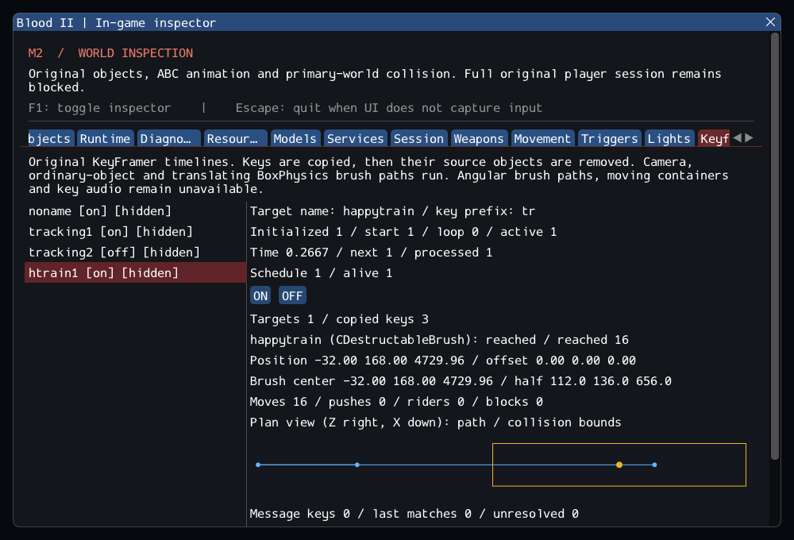

# M2 — Keyframed train translation (in progress)

16 October 2026. **M2 remains incomplete.** The original KeyFramer can now move
SubwayA's happytrain brush through the typed world-model service. Source sequencing
is unchanged; this increment supplies bounded replacement physics and inspection.
Read the [contracts](../../contracts/worldpath_contracts.md) and
[source/engine ledger](../sources/m2_worldpath_sources.json).

## Delivered behavior

Static world-model paths with unchanged orientation use the existing atomic
pusher/rider transaction. BoxPhysics movers without GOTHRUWORLD now sweep their
actual bounds against primary-world geometry. Doors keep their original bypass.
Blocked moves leave the mover and every passenger unchanged. Successful moves
commit positions before contact/sensor callbacks; removal stays deferred and
reentrant motion rejects. Standing riders, jumping/DONTFOLLOWSTANDING and the
single shared player integration are covered. The authored shell is not rebuilt
or mutated for translations.

The original controller continues time through blocked moves and preserves its
missing final endpoint snap. Rotation-changing paths, dynamic/gravity bodies,
containers and polygon-vs-world translation remain explicit Unavailable cases.
No successful stub, source flag workaround or generic transform bypass was added.

The Keyframes panel now offers queued ON/OFF, actual brush bounds, pusher/rider
and blocker diagnostics, and a plan view of copied keys/current collision bounds.
`--worldpaths-smoke` checks the real train with UI hidden and after reload; the same
scenario runs without ImGui. Diagnostic drawings are not a world renderer.

## Actual content

Two full SubwayA load/enter/activate/run/unload cycles each yielded **297 accepted
moves and two blocked attempts**. The three source keys use times 0/3/5 seconds
and Z positions 4912/2864/3376, with X=-32, Y=168 and identity rotations. The two
blocks near the turnaround hit primary polygon **1209** at roughly 3.0 and 3.01666
seconds. Independent swept-box queries confirm the obstruction and the train stays
at its previous pose; the return leg resumes. Final Z is approximately **3371.74**,
retaining the source's lack of final snap. Retail motion/blocking equivalence is
unverified. This all-or-nothing solver does not reconstruct retail clipping/crushing.

The first new private test assumed uninterrupted motion and failed at that authored
obstruction. Its corrected assertions check the observed collision, rollback,
exact current move/block counts, resumed motion and source completion. The initial
failure and investigation are retained. Existing tests, timeout limits and malformed
resource checks were not weakened; the earlier keyframe catalog now requires a
real successful first train movement instead of an Unavailable result.

No additional classes are registered: **160 created source entries + seven
SelfTriggers**, **372 editor-only**, **48 unported**, zero failed. Runtime before/after
player entry is **167/170**, then **158/161** after consuming nine Keys.
Activation here is a direct original ON message after key collection, not evidence
that the full level script or remaining AI works. References and external assets
are unchanged; no new dependency or SDL revision is introduced.

## Verification

GCC Debug passed **215/215** in **98.87s**; GCC Release without ImGui passed **215/215** in **52.69s**. Clang ASan/UBSan/leak checks passed **198/198 headless sequentially** in **438.73s**, without findings.
The suite contains 176 synthetic headless, 22 private headless and 17 serial GPU
cases. All 12 changed/new C++ files pass clang-format 23.1.3; final builds are warning-free.
All 10,923 inventoried reference files are unchanged and the six reference repos
are clean. All 1,297 local Markdown targets resolve. After full Debug validation, the GPU helper was hardened to revalidate
its selected handle after key consumption; both affected GPU cases passed again.
Simulation did not change. The final capture was reviewed. Raw logs, source integrity,
patch and hashes are in the [evidence ledger](evidence/m2-worldpaths.json).
Blood2 commit: `193862806f45efa1aef996a1328aee7718148e8d`.

Eight new synthetic scenarios exercise translation/rays, collision/atomic rollback,
riders/detachment, pushing, callback removal/reentrancy, unsupported transforms,
local player transport and source timeline/lifetime. The private scenario evaluates
every attempted pose over two full train paths. The GPU scenario checks real
collision and authored path interpolation while hidden and after reload.

Commands from `Blood2/`:

```sh
cmake --preset local-debug
cmake --build --preset debug -j4
ctest --preset debug --output-on-failure -j4
cmake --preset local-release
cmake --build --preset release -j3
ctest --preset release --output-on-failure -j4
cmake -S . -B build/sanitize -G Ninja -DCMAKE_BUILD_TYPE=Debug \
  -DCMAKE_C_COMPILER=clang -DCMAKE_CXX_COMPILER=clang++ \
  -DBLOOD2_INSPECTOR=OFF -DBLOOD2_SANITIZERS=ON -DBLOOD2_GPU_TESTS=OFF \
  -DBLOOD2_TEST_DATA_DIR="/path/to/Blood II"
cmake --build build/sanitize -j2
ASAN_OPTIONS=detect_leaks=1:halt_on_error=1 UBSAN_OPTIONS=halt_on_error=1 \
  ctest --test-dir build/sanitize -L headless --output-on-failure -j1
./build/debug/blood2 --inspect-player
./build/debug/blood2 --start-game  # Still exits 6.
./build/debug/blood2 --worldpaths-smoke
```



## Remaining M2 gate

48 required SubwayA objects remain unported. CinematicTrigger, Gideon/AI,
client FX/audio, transitions, attachments, angular keyframe paths and moving
containers remain incomplete. Static light state/inspection does not supply world
illumination. Original rules run on replacement engine services whose numerical
and physics parity remain unverified. Linux/Wayland/Vulkan is the tested platform;
other platforms and XR are not claimed. The heartbeat remains active.
